# Ashen Wilds

**A grounded, isometric dark-survival action game built in Godot 4.7.**
Thirty years into the Smothering, you are a broken survivor scavenging the Blackfen Outskirts — every swing costs stamina, every gram in your pack is noise, and the dark belongs to things that don't need torches.

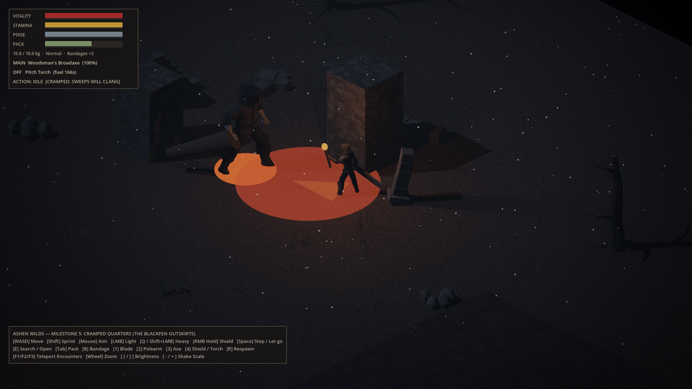

> **Status:** single-player prototype, Milestones 1–5 complete · verified on Godot 4.7.2-stable (Forward+) · **434/434** headless regression checks passing
> Art is still mostly placeholder (primitive meshes, procedural audio) — systems first. The survivor is now a rigged, animated character: the Ranger from [Quaternius](https://quaternius.com)'s Modular Character Outfits with his Universal Animation Libraries (CC0), recoloured dark and dirty for the Blackfen and replaceable later. Walls, ground, roof and crates wear photo-scanned textures from [ambientCG](https://ambientcg.com) (CC0), and the yard is dressed with the project's own environment kit: crates and barrels, dead trees, rocks, ruins, fences and ground cover. Nights are cold moonlight and low mist, with falling ash and warm, flickering firelight. The enemies are the Ashbound: hooded, ragged, grey-skinned figures (a hunched goblin, a shielded ork, a hulking ogre) on the same animation library.
>
> **Play it:** [in the browser](https://dribblejerp-klunkdunker.github.io/Ashen-Wilds/) (the single-player prototype; click the game once so it gets the keyboard) · [downloads for Linux, Chromebook, Windows and the dedicated server](https://github.com/dribblejerp-KlunkDunker/Ashen-Wilds/releases/tag/playtest). Both are rebuilt from `main` on every merge. The two-player courtyard needs a download: browsers cannot use its network transport yet.
>
> **New direction (2026-11-03):** the project is becoming a two-developer, two-player-first 3D survival game with server-owned shared state and an independently rotatable camera. The networked courtyard runs from `net_main.tscn`: per-client quarter-turn cameras, server-validated movement, a protocol handshake, disconnect and rejoin, and a shared supply crate whose contents only the server changes (weight-only packs, request ids, one flask that two players cannot both take). Items can be taken and stored back; a breach in the yard wall can be repaired with timber and a hearth lit, and both players see it. The server saves the world (crate, fixtures, every player's position and pack) and restores it after a restart; a corrupt save falls back to its backup, a newer save is never overwritten. `tools/net_spike.py` runs 65 checks: five processes on loopback, a restart, broken saves and a hard server kill, and `tools/export_builds.sh` produces Linux server, Linux client (x86_64 and ARM64), Windows client and browser test builds (with `builds/BUILD_INFO.txt` giving the connection steps) that the same test can run. The single-player prototype below is preserved unchanged. The working record is [docs/PRODUCTION.md](docs/PRODUCTION.md).

---

## Screenshots

| | |
|---|---|
| 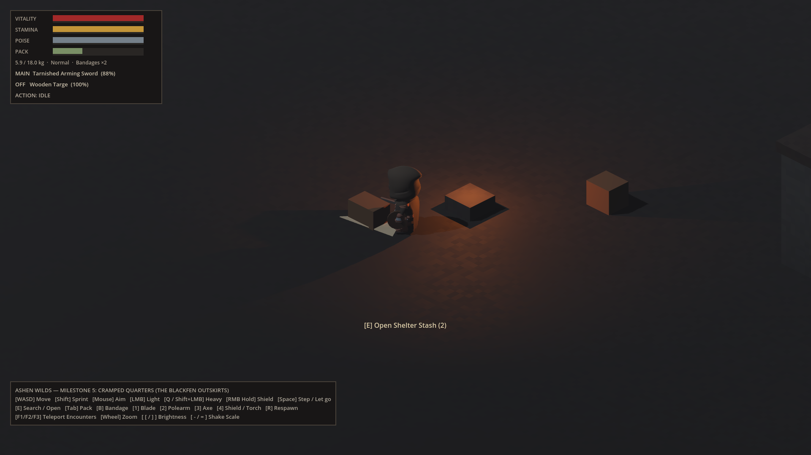 | 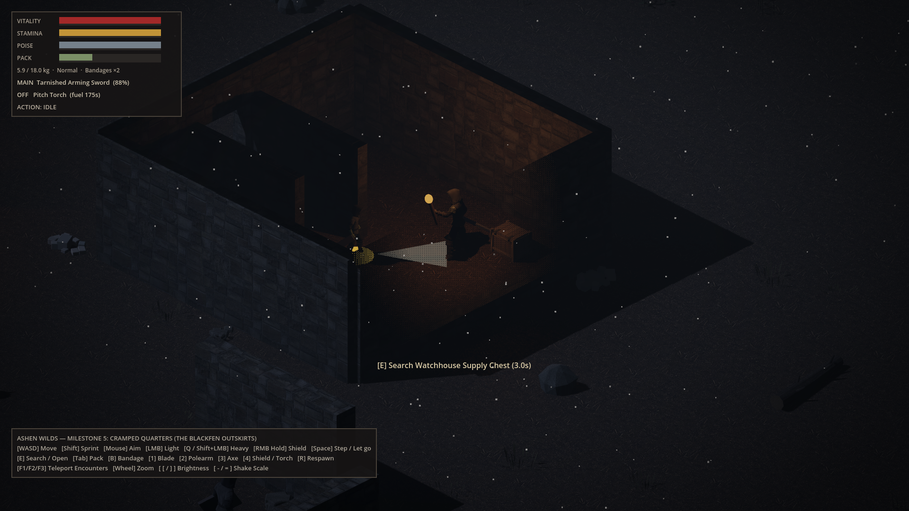 |
| **Shelter fire.** You start with a tarnished sword, a wooden targe and a stash you already know. | **Watchhouse by torchlight.** The roof hides when you step inside and foreground walls dither away around you. A goblin waits at the end of the entry hall. |
| 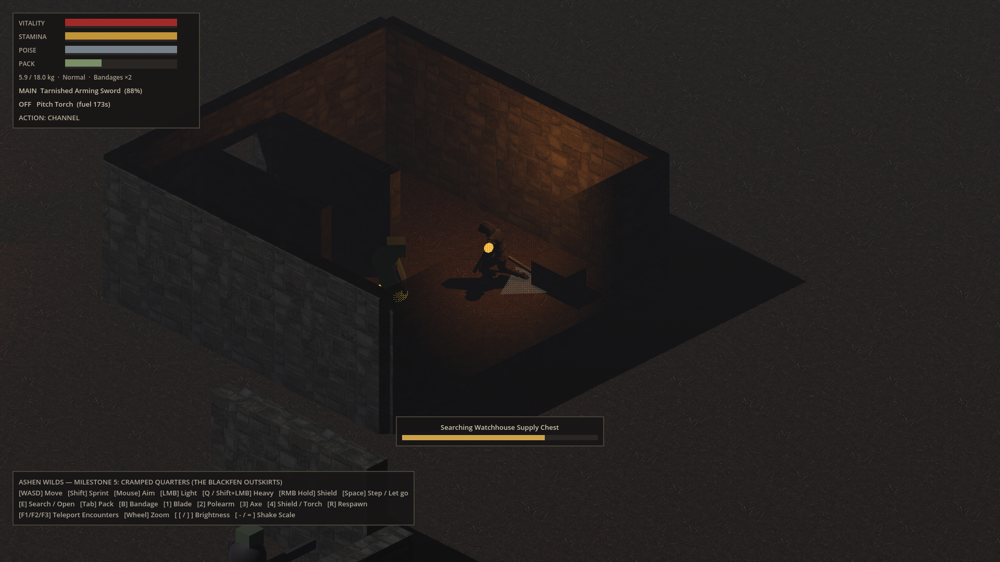 | 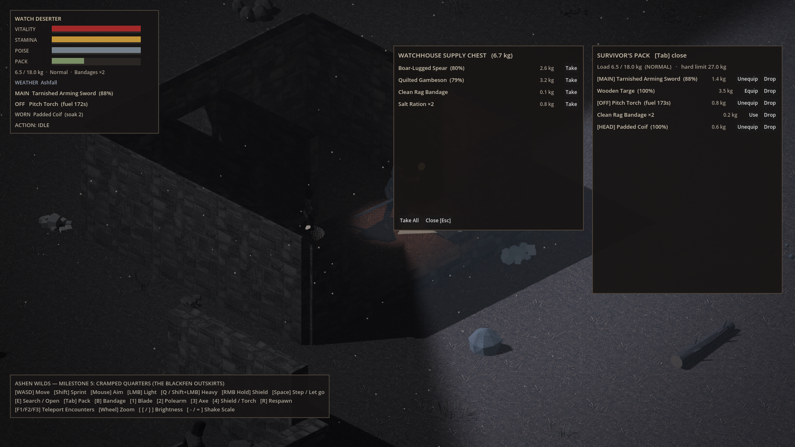 |
| **Scavenging is timed and interruptible.** Move, attack, dodge or get hit and the search is lost — and goblins hear you rummaging. | **Pack & loot windows.** Every item has weight and condition; the world keeps moving while you decide. |
| 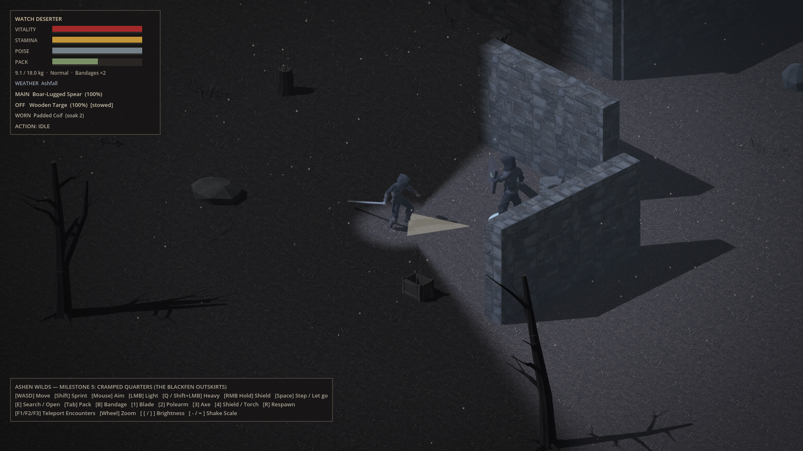 |  |
| **Ork choke point with a spear.** Two-handed grip stows your shield; narrow thrusts outreach the Ork's shield wall. | **The Blackfen Ogre.** Slow, enormous, and too wide for doorways. The red ring is its slam zone. |
| 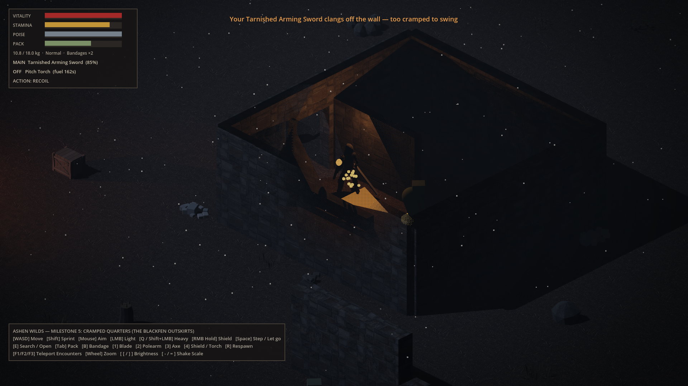 | 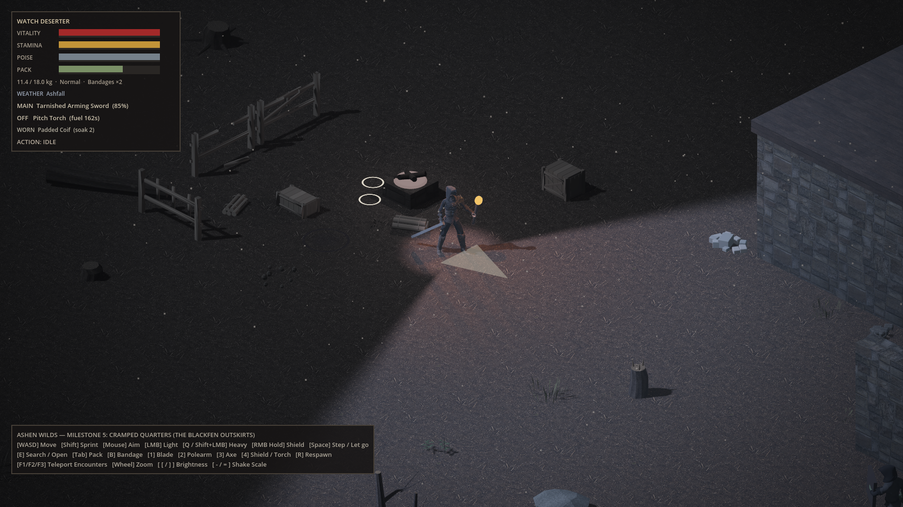 |
| 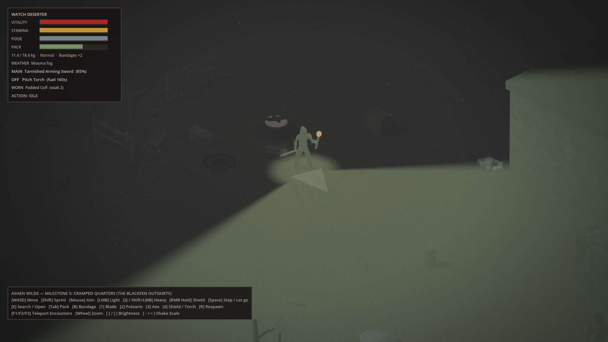 | 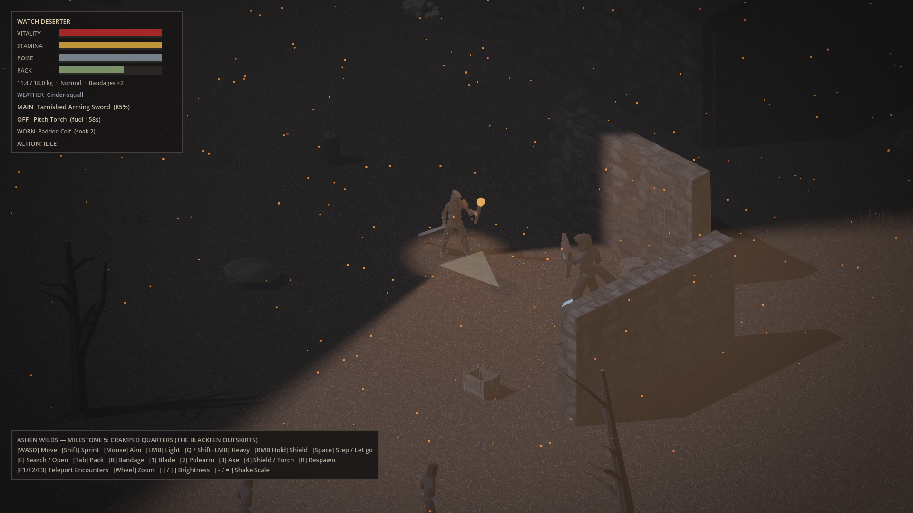 |
| 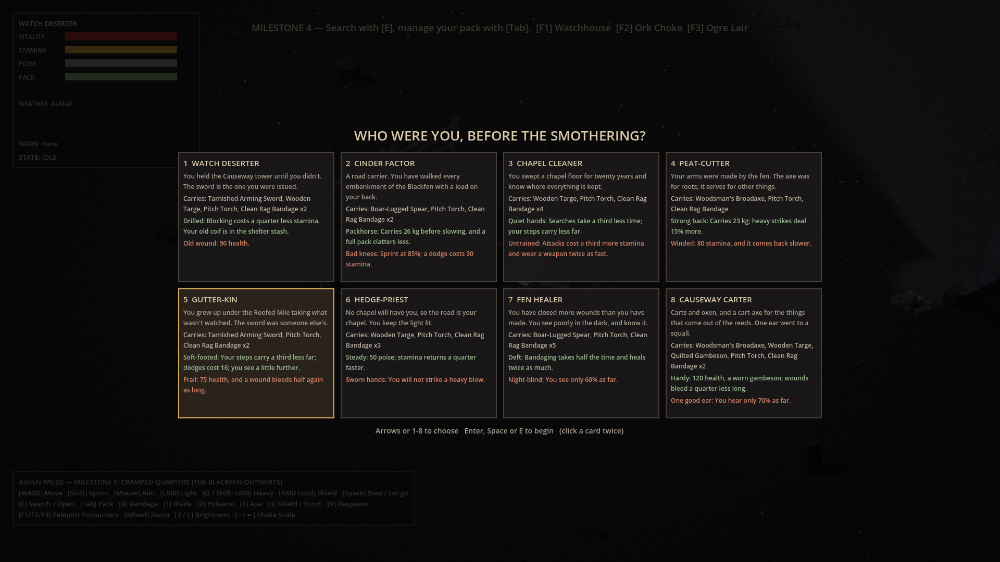 | 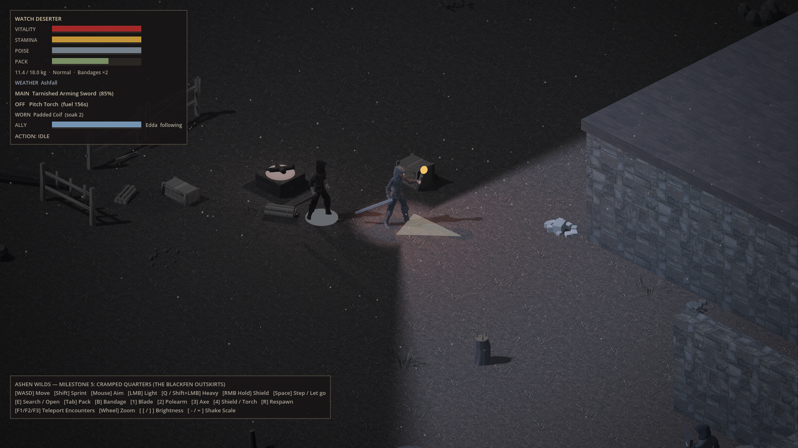 |
| 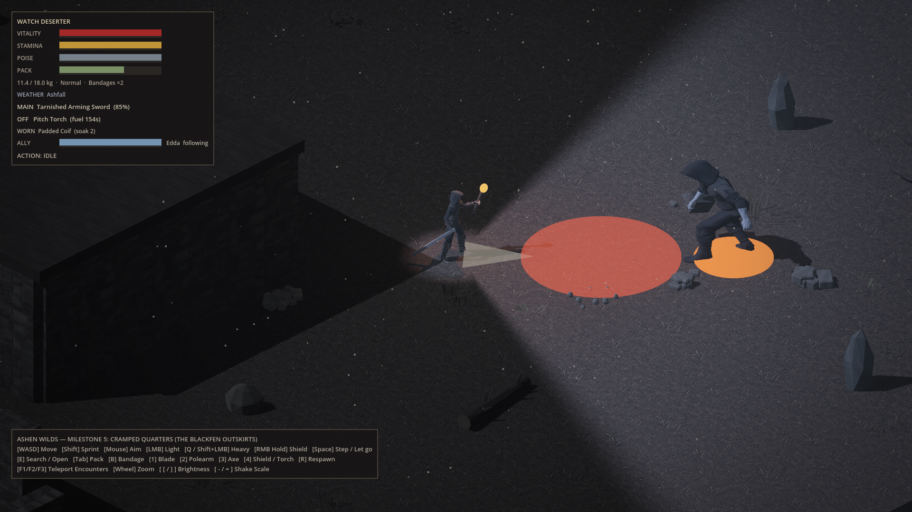 | 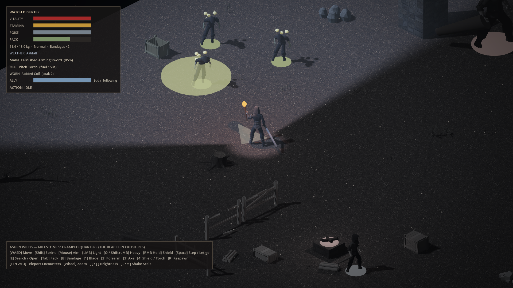 |
| **Cramped quarters.** A sword slash in the 1.7 m entry hall clangs off the stone: sparks, a recoil stagger and triple wear. Indoors, thrust. | |

<sub>Rendered with the project's own `tools/capture_screenshots.gd` (software Vulkan under Xvfb) at the default brightness. Enemies are frozen and posed for framing; time is slowed for the clang so the sparks survive the slow software frame rate.</sub>

---

## Premise

The Highland Citadels broke open the Deep-Seam Vaults hunting slag-iron and instead released ash-spores, goblin hordes, ork war-clans fleeing something deeper, and a volcanic winter called **the Smothering**. The kings fled south and burned the ships. No prophecy is coming. The people left in the Blackfen are stragglers, deserters and peasants trying to last until spring.

Act I (the current playable slice) is the **Blackfen Outskirts**: secure the ruined Wayfarer's Watchhouse, scavenge what the shelter needs to survive, and break the Ork choke point on the Old Causeway.

---

## What's in the game

### Combat core (Milestones 1–3)
- **Fixed isometric camera** — 45° yaw, −30° pitch orthographic rig with cursor peek, zoom, trauma-based shake, and brightness/shake accessibility controls.
- **Readable occlusion** — 4×4 Bayer-dithered cutaway on foreground walls, roofs that vanish when you're inside (with a shadow-only proxy so interiors stay dark), and **true line-of-sight enemy masking**: enemies behind walls aren't drawn, but you'll *hear* them.
- **A 130° vision cone and acoustic ripples.** You see what the survivor sees: a wedge around where you aim, cut by walls. Outside it the world is a charcoal memory map and enemies are not drawn, and where one slips out of sight it leaves a dark mark on the ground. What you cannot see, you hear: every footstep, grunt, swing, roar and slam an enemy makes has a loudness in metres (muffled through stone), and an unseen one you hear raises a dust-ring ripple at its source, sized by its loudness. A goblin circling to your back is a trail of rings; keep it in front of you. F4 turns the cone off (dev).
- **Who were you, before the Smothering?** The start screen offers eight survivors, each a kit, one trait and one permanent flaw: the **Watch Deserter** (the sword and targe you were issued; drilled blocks; an old wound: 90 health), the **Cinder Factor** (a road carrier's spear and a 26 kg back; bad knees), the **Chapel Cleaner** (four bandages, quiet hands and quick searches; untrained), the **Peat-cutter** (the broadaxe and a strong back; winded), the **Gutter-kin** (soft-footed, cheap dodges, sharp eyes; frail, and slow to stop bleeding), the **Hedge-priest** (steady, a long-burning torch; sworn hands that will not strike heavy), the **Fen Healer** (five bandages, deft; night-blind) and the **Causeway Carter** (hardy, 120 health; one good ear). Your eyes and ears stack with the weather: a night-blind healer in the miasma sees four paces.
- **A companion.** A survivor the Ashbound left bound in the Watchhouse. Cut her free (E, two seconds) and **Edda** throws in with you: she follows a few paces behind, fights whatever comes within reach of either of you with a cudgel, and holds a spot when told (**F** toggles follow / hold). She is not you: no pack, no stamina, 70 health. Enemies don't hunt her, but their blows land on whoever is nearer, so a sweep meant for you can take her instead. Knocked to nothing she goes **down, not dead**, for 25 seconds: lift her with E and a clean rag before then, or she dies and leaves a body to search. Left far behind (there is no pathfinding yet) she catches up behind you.
- **Armour.** Three slots (head, body, legs) and six pieces to find: a padded coif in the shelter stash, a quilted gambeson in the Watchhouse chest, a rusted mail hauberk in the ork plunder pile, a kettle hat in the ogre's bone heap, leather greaves in the grain crate, splinted greaves on some ork corpses. Armour takes a flat **soak** off every blow (heavy blows count it at 60%, and a blow always does at least 30%), adds **poise** (the full set, 19, shrugs off an ork's chop once), and cloth and mail turn **bleeding** cuts. It weighs what it weighs through the pack, mail **clinks** (your steps carry further), every blow **wears** it, and a ruined piece soaks half. Putting a piece on takes its own time (a hauberk, 4 s) through the pack window; taking it off, half. The Causeway Carter starts in a gambeson.
- **The Smothering's weathers.** Six conditions drift in and out on a cycle (a spell lasts 70–130 s, a change blends over 8 s), each changing what you can see, hear and do: **Ashfall** (the ordinary night), **Miasma fog** (sight closes to 7 m, sounds die), **Sleet** (the torch burns at ×1.8, the shelter fire dims, the ground is grease: 85% speed), **Cinder-squall** (embers on the wind, nothing heard over it, the torch fans), **Hoarfrost** (a hard bright moon, every sound carries ×1.25, the ground is ice: 80% speed) and the **Dead Calm** (nothing falls; everything is heard by everyone, ×1.6). Hearing cuts both ways: what muffles the goblin's footsteps muffles yours. F5 forces the next weather (dev).
- **Commitment-based melee** — explicit `STARTUP → ACTIVE → RECOVERY` attack phases, stamina with exhaustion, poise and stagger, directional shield blocking with guard breaks, an evasive step with i-frames, and bleeding.
- **Fair hit registration** — one hit per target per swing, and swings can't pass through walls.
- **Five enemies, five ways to fight.** Each has its own attack style, an `aggression` (how readily it commits) and an `attack_power` (scales all its damage), tunable per enemy:

  | | Style | Aggression | Its blows | Beat it by |
  |---|---|---|---|---|
  | *Goblin Scavenger* | **The opportunist.** Circles just out of reach and darts in when you're open: back or side turned, recovering from a swing, searching, staggered or out of breath. Jabs, then skitters back; any blow knocks it out of an attack. Throws stones at 5–11 m; flees when hurt and keeps throwing. Hears footsteps. | Low (0.3): waits for openings, loses patience after about 3 s | Jab 12 plus a 12 s bleed (about 22 more unless you bandage), **backstab 24** from behind your guard, stone 7 | Keeping it in front of you; punishing the dart |
  | *Ork Vanguard* (shield) | **The soldier.** Advances behind its shield; slash-then-chop combo. Hide behind your own shield too long and it **bashes your guard aside** (staggers you, costs stamina). | Steady (0.5) | Slash 24, chop 36 (heavy, bleeds), bash 6 (breaks guard) | Flanking, heavy blows to break its guard, dodging the bash |
  | *Ork Vanguard* (cleaver, no shield) | **The reckless one.** Runs you down faster than you walk, chases its chop further, rests less between combos. | High (0.85) | As above, more often | Its short recovery is still a window; dodge, then strike |
  | *Blackfen Ogre* | **The juggernaut.** Slow sweeps and slams that take half your health. **Doesn't flinch mid-windup.** From 5–11 m it lowers its head and **charges** in a line it cannot steer; sidestep, and if a wall or tree is behind you it crashes and reels for 2 s. It only charges where its shoulders fit, never a doorway. **Enraged** below 40% health: faster and quicker to charge. Too wide for the 1.35 m watchhouse doorway. | Relentless (0.8): chases 20 m, charges every ~6 s | Sweep 46, slam 62 (bleeds), charge 38 | Dodging, never trading; baiting the charge into stone |
  | *Blind Quarry-Troll* | **The blind hunter.** No eyes: it hunts by **sound alone**. Every noise you make has a reach (walk 6 m, sprint 14 m, a swing 12 m, a sword clanging off stone 16 m), scaled by your load, armour, background and the weather. Inside it, the troll lumbers to **where the sound was** and brings both fists down on that spot. Hit it and it knows where you are: it **thrashes** round itself. It hears your companion too. | Hungry (0.5): lumbers at 2.7 m/s, listens 2.6 s after a blow | Pound 55 (heavy, a ring marks the spot), thrash 30 | **Keep still** (it cannot find you at arm's length), creep out of the ring, hit and step away |
  | *Ash-Spore Husk* | **The carrier.** One of the Ashbound's dead, colonised by the spores from the Deep-Seam Vaults. Slow (it shambles slower than you walk), half-blind (8 m, a 120° cone) and weak alone, but **every wound puffs spores and its death bursts a choking cloud** where it stood: kill one at arm's length and you're in it. In a cloud you **choke**: health drains, stamina barely returns, and you see a third as far. Its claw drives spores in. **Fire burns spores**: a lit torch eats a cloud in a second. Still air keeps clouds hanging (the Dead Calm: 13 s), wind and sleet clear them (a cinder-squall: 3 s). Three gather in the Spore Hollow on the west edge, round a cart with a fresh torch. | Low (0.4): follows for 5 s, claws again after 1 s | Claw 16 and 2 s of choking; clouds 3 health/s | **The torch**; reach (the spear) and stepping back out of the burst |

  The Watch Deserter (the default survivor) has 90 health; the eight backgrounds range from 75 to 120. Against a 100-health survivor who stands still, the cleaver ork kills in about 5 s, the shield ork and the ogre in about 6–7 s, and a goblin in 9 s if they turn their back; facing it, a goblin takes 20 s to do 70 damage.
- **Encounter coordinator** — attack tokens and a readability gap so enemies take turns instead of swinging all at once.

### Scavenging & equipment (Milestone 4)
- **Timed, cancellable searches** of crates, chests and enemy corpses. Moving, attacking, dodging, pressing E again or taking a hit cancels the search; rummaging is audible to nearby goblins.
- **Carry weight** — an 18 kg pack. Over 75% you're *Burdened* (your pack clatters, so enemies hear you ~35% farther away, and dodges cost more). Over 100% you're *Overburdened* (no sprint, no dodge, slow). Nothing can be picked up past 150%.
- **Item condition**
  - Weapons wear per landed hit; damage tapers below 50% condition and drops to 40% when broken.
  - Shields wear when they block and **splinter** at zero — then they can't block.
  - The torch's condition *is* its fuel: it burns while lit, dims as it runs low, and gutters out.
- **Equipment switching** with a short, interruptible swap:

  | Weapon | Reach | Light | Heavy | Lodge | Notes |
  |---|---|---|---|---|---|
  | Tarnished Arming Sword | 1.65 m | 105° slash *(sweep)* | Lunging thrust, 45% bleed *(thrust)* | 15% | Reliable all-rounder |
  | Boar-Lugged Spear | 2.45 m | 25° thrust *(thrust)* | 150° shaft-sweep, steps you back *(sweep)* | never | **Two-handed** — stows your off-hand |
  | Woodsman's Broadaxe | 1.55 m | 135° cleave *(sweep)* | Heavy cleave, 30% bleed *(sweep)* | 40% | Hits hard, slow to recover |

  *Sweeps clang off walls in tight spaces; thrusts don't. Lodging only happens on heavy blows that kill or stagger.*

  The hitbox is reshaped to each weapon's reach and swing arc. Off-hand: **Wooden Targe** (block) or **Pitch Torch** (light, no block).
- **Bandaging** is a 1.6 s channel that consumes a Clean Rag Bandage.
- **Pack & loot UI** — equip, use and drop from the pack; take items one at a time or all at once. Drops become ground piles you can pick back up.
- **World loot** — five containers, including the spear in the Watchhouse chest, the broadaxe in the Ork plunder pile, and the **Cast-Iron Cooking Pot** (an Act I objective) in the Ogre's bone heap. Every enemy leaves a searchable corpse.

### Cramped quarters (Milestone 5)
- **Wall & corridor deflection.** When a swing goes live, the game sweeps its arc at blade height. If a *sweeping* stroke would meet stone, it **clangs**: no damage, a 0.5 s recoil stagger, sparks, a metallic ring, and triple the usual wear. **Thrusts never clang.**
- **You're warned before you commit.** While a sweep would clang, your aim arc turns orange and the HUD shows `CRAMPED: SWEEPS WILL CLANG`.
- **The Watchhouse entry hall** is a 1.7 m-wide corridor inside the doorway: sword slashes, axe cleaves and the spear's shaft-sweep all clang there, while spear thrusts and the sword's lunge work.
- **Enemies clang too.** The same rule applies to them:
  - The *Ork*'s opening slash clangs off the walls of a cramped space and leaves it reeling, guard down. Its overhead chop does not.
  - The *Ogre*'s club sweep smashes into stone for a long recoil. Its ground slam does not.
  - The *Goblin* jabs with a shiv, a thrust, so it stays dangerous in corridors.

  Draw a sweeping enemy into tight quarters and punish the clang. A clanging enemy counts as staggered, so a heavy blow can lodge.
- **Weapon lodging.** A heavy blow that kills or staggers can bite too deep (axe 40%, sword 15%, spear never: the boar spear's lugs exist to stop exactly that). You're rooted for a 0.35 s wrench, then recover. Mid-wrench you can:
  - **press Space** to let go and leap clear, leaving the weapon in the body; or
  - **get hit**, and it's torn from your grip.
  
  Either way the weapon stays where it lodged. Walk back and **work it loose** (1.2 s) to recover it, then fight on with fists or draw another weapon with 1–3.

---

## Controls

| Input | Action |
|---|---|
| **WASD** | Move (camera-relative) |
| **Shift** | Sprint |
| **Mouse** | Aim |
| **LMB** | Light attack (tap again late in recovery to chain) |
| **Q** / **Shift+LMB** | Heavy attack |
| **RMB (hold)** | Raise shield |
| **Space** | Evasive step · let go of a lodged weapon |
| **E** | Search / open a container or corpse, or work a lodged weapon loose (press again to stop) |
| **Tab** | Open/close pack · **Esc** closes windows |
| **B** | Bandage a wound |
| **1 / 2 / 3** | Ready blade / polearm / axe |
| **4** | Swap off-hand: shield ⇄ torch |
| **R** | Respawn at the shelter fire |
| **F1 / F2 / F3** | Teleport to Watchhouse / Ork choke point / Ogre lair (dev) |
| **F4** | Vision cone on / off (dev) |
| **F5** | Next weather (dev) |
| **F** | Companion: follow / hold |
| **F6** | Teleport to the Old Quarry (dev) |
| **F7** | Teleport to the Spore Hollow (dev) |
| **Mouse wheel** | Zoom |
| **[ / ]** | Brightness down / up |
| **- / =** | Camera shake down / up |

---

## Getting started

**Requirements:** [Godot 4.7.2-stable](https://godotengine.org/download/archive/4.7.2-stable/) (standard build, not .NET). The project uses the Forward+ renderer, so you need a Vulkan-capable GPU.

```bash
git clone https://github.com/dribblejerp-KlunkDunker/Ashen-Wilds.git
cd Ashen-Wilds
```

Then open `project.godot` in the Godot editor and press **F5**, or run it from a terminal:

```bash
godot --path .
```

Everything — level geometry, enemies, UI, items, audio — is built in code at startup by `scripts/core/scene_bootstrap.gd`, so there are no assets to import.

### Running the tests

The game's systems are covered by a headless regression suite (no GPU needed):

```bash
godot --headless --path . --import          # first run only: builds the class cache
godot --headless --path . --script res://tests/smoke_test.gd
```

The process exit code is the number of failures (`0` = all passed). It covers spawning, the damage pipeline, the attack state machine, attack tokens, inventory stacking and weight, encumbrance, searching and every way to cancel it, equipment swaps and hitbox reshaping, torch fuel, durability and shield splintering, bandaging, dropping and picking up, the pack/loot UI, corpse loot, the world containers, which strokes clang where (per weapon, per stroke, hall vs. open ground vs. doorway, and for each enemy's attacks), and every lodging outcome (tug free, let go, torn free, work loose, and the cases that must *not* lodge).

> Headless runs print `Parameter "m" is null` and an "instances leaked at exit" warning. Both come from Godot's dummy renderer and audio driver, which are only used in headless mode — not from the game.

### Re-rendering the screenshots

```bash
# Linux without a GPU: needs Xvfb and Mesa's software Vulkan (mesa-vulkan-drivers)
xvfb-run -s "-screen 0 1920x1080x24" godot --path . --script res://tools/capture_screenshots.gd
```

On a desktop with a GPU, drop the `xvfb-run …` prefix.

---

## Project structure

```
CLAUDE.md                  Working notes for AI agents: Godot setup, verify steps, conventions
project.godot              Engine config, physics layer names
main.tscn                  Single root node → scene_bootstrap.gd
shaders/
  foreground_cutaway.gdshader   Bayer-dither wall/roof cutaway
scripts/
  core/       scene_bootstrap.gd (builds the level, input map, containers), procedural_audio.gd
  camera/     iso_camera_rig.gd
  combat/     hitbox / hurtbox components, encounter_coordinator.gd, wall_deflection.gd
  data/       weapon_data, combat_payload, item_data, item_instance, item_database (all items + loot tables)
  inventory/  inventory.gd (stacking, weight, encumbrance, equip slots)
  world/      lootable.gd (crates, corpses, ground piles)
  player/     player_controller.gd, survivor_model.gd (the animated character)
  enemies/    goblin scavenger, ork warrior, ogre brute
  ui/         tactical_hud.gd, inventory_ui.gd
art/quaternius/            The survivor character and its animations (CC0; see the README there)
art/ambientcg/             Photo textures for walls, ground, roof and props (CC0; see the README there)
assets/environment/        The project's own environment kit (ENV-001 to ENV-010; each set has a README)
tests/
  smoke_test.gd            Headless regression suite (434 checks)
tools/
  capture_screenshots.gd   Renders docs/screenshots/
  recolor_survivor_texture.py   Rebuilds the survivor's grim textures from the Ranger's
docs/screenshots/          README images (ignored by Godot via docs/.gdignore)
```

### How the pieces fit

- **Damage flow:** an attacker builds a `CombatPayload` and opens its `HitboxComponent` during the *active* phase. The hitbox finds overlapping `HurtboxComponent`s, rejects repeat hits and anything behind a wall (raycast), then calls `receive_attack()`. The defender decides whether it was dodged, blocked or taken.
- **Physics layers:** 1 Environment · 2 PlayerBody · 3 EnemyBody · 4 PlayerHurtbox · 5 EnemyHurtbox · 6 Occluders (roofs) · 7 Props (set dressing: blocks movement, ignored by sight and combat rays).
- **Items:** `ItemData` is the shared definition (one instance per id, built in code by `ItemDatabase`); `ItemInstance` carries quantity and condition. `Inventory` holds instances plus the main-hand and off-hand slots — equipped items still count toward weight.
- **Survivor look:** `SurvivorModel` is the body only. The controller picks an animation from its action state and stretches timed ones (swings, dodges, staggers) to the state's own duration, so combat timing is unchanged. The sword, shield and torch hang off the character's hand bones; hitboxes and collision never read the mesh.
- **Timed actions:** searching, bandaging and equipment swaps all share the player's `CHANNEL` state, so they're interrupted by the same rules and drive the same HUD progress bar.
- **Deflection:** `WeaponData` marks each player stroke as a thrust or a sweep, and each enemy declares its own attacks. When a sweep goes active, `WallDeflection.sweep_obstruction()` casts 3–9 rays across the arc against the Environment layer. A hit sends the attacker into `RECOIL` instead of opening the hitbox. Player and enemies share the same helper. For the player, the same check runs every frame while idle to drive the orange "cramped" warning.
- **Lodging:** on a confirmed heavy hit, the player asks the target `is_dead()` / `is_staggered()` and rolls `heavy_lodge_chance`. A lodge enters the `LODGED` state; releasing the weapon spawns a `Lootable` with a "Work loose" verb at the body.

---

## Roadmap

Next milestone not yet chosen. Candidates from the design document:

- More companions and their stories, the rest of the bestiary, and Acts II–III.

---

## Known limitations

- Placeholder visuals: the enemies are stand-in Ashbound bodies (Quaternius, CC0), the environment kit is a first pass, and the survivor is a stand-in (Quaternius, CC0); audio is synthesized at runtime.
- No save system yet; your pack is kept when you respawn.
- Only tested on Godot **4.7.2-stable**. Older versions cannot open the project.
- The test suite checks game logic, not feel — swap times, light levels and UI layout still need hands-on tuning.

---

*No license has been chosen yet; all rights reserved by the author until one is added.*
