# The Long Account

A first-person game of dread in the world of Ashen Wilds, for one to four players, played in a web
browser. A small carrying company takes a dead kingdom's unpaid receipts, and one old woman who was
inside the Vaults, around a cold sea under a dimmed sun. No prophecy is coming.

**Status: the prologue is playable; the Acts and endings are logic.** You can stand on the prologue's ledge, look at the Slagcrown under the
coal sun, walk down past the walking bloom that stands on the shelf, and reach Marget Sayle's
bothy and speak to her. Walk, do not run: it hunts by sound. Put the bar across her door, or it may
follow you in. Out in the dark, or with it coming at you, the picture closes in. Acts I to III and the five endings are built as pure content and state machines, with their maps, art and scenes still to come. `ROADMAP.md` says exactly what is and is not here.

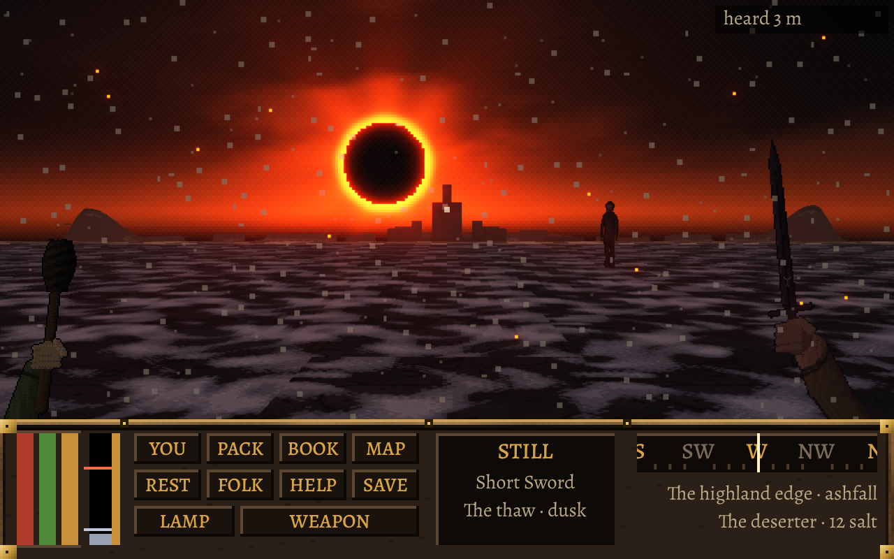

| | |
| --- | --- |
| 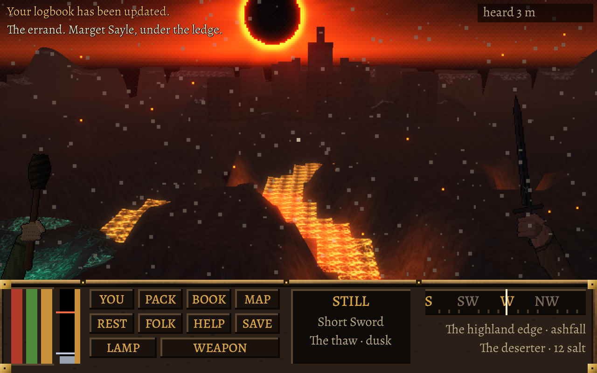 | 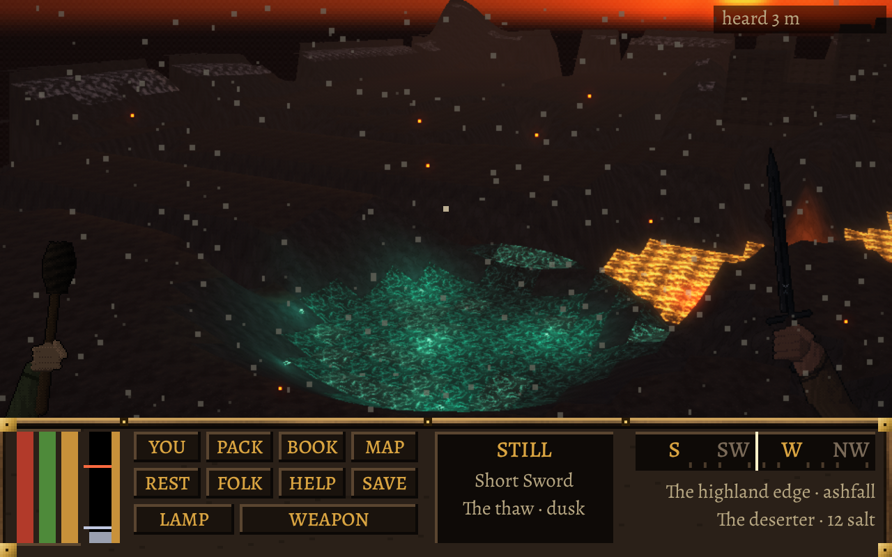 |
| 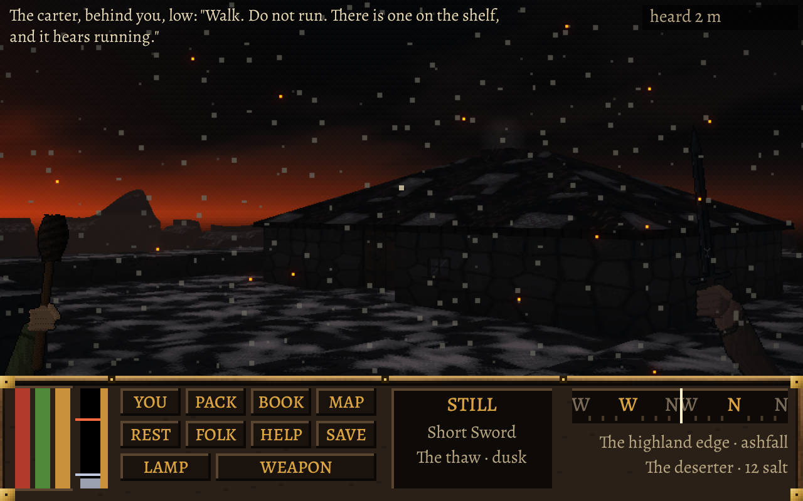 | 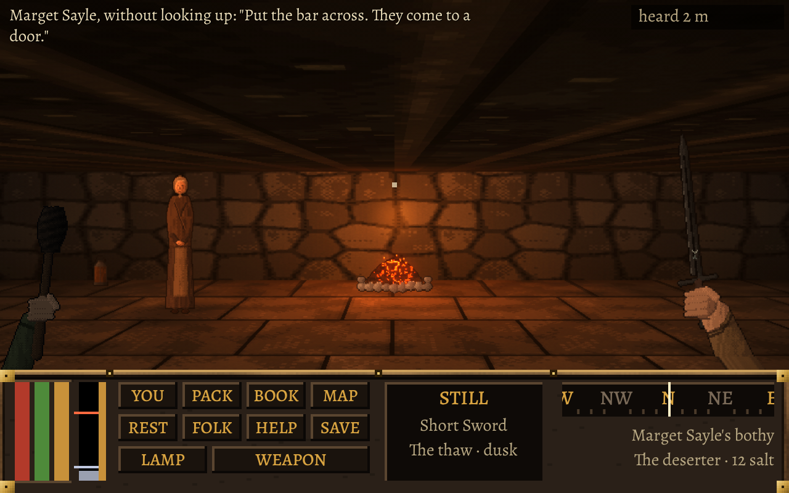 |
| 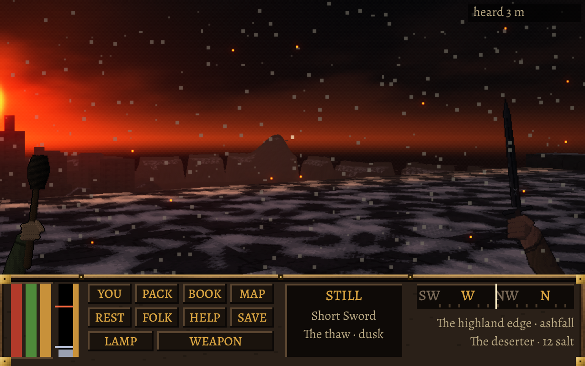 | 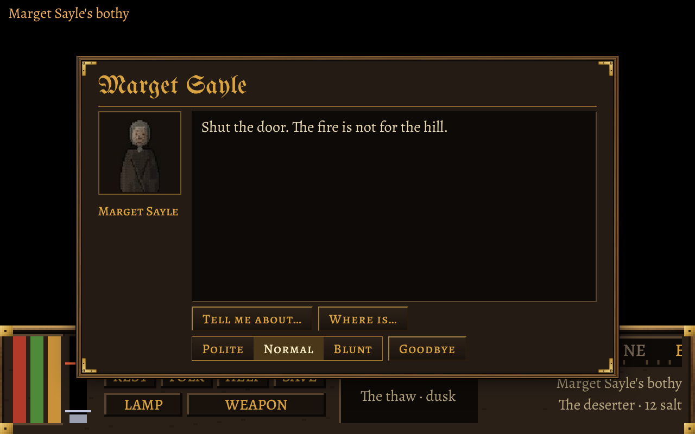 |
| 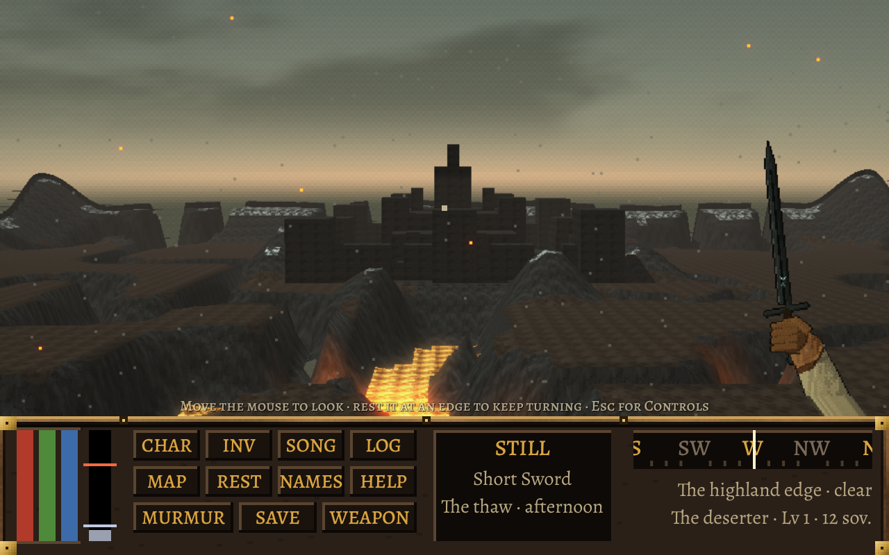 | 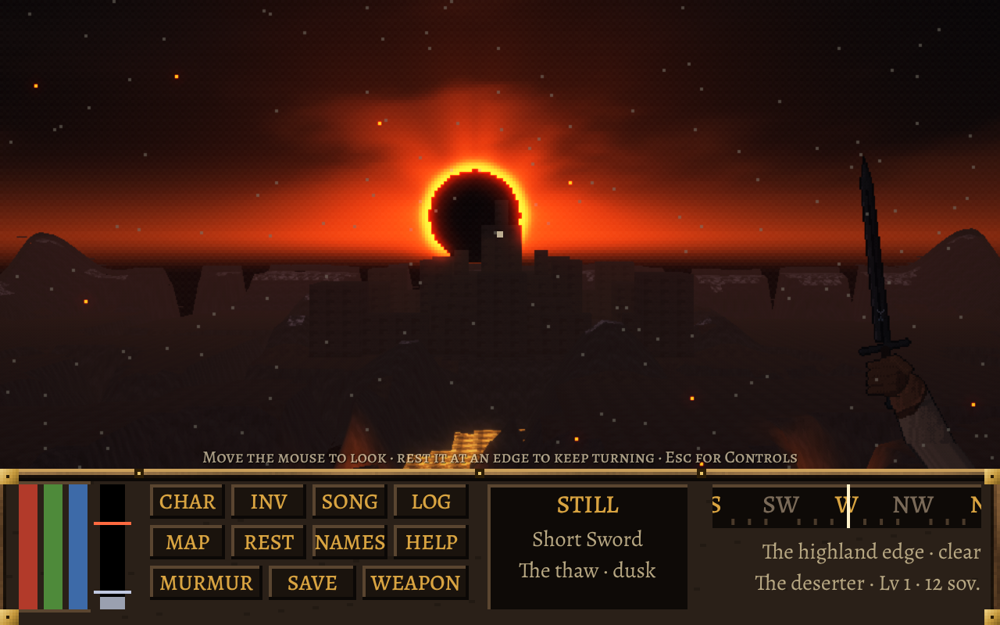 |
| 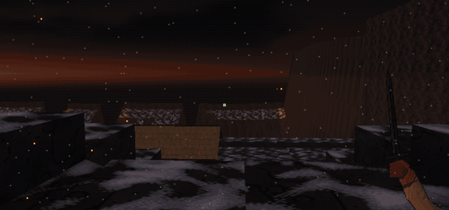 | 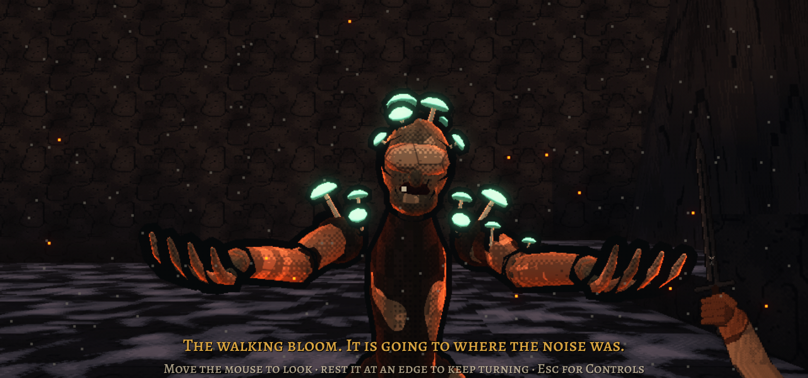 |
| 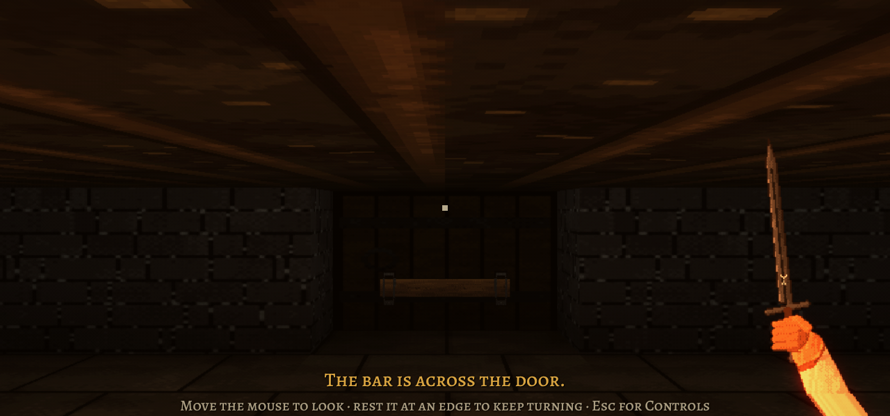 | 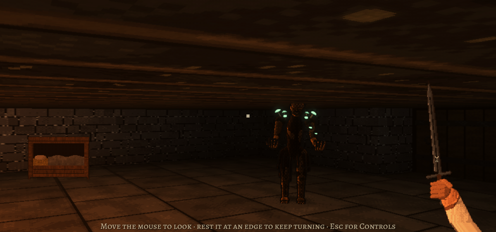 |
| 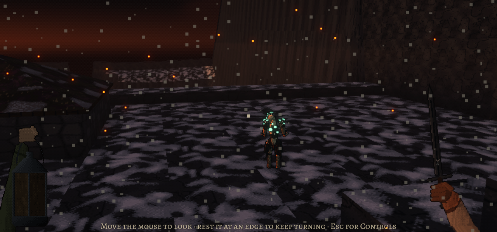 | 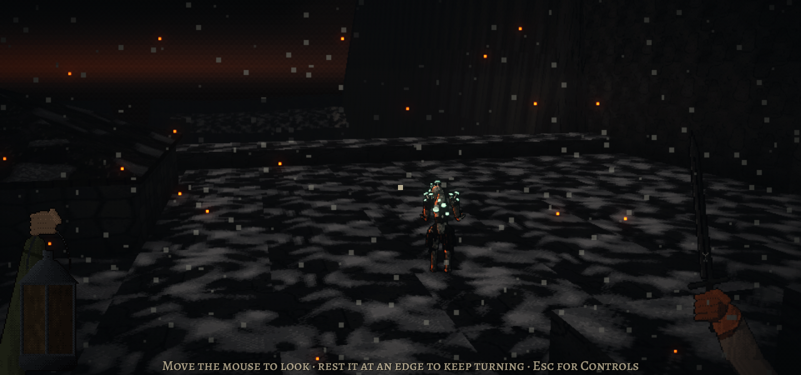 |

## Play

Once the owner has merged this and turned on Pages (Settings > Pages > Source: GitHub Actions), the
game is published from `main` to `https://dribblejerp-klunkdunker.github.io/Ashen-Wilds/`.

From source there is nothing to build or install. Serve the folder and open it:

    git clone https://github.com/dribblejerp-KlunkDunker/Ashen-Wilds.git
    cd Ashen-Wilds
    python3 -m http.server 8000        # then open http://localhost:8000

### Play on your phone

Open the game with `?touch=1` or `?mobile` in the address, for example
`https://dribblejerp-klunkdunker.github.io/Ashen-Wilds/?touch=1`, or open it on a device whose main
pointer is a finger. The touch stick, its buttons and the touch-aware opening start with play.
Options > Controls > Touch controls still rules: Off wins. This is the phone-link support, not the
Act III content in Phase 36.

| Input | Action |
| --- | --- |
| W A S D | Walk |
| Mouse | Look (click the view first) |
| E or Space | Open a door, speak, read what is in front of you |
| U or N | Light or douse what is in your left hand: your torch, or a lantern once you have one |
| C, I, L, K, H | Who you are, your pack, the book, who you know, how to play |
| X | The Account: what is owed, and what you promised (it does not stop the world) |
| Esc | Controls and Options |

Options, under Graphics & access, has a switch for each thing this game draws on top of the engine:
the coal sun, ash and embers, burning ground, the sun's day, modelled bodies, ashfall and sleet, your lantern, highland building, the chill, and the prologue's end card.

## What is in the build

- **Who walks north.** Begin asks which of the eight walks of life you are, quoted from the lore:
  the Watch deserter Gytha Marrin sent, or a carrier, a chapel cleaner, a peat-cutter, a gutter-kin, a
  hedge-priest, a fen healer or a causeway carter. It sets your name, your health and how loud your
  feet are; the rest of each card waits for the systems it needs.
- **This game's panel:** YOU, PACK, BOOK, FOLK and HELP in this game's words; salt, not sovereigns; the
  lantern's oil as a tallow bar; and this repository's credits.
- **The ledge** on Orlen's highland edge: frosted rock fourteen up, a cliff you cannot step off, a
  ramp down to a shelf.
- **The country of the key painting, as a map you could walk:** the cracked highland with fire in the
  beds of its cracks, a canyon running west, the teal hollow of the bloom, and the Slagcrown on its
  rise, with the far rim behind.
- **The sun's day.** The sun crosses the sky and has three faces: the coal sun on the worst days, a
  pale coin behind the ash on most, and on some days a clear noon with real sunlight and shadows.
  Every dusk it goes down red behind the Slagcrown.
- **Ashfall and sleet.** Ash falls in the world and stops at roofs. On grey days sleet comes in
  spells: the fog closes in, you walk at 85%, and the walking bloom hears less. Inside the bothy you
  hear it on the roof.
- **Marget Sayle's bothy, built the highland way**: field stone laid dry under a low hipped roof of
  turf and heather, one small window on the lee side and none to the north wind, and smoke from a
  hole in the roof.
- **Your torch**, in your left hand from the start: pitch on a stave, a bigger and redder light than a
  lantern's, and four minutes of fuel (the gutter-kin's a minute and a half, the hedge-priest's six). It
  burns down, gutters and goes out, and spent is spent. Lit after dark, it shows you to the walking bloom.
- **A lantern, when you get one**: Marget Sayle gives you her horn lantern when you first speak to her. A
  small tallow light; a full one lasts dusk to dawn; sleet spends it nearly twice as fast. Her two flasks fill it.
  From the pack you take the torch or the lantern into your hand.
- **The walking bloom**, modelled, on the shelf by the foot of the ramp. It hunts by sound: walk
  and it does not hear you; run and it comes to where the noise was, and claws. It sees only
  movement, close and in front of it, unless your lantern is lit. It cannot follow you in at the bothy's door.
- **Marget Sayle's bothy:** field stone under a roof, one door, a banked peat fire. The safe room, if
  you bar the door: barred, the bloom leans on it once and goes away; left open, it comes in.
- **Two people who can be spoken to:** the carter on the ledge, and Marget Sayle. Both are painted
  in code and move on the engine's rig.
- **The warning book's beasts page.** The book's seventeen entries, with the book's own senses and
  the exact quarry-troll and bloom distances, open from the book under The beasts.
- **The chill.** A warmth pool you lose in sleet and at night and get back at the bothy's lit
  hearth. Below half your hands slow; at zero you cannot run or fight. Options > The chill.
- **The hearth at the bothy.** REST at the lit fire opens the hearth: rest four or eight hours,
  keep a small store of smoked eel and lamp oil, name a dead person in the company roll, and read
  the promises already written in the Account. The panel's wording is still proposed.
- **The phone link.** A `?touch=1` or `?mobile` address, or a coarse pointer, starts the thumb
  stick and touch buttons from the first frame and leaves out the mouse-capture line. Options >
  Controls > Touch controls still rules. This is support, not the Act III content in Phase 36.
- **The Acts and the endings, as logic.** Act I's Burned Quay scenes, the three courts of Act II,
  its five side arcs, the eleven days at Halsing and the five endings are built as deterministic
  content and state machines. The tests play every route, including the receipt's unanswered
  identity, Marget's limit and the three blanks. No Act map, scene art, dialogue UI or save is
  built yet; the briefs and proposed rulings are in `ROADMAP.md`.
- **The prologue, played through.** From Begin to the end: look at the Slagcrown for two seconds and
  the errand is given; walk down the ramp with the carter behind; bar Marget Sayle's door; she gives you
  her lantern; ask her about the south and give your word, and it is the Account's first entry; take
  her arm, lift the bar and carry her out at her pace, tell the carter to follow, and at the top of the
  ramp she looks back at the Slagcrown and THE LONG ACCOUNT comes up. Then a card with the run: the
  days, the oil and pitch left, and who lived. A test plays the whole of it with a player's keys and
  clicks. The walk south after it is not built yet.

  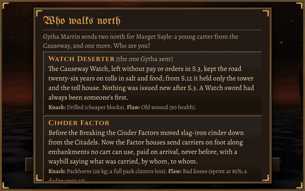

- **No picture this repository did not make.** Every tile, person, thing, hand and icon is drawn by
  code here.

## What it is built on

The engine is the one written for *Echoes of the Shattered Octave* (same owner), copied in at that
game's commit `f2b3990` with its story and all of its pictures removed. It is plain JavaScript: no
framework, no bundler, no build step. `index.html` loads the scripts in order. Some wording inside
the engine is still that game's: the panel's buttons, its items, its credits screen. `ROADMAP.md`
lists all of it. `CREDITS.md` says where every file came from.

## Where things are

| Path | Purpose |
| --- | --- |
| `index.html` | The page. Loads every script in order, each with `?v=N` |
| `js/fork0.js` | Phase 0: quiet stand-ins for the story hooks the engine still calls |
| `js/ledge1.js` | Phase 1: the ledge, the bothy, the coal sun, the ash, the words |
| `js/art2.js` | Phase 2: the tiles, the two people, the bothy's things, the hand and blade, painted in code |
| `js/sun3.js` | Phase 3: the sun's day |
| `js/bloom4.js` | Phase 4: the walking bloom, its hunt and its modelled body |
| `js/door5.js` | Phase 5: the bar on Marget Sayle's door, and what the bloom does at it |
| `js/weather6.js` | Phase 6: ashfall and sleet, stopped by the bothy's roof |
| `js/lantern7.js` | Phase 7: the light in your left hand, the lantern, its oil, and Marget Sayle's flasks |
| `js/torch38.js` | Phase 38: you start with a torch; Marget Sayle gives you her horn lantern (or one is bought) |
| `js/prologue39.js` | Phase 39: the prologue's end card after the title, with the run's numbers; `test/prologue39.test.js` plays the prologue through |
| `js/building8.js` | Phase 8: the highland edge's way of building: the bothy's turf roof, smoke hole, window and stone |
| `js/dread9.js` | Phase 9: dread, a value you never see, and the picture closing in as it rises |
| `js/panel10.js` | Phase 10: who walks north, and this game's panel words, HUD and credits |
| `js/hearth27.js` | Phase 27: the bothy REST panel, rest, the store, the named dead and the Account promises |
| `js/touchlink36.js` | Phase 36 support: the phone link that starts touch controls from `?touch`/`?mobile` or a coarse pointer |
| `js/actone33.js`, `js/acttwo34.js`, `js/sidearcs35.js`, `js/actthree36.js`, `js/endings37.js` | Phases 33-37: the Acts and the endings as content and state engines |
| `tools/look/` | Look tests the page never loads: the quarry-troll, modelled |
| `tools/lore/`, `docs/data/` | The lore pipeline (`docs/pipeline.md`): tools that read the world bible into data the game will load; its first slice writes `docs/data/places.json` |
| `js/` (the rest) | The engine: the map, two renderers, light, weather, roofs, painted people, co-op |
| `sw.js`, `tools/pwa/precache.js` | Offline play, and the tool that rebuilds and checks its file list |
| `test/` | One test file per phase, and the shared browser harness |
| `tools/shots.js` | Writes the stills in `docs/screenshots/` (and `sunshots.js`, `beastshots.js`, `bloomshots.js`, `doorshots.js`, `weathershots.js`, `lanternshots.js`, `buildshots.js`, `dreadshots.js`, `panelshots.js`, `prologueshots.js`; `bloomgifs.js`, `doorshots.js`, `weathershots.js`, `lanternshots.js` and `buildshots.js` write the clips) |
| `tools/icons.js`, `tools/portraits.js` | Write the app icons and the dialogue portraits from the game's own art |
| `.github/workflows/` | The checks on every pull request, and publishing from `main` |
| `docs/worldbuilding/` | The world bible: the story folder. Start with `CANON.md` |
| `docs/worldbuilding/the-round-and-the-long-account.md` | The wider world, and this game's design |
| `ROADMAP.md` | Every phase, what is invented and awaits a ruling, what is not done |
| `CLAUDE.md` | How to work on this repository |

## Tests

    node test/fork0.test.js --no-browser
    node test/ledge1.test.js --no-browser
    node test/art2.test.js --no-browser
    node test/sun3.test.js --no-browser
    node test/bloom4.test.js --no-browser
    node test/door5.test.js --no-browser
    node test/weather6.test.js --no-browser
    node test/lantern7.test.js --no-browser
    node test/torch38.test.js --no-browser
    node test/building8.test.js --no-browser
    node test/dread9.test.js --no-browser
    node test/panel10.test.js --no-browser
    node test/hearth27.test.js --no-browser
    node test/touchlink36.test.js --no-browser
    node test/actone33.test.js --no-browser
    node test/acttwo34.test.js --no-browser
    node test/sidearcs35.test.js --no-browser
    node test/actthree36.test.js --no-browser
    node test/endings37.test.js --no-browser
    node test/prologue39.test.js --no-browser
    node test/lore-places.test.js --no-browser      # the lore pipeline: places
    node tools/pwa/precache.js --check
    node tools/icons.js --check

    # the played half, in a headless browser (Playwright is not bundled)
    NODE_PATH=$(npm root -g) node test/fork0.test.js
    NODE_PATH=$(npm root -g) node test/ledge1.test.js
    NODE_PATH=$(npm root -g) node test/art2.test.js
    NODE_PATH=$(npm root -g) node test/sun3.test.js
    NODE_PATH=$(npm root -g) node test/bloom4.test.js
    NODE_PATH=$(npm root -g) node test/door5.test.js
    NODE_PATH=$(npm root -g) node test/weather6.test.js
    NODE_PATH=$(npm root -g) node test/lantern7.test.js
    NODE_PATH=$(npm root -g) node test/torch38.test.js
    NODE_PATH=$(npm root -g) node test/building8.test.js
    NODE_PATH=$(npm root -g) node test/dread9.test.js
    NODE_PATH=$(npm root -g) node test/panel10.test.js
    NODE_PATH=$(npm root -g) node test/hearth27.test.js
    NODE_PATH=$(npm root -g) node test/prologue39.test.js   # the whole prologue, played

A passing run says the land is the shape it should be, the cliff holds, the way down can be walked,
the door opens, the people answer, the walking bloom lets a walker by and comes for a runner, the
barred door holds and the open one does not, the lantern burns its oil and goes out, dread rises in the dark and leaves you behind a barred door, the switches change the picture, and the bothy hearth opens from REST, and the prologue can be played from Begin to its end. It says nothing about how the
game feels: that needs a person at the controls.

## The games this replaced

Until 2026-11-11 this repository held Ashen Wilds, an isometric dark-survival game (owner decision
O5 in `docs/worldbuilding/CANON.md`). **All of its lore is kept** in `docs/worldbuilding/`. Its code
is on the branch
[`archive/isometric-prototype`](https://github.com/dribblejerp-KlunkDunker/Ashen-Wilds/tree/archive/isometric-prototype).
A one-day Godot look test of this game followed it and was dropped for the browser engine (decision
D14); it is in the history of this branch.
