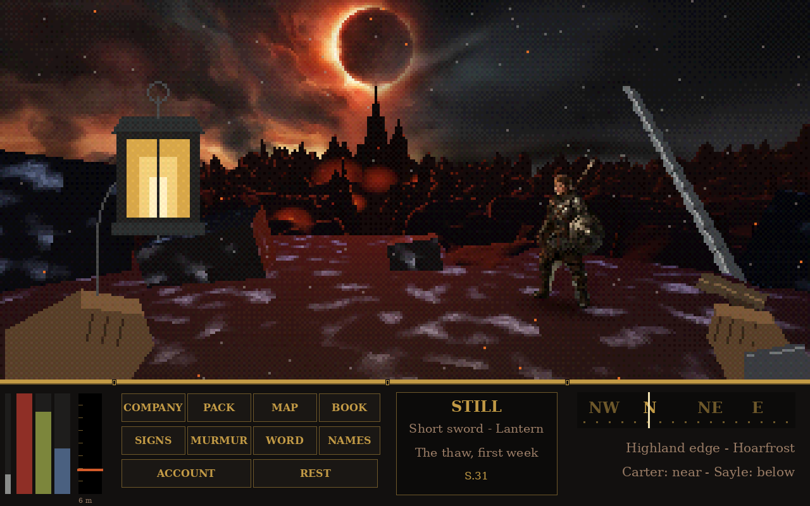
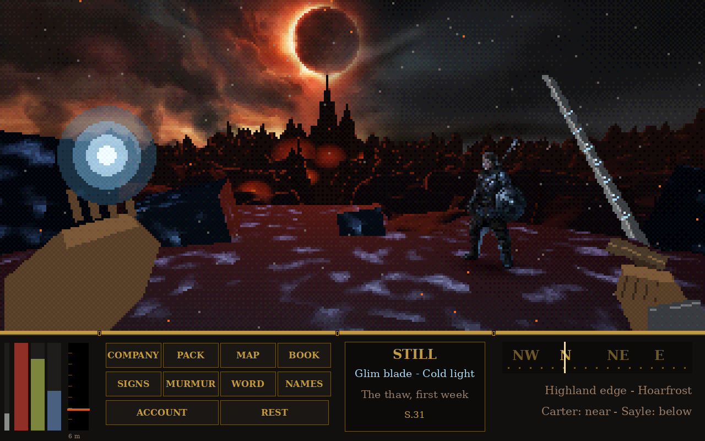
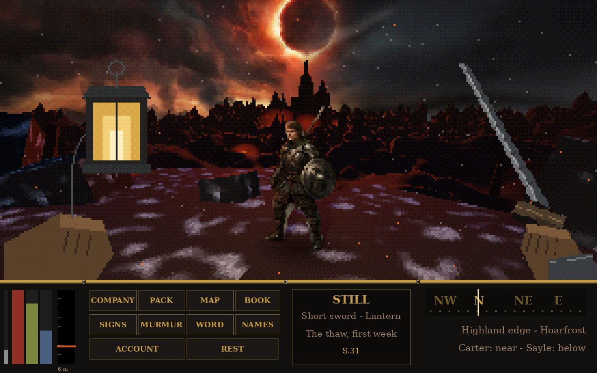

# The Long Account

A first-person, co-op dark-fantasy game in the world of Ashen Wilds, for one to four players.
A small carrying company takes a dead kingdom's unpaid receipts, and one old woman who was inside
the Vaults, around a cold sea under a dimmed sun. No prophecy is coming.

**Status: a look test.** What is here renders the game's opening view and lets you walk a few
metres of it. There is no combat, noise, load, saving or multiplayer yet.

| | |
| --- | --- |
|  |  |

## What the look test shows

- **The scale of the Shattered Octave build:** a 320 x 150 first-person view shown at exactly four
  times its size, with an ordered dither, above a 200-pixel ledger panel.
- **The prologue's ledge:** frosted black rock on Orlen's highland edge.
- **The world of the key painting as real geometry:** the broken highland, cracks with fire in them,
  the Slagcrown on its rise under the coal sun, smoke, and the teal hollow of the bloom.
- **People are painted, and two hands are on screen:** a lantern or cold light in the left, a blade
  in the right. `L` swaps them.

**Placeholder art.** The sky and the partner figure are cut from the owner's key painting. The hands,
the panel and the textures are drawn by `tools/make_assets.py`. The land is a height field and the
Slagcrown is boxes. None of it is final.

## Run

Godot **4.7.2-stable** (standard build, Forward+). Do not open the project in a newer editor.

    git clone https://github.com/dribblejerp-KlunkDunker/Ashen-Wilds.git
    cd Ashen-Wilds
    godot --path .                       # walk the ledge
    godot --path . -- --shots out        # write the four stills to out/ and quit

| Input | Action |
| --- | --- |
| WASD | Walk (the ledge only) |
| Mouse | Look |
| L | Swap lantern and cold light |
| Esc | Quit |

## Where things are

| Path | Purpose |
| --- | --- |
| `project.godot`, `main.tscn` | Engine configuration and the one scene |
| `scripts/main.gd` | The whole look test: view, sky, land, the Slagcrown, the ledge, hands, panel, stills |
| `scripts/ash_overlay.gd` | Falling ash and rising embers over the low-resolution view |
| `assets/` | Placeholder art, built by `tools/make_assets.py` |
| `tools/make_assets.py` | Rebuilds `assets/` from the key painting (not stored here) |
| `docs/worldbuilding/` | The world bible. Start with `CANON.md`. |
| `docs/worldbuilding/the-round-and-the-long-account.md` | The wider world, and this game's design |
| `docs/screenshots/` | Stills written by `-- --shots` |
| `CLAUDE.md` | How to work on this repository |

## The game this replaced

Until 2026-11-11 this repository held Ashen Wilds, an isometric dark-survival game with a networked
prototype. The owner retired it in favour of this game (owner decision O5 in
`docs/worldbuilding/CANON.md`). **All of its lore is kept** in `docs/worldbuilding/`. Its code,
assets, tests, tools and production records are on the branch
[`archive/isometric-prototype`](https://github.com/dribblejerp-KlunkDunker/Ashen-Wilds/tree/archive/isometric-prototype).
Its rules (commitment melee, hearing, carry weight, the six weathers) are the starting point for
this game's design and will be rebuilt for first person.

## Verification

    godot --headless --path . --import
    godot --headless --path . --check-only --script res://scripts/main.gd
    godot --headless --path . --quit-after 120

CI runs the compile check and a headless boot on every push and pull request. There is no
regression suite yet. A passing check says the scripts compile and the scene builds; it says nothing
about how the game looks or feels.
