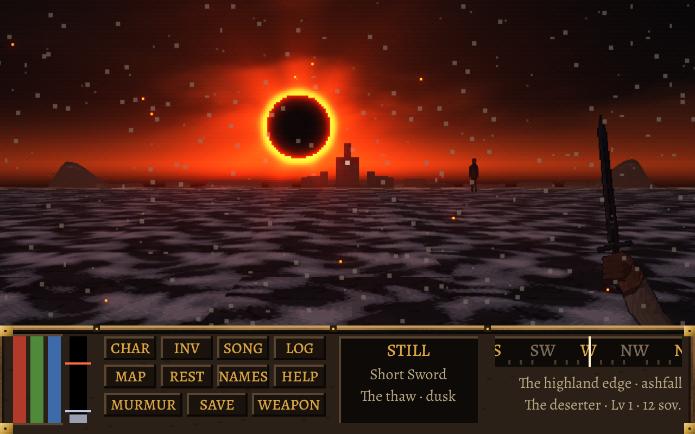
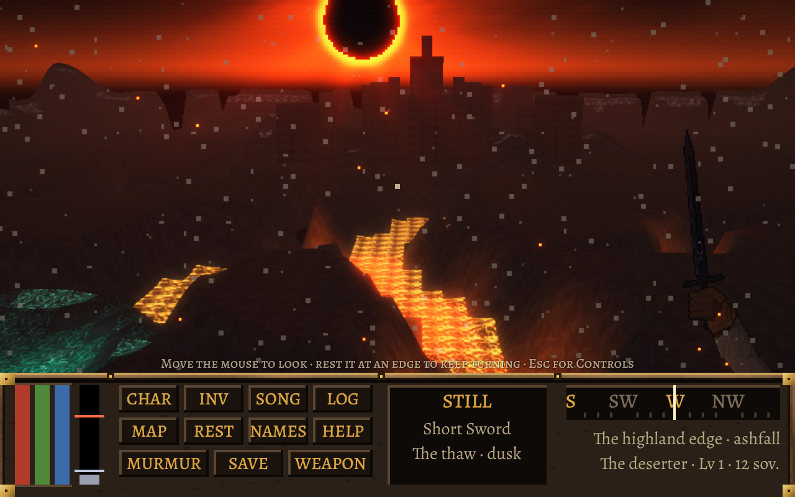
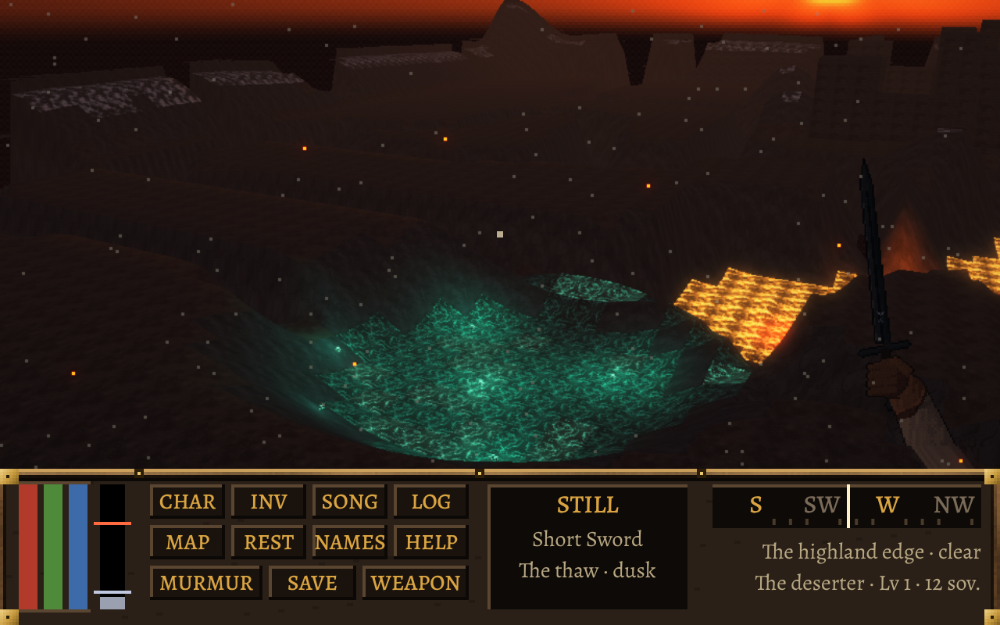
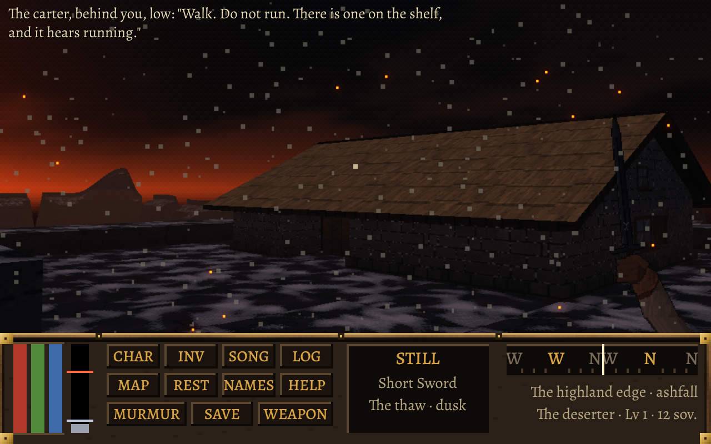
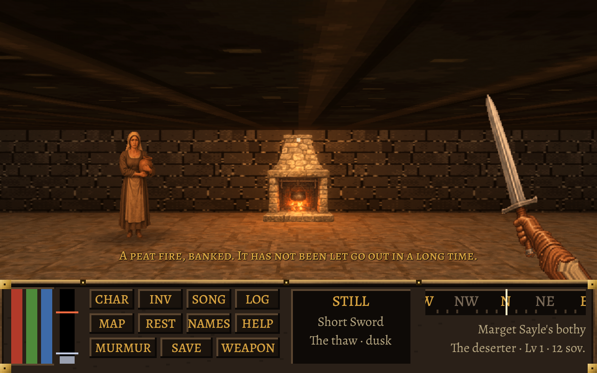
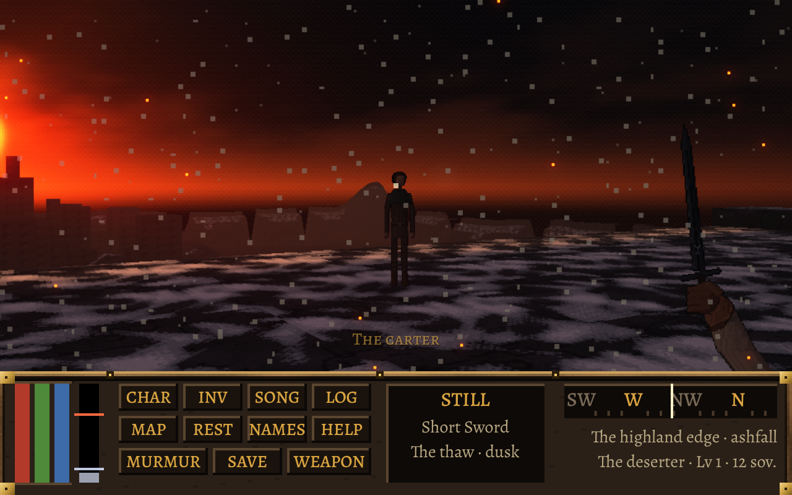
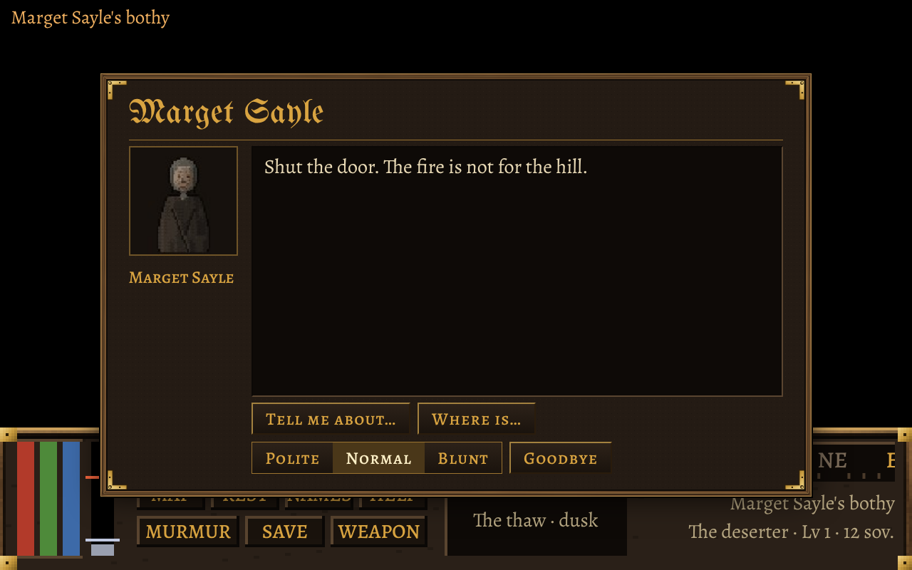
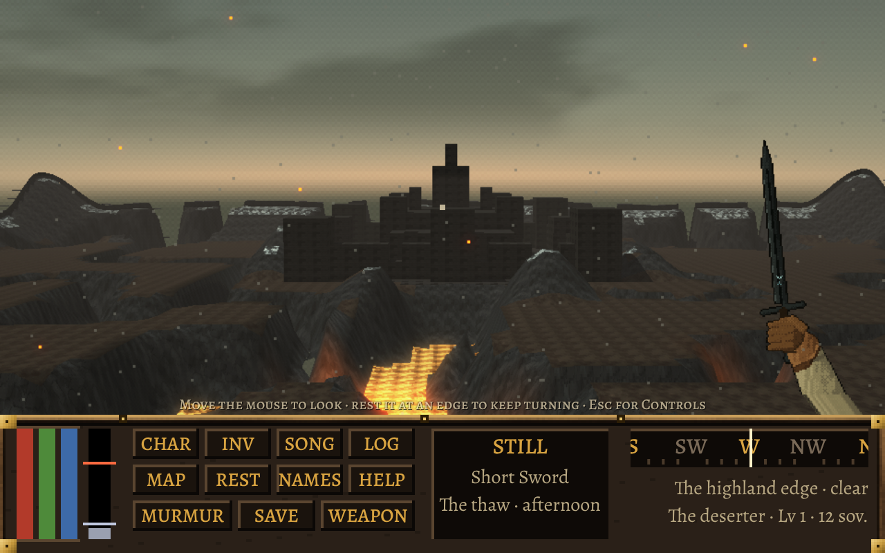
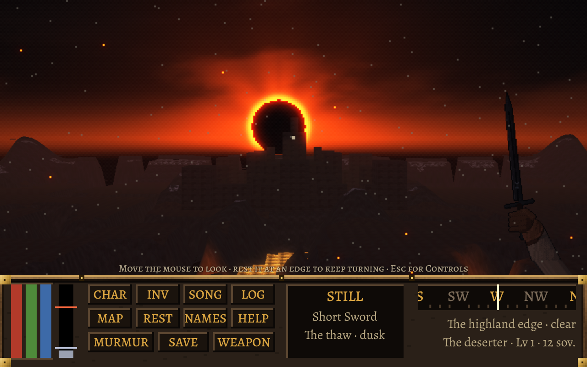

# The Long Account

A first-person game of dread in the world of Ashen Wilds, for one to four players, played in a web
browser. A small carrying company takes a dead kingdom's unpaid receipts, and one old woman who was
inside the Vaults, around a cold sea under a dimmed sun. No prophecy is coming.

**Status: the first place only.** You can stand on the prologue's ledge, look at the Slagcrown under
the coal sun, walk down to Marget Sayle's bothy and speak to her. Nothing hunts you yet, and nothing
of the story past that door is built. `ROADMAP.md` says exactly what is and is not here.

| | |
| --- | --- |
|  |  |
|  |  |
|  |  |
|  |  |

## Play

Once the owner has merged this and turned on Pages (Settings > Pages > Source: GitHub Actions), the
game is published from `main` to `https://dribblejerp-klunkdunker.github.io/Ashen-Wilds/`.

From source there is nothing to build or install. Serve the folder and open it:

    git clone https://github.com/dribblejerp-KlunkDunker/Ashen-Wilds.git
    cd Ashen-Wilds
    python3 -m http.server 8000        # then open http://localhost:8000

| Input | Action |
| --- | --- |
| W A S D | Walk |
| Mouse | Look (click the view first) |
| E or Space | Open a door, speak, read what is in front of you |
| Esc | Controls and Options |

Options, under Graphics & access, has a switch for each thing this game draws on top of the engine:
the coal sun, ash and embers, burning ground, the sun's day.

## What is in the build

- **The ledge** on Orlen's highland edge: frosted rock fourteen up, a cliff you cannot step off, a
  ramp down to a shelf.
- **The country of the key painting, as a map you could walk:** the cracked highland with fire in the
  beds of its cracks, a canyon running west, the teal hollow of the bloom, and the Slagcrown on its
  rise, with the far rim behind.
- **The sun's day.** The sun crosses the sky and has three faces: the coal sun on the worst days, a
  pale coin behind the ash on most, and on some days a clear noon with real sunlight and shadows.
  Every dusk it goes down red behind the Slagcrown.
- **Marget Sayle's bothy:** field stone under a roof, one door, a banked peat fire. It is marked as
  the safe room, though nothing yet exists for it to be safe from.
- **Two people who can be spoken to:** the carter on the ledge, and Marget Sayle. Both are painted
  in code and move on the engine's rig.
- **No picture this repository did not make.** Every tile, person, thing, hand and icon is drawn by
  code here.

## What it is built on

The engine is the one written for *Echoes of the Shattered Octave* (same owner), copied in at that
game's commit `f2b3990` with its story and all of its pictures removed. It is plain JavaScript: no
framework, no bundler, no build step. `index.html` loads the scripts in order. Some wording inside
the engine is still that game's: the panel's buttons, its items, its credits screen. `ROADMAP.md`
lists all of it. `CREDITS.md` says where every file came from.

## Where things are

| Path | Purpose |
| --- | --- |
| `index.html` | The page. Loads every script in order, each with `?v=N` |
| `js/fork0.js` | Phase 0: quiet stand-ins for the story hooks the engine still calls |
| `js/ledge1.js` | Phase 1: the ledge, the bothy, the coal sun, the ash, the words |
| `js/art2.js` | Phase 2: the tiles, the two people, the bothy's things, the hand and blade, painted in code |
| `js/sun3.js` | Phase 3: the sun's day |
| `tools/look/` | Look tests the page never loads: the walking bloom and the quarry-troll, modelled |
| `js/` (the rest) | The engine: the map, two renderers, light, weather, roofs, painted people, co-op |
| `sw.js`, `tools/pwa/precache.js` | Offline play, and the tool that rebuilds and checks its file list |
| `test/` | One test file per phase, and the shared browser harness |
| `tools/shots.js` | Writes the stills in `docs/screenshots/` |
| `tools/icons.js`, `tools/portraits.js` | Write the app icons and the dialogue portraits from the game's own art |
| `.github/workflows/` | The checks on every pull request, and publishing from `main` |
| `docs/worldbuilding/` | The world bible: the story folder. Start with `CANON.md` |
| `docs/worldbuilding/the-round-and-the-long-account.md` | The wider world, and this game's design |
| `ROADMAP.md` | Every phase, what is invented and awaits a ruling, what is not done |
| `CLAUDE.md` | How to work on this repository |

## Tests

    node test/fork0.test.js --no-browser
    node test/ledge1.test.js --no-browser
    node test/art2.test.js --no-browser
    node test/sun3.test.js --no-browser
    node tools/pwa/precache.js --check
    node tools/icons.js --check

    # the played half, in a headless browser (Playwright is not bundled)
    NODE_PATH=$(npm root -g) node test/fork0.test.js
    NODE_PATH=$(npm root -g) node test/ledge1.test.js
    NODE_PATH=$(npm root -g) node test/art2.test.js

A passing run says the land is the shape it should be, the cliff holds, the way down can be walked,
the door opens, the people answer, and the switches change the picture. It says nothing about how the
game feels: that needs a person at the controls.

## The games this replaced

Until 2026-11-11 this repository held Ashen Wilds, an isometric dark-survival game (owner decision
O5 in `docs/worldbuilding/CANON.md`). **All of its lore is kept** in `docs/worldbuilding/`. Its code
is on the branch
[`archive/isometric-prototype`](https://github.com/dribblejerp-KlunkDunker/Ashen-Wilds/tree/archive/isometric-prototype).
A one-day Godot look test of this game followed it and was dropped for the browser engine (decision
D14); it is in the history of this branch.
