# Ashen Wilds

**A grounded, isometric dark-survival action game built in Godot 4.3.**
Thirty years into the Smothering, you are a broken survivor scavenging the Blackfen Outskirts — every swing costs stamina, every gram in your pack is noise, and the dark belongs to things that don't need torches.

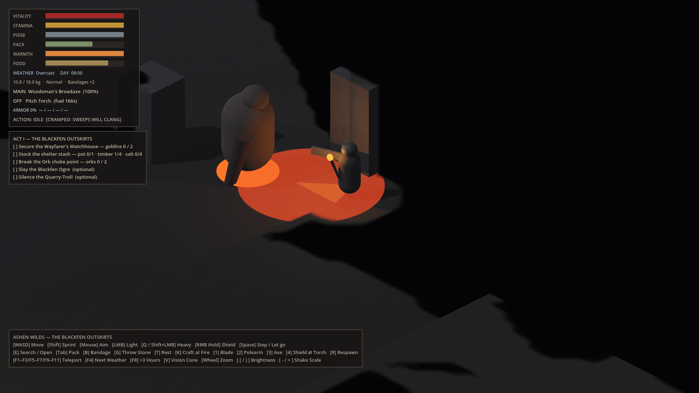

> **Status:** Milestones 1–11 complete · verified on Godot 4.3-stable (Forward+) · **272/272** headless regression checks passing
> Art is intentionally placeholder (primitive meshes, procedural audio) — systems first.

---

## Screenshots

| | |
|---|---|
| 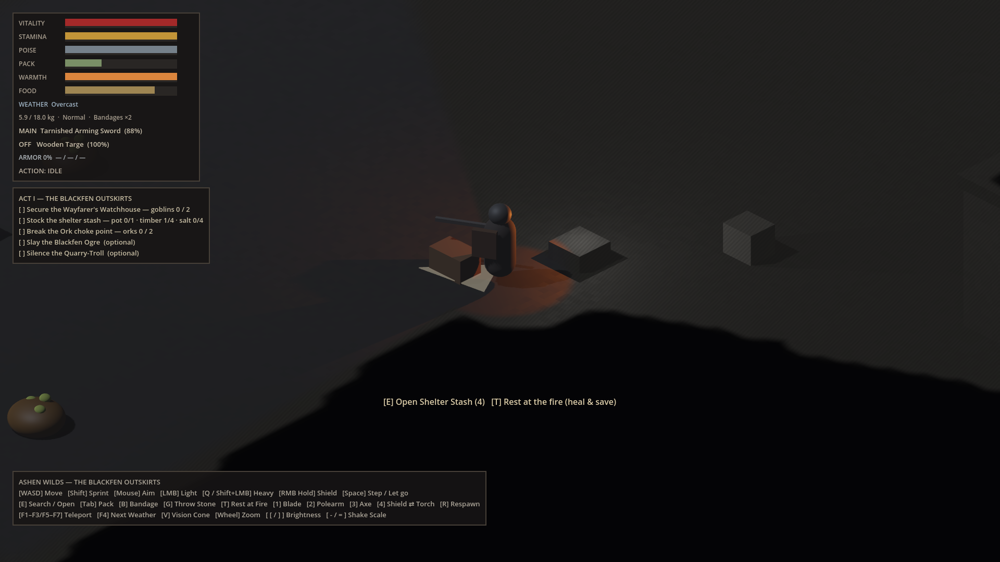 | 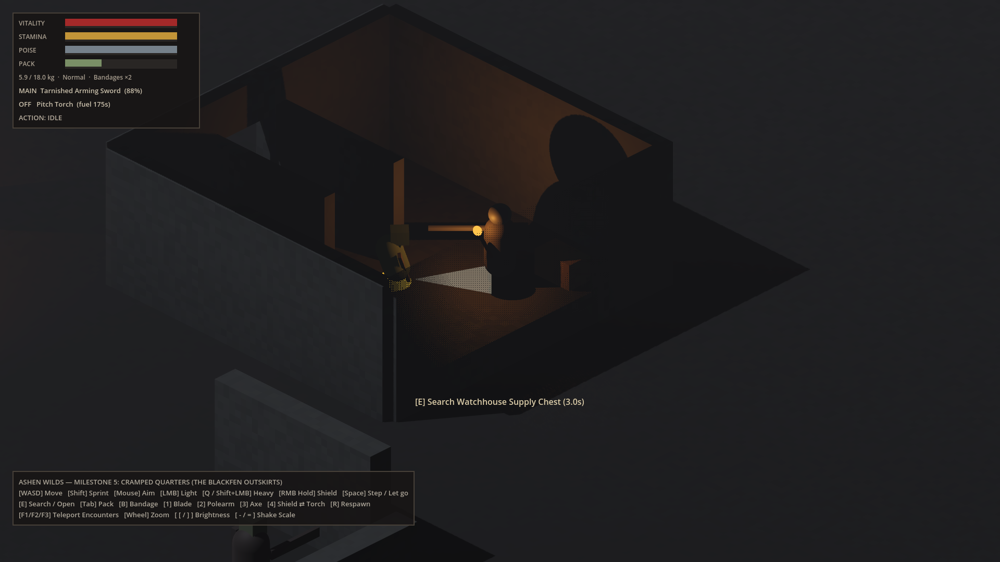 |
| **Shelter fire.** You start with a tarnished sword, a wooden targe and a stash you already know. | **Watchhouse by torchlight.** The roof hides when you step inside and foreground walls dither away around you. A goblin waits at the end of the entry hall. |
| 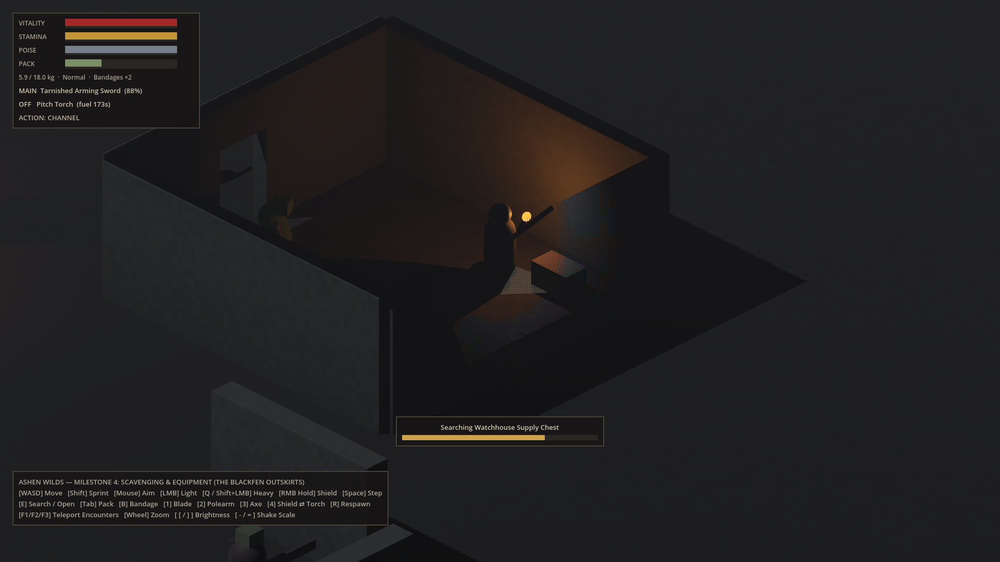 | 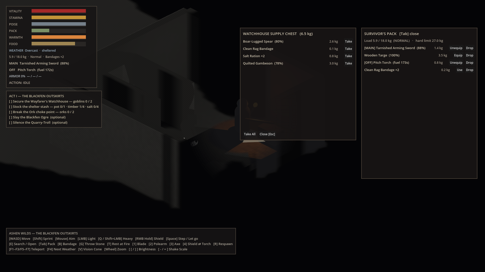 |
| **Scavenging is timed and interruptible.** Move, attack, dodge or get hit and the search is lost — and goblins hear you rummaging. | **Pack & loot windows.** Every item has weight and condition; the world keeps moving while you decide. |
| 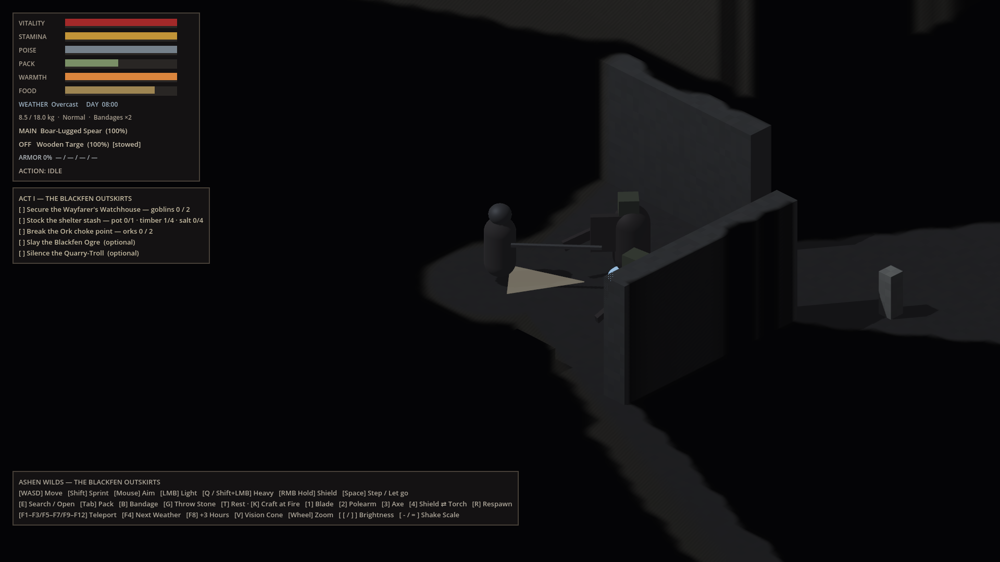 |  |
| **Ork choke point with a spear.** Two-handed grip stows your shield; narrow thrusts outreach the Ork's shield wall. | **The Blackfen Ogre.** Slow, enormous, and too wide for doorways. The red ring is its slam zone. |
| 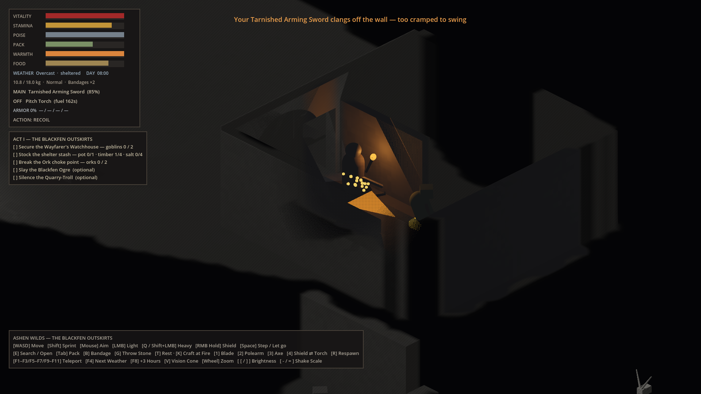 | |
| **Cramped quarters.** A sword slash in the 1.7 m entry hall clangs off the stone: sparks, a recoil stagger and triple wear. Indoors, thrust. | |

<sub>Rendered with the project's own `tools/capture_screenshots.gd` (software Vulkan under Xvfb) at in-game brightness +0.4. Enemies are frozen and posed for framing; time is slowed for the clang so the sparks survive the slow software frame rate.</sub>

---

## Premise

The Highland Citadels broke open the Deep-Seam Vaults hunting slag-iron and instead released ash-spores, goblin hordes, ork war-clans fleeing something deeper, and a volcanic winter called **the Smothering**. The kings fled south and burned the ships. No prophecy is coming. The people left in the Blackfen are stragglers, deserters and peasants trying to last until spring.

Act I (the current playable slice) is the **Blackfen Outskirts**: secure the ruined Wayfarer's Watchhouse, scavenge what the shelter needs to survive, and break the Ork choke point on the Old Causeway.

---

## What's in the game

### Combat core (Milestones 1–3)
- **Fixed isometric camera** — 45° yaw, −30° pitch orthographic rig with cursor peek, zoom, trauma-based shake, and brightness/shake accessibility controls.
- **Readable occlusion** — 4×4 Bayer-dithered cutaway on foreground walls, roofs that vanish when you're inside (with a shadow-only proxy so interiors stay dark), and **true line-of-sight enemy masking**: enemies behind walls aren't drawn, but you'll *hear* them.
- **Commitment-based melee** — explicit `STARTUP → ACTIVE → RECOVERY` attack phases, stamina with exhaustion, poise and stagger, directional shield blocking with guard breaks, an evasive step with i-frames, and bleeding.
- **Fair hit registration** — one hit per target per swing, and swings can't pass through walls.
- **Three enemy archetypes**
  - *Goblin Scavenger* — flanks, retreats when hurt, hears footsteps, causes bleeding.
  - *Ork Vanguard* — advances behind a shield, punishes button-mashing with a 2-hit combo; heavy attacks or flanking break the guard.
  - *Blackfen Ogre* — slow sweeps and telegraphed ground slams; its 1.70 m body physically can't fit the 1.35 m watchhouse doorway.
- **Encounter coordinator** — attack tokens and a readability gap so enemies take turns instead of swinging all at once.

### Scavenging & equipment (Milestone 4)
- **Timed, cancellable searches** of crates, chests and enemy corpses. Moving, attacking, dodging, pressing E again or taking a hit cancels the search; rummaging is audible to nearby goblins.
- **Carry weight** — an 18 kg pack. Over 75% you're *Burdened* (your pack clatters, so enemies hear you ~35% farther away, and dodges cost more). Over 100% you're *Overburdened* (no sprint, no dodge, slow). Nothing can be picked up past 150%.
- **Item condition**
  - Weapons wear per landed hit; damage tapers below 50% condition and drops to 40% when broken.
  - Shields wear when they block and **splinter** at zero — then they can't block.
  - The torch's condition *is* its fuel: it burns while lit, dims as it runs low, and gutters out.
- **Equipment switching** with a short, interruptible swap:

  | Weapon | Reach | Light | Heavy | Lodge | Notes |
  |---|---|---|---|---|---|
  | Tarnished Arming Sword | 1.65 m | 105° slash *(sweep)* | Lunging thrust, 45% bleed *(thrust)* | 15% | Reliable all-rounder |
  | Boar-Lugged Spear | 2.45 m | 25° thrust *(thrust)* | 150° shaft-sweep, steps you back *(sweep)* | never | **Two-handed** — stows your off-hand |
  | Woodsman's Broadaxe | 1.55 m | 135° cleave *(sweep)* | Heavy cleave, 30% bleed *(sweep)* | 40% | Hits hard, slow to recover |

  *Sweeps clang off walls in tight spaces; thrusts don't. Lodging only happens on heavy blows that kill or stagger.*

  The hitbox is reshaped to each weapon's reach and swing arc. Off-hand: **Wooden Targe** (block) or **Pitch Torch** (light, no block).
- **Bandaging** is a 1.6 s channel that consumes a Clean Rag Bandage.
- **Pack & loot UI** — equip, use and drop from the pack; take items one at a time or all at once. Drops become ground piles you can pick back up.
- **World loot** — five containers, including the spear in the Watchhouse chest, the broadaxe in the Ork plunder pile, and the **Cast-Iron Cooking Pot** (an Act I objective) in the Ogre's bone heap. Every enemy leaves a searchable corpse.

### Cramped quarters (Milestone 5)
- **Wall & corridor deflection.** When a swing goes live, the game sweeps its arc at blade height. If a *sweeping* stroke would meet stone, it **clangs**: no damage, a 0.5 s recoil stagger, sparks, a metallic ring, and triple the usual wear. **Thrusts never clang.**
- **You're warned before you commit.** While a sweep would clang, your aim arc turns orange and the HUD shows `CRAMPED: SWEEPS WILL CLANG`.
- **The Watchhouse entry hall** is a 1.7 m-wide corridor inside the doorway: sword slashes, axe cleaves and the spear's shaft-sweep all clang there, while spear thrusts and the sword's lunge work.
- **Weapon lodging.** A heavy blow that kills or staggers can bite too deep (axe 40%, sword 15%, spear never: the boar spear's lugs exist to stop exactly that). You're rooted for a 0.35 s wrench, then recover. Mid-wrench you can:
  - **press Space** to let go and leap clear, leaving the weapon in the body; or
  - **get hit**, and it's torn from your grip.
  
  Either way the weapon stays where it lodged. Walk back and **work it loose** (1.2 s) to recover it, then fight on with fists or draw another weapon with 1–3.

### Cramped for everyone (Milestone 6)
- **Enemy swings clang too.** Every attacker runs the survivor's arc check. A clanged enemy swing deals no damage, throws sparks, frees the attack token, and leaves the enemy open. It counts as staggered, so a heavy blow can lodge.

  | Attacker | Stroke | Clangs? | Opening |
  |---|---|---|---|
  | Goblin Scavenger | hooked-knife stab | never — goblins are tunnel fighters | — |
  | Ork (combo opener) | 110° cleaver sweep | yes | 0.8 s |
  | Ork (combo finisher) | overhead chop | never | — |
  | Blackfen Ogre | 150° club sweep | yes, off pillars and walls | 1.1 s |
  | Blackfen Ogre | ground slam | never | — |
- **The Vanguard reads the walls.** When there's no room to sweep, the shielded Ork shortens its grip and opens with the overhead chop. The unshielded Ork Cleaver swings anyway, and you can bait it into the entry hall.

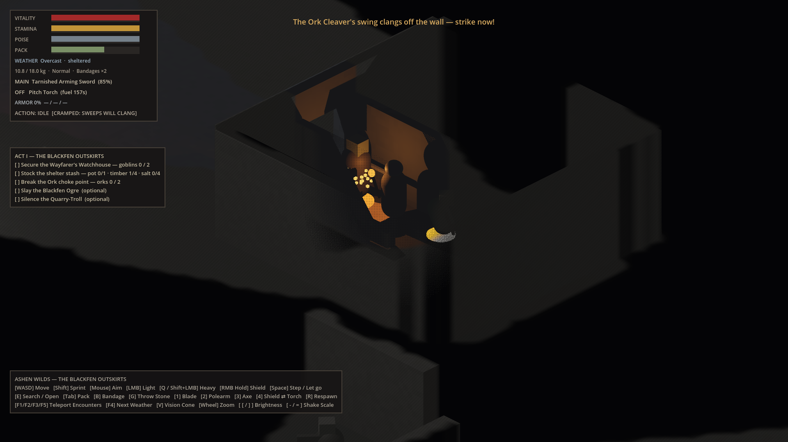

### Survivor backgrounds (Milestone 7)
A new game opens on **"Who were you before the Smothering?"** Pick one of eight survivors (click, or **1–8** and **Enter**). Each has a starting loadout, one **trait** and one **permanent flaw**. Respawning keeps both.

| Survivor | Starts with | Trait | Flaw |
|---|---|---|---|
| Citadel Deserter | sword, targe, torch, 2 bandages | **Shield Drill**: blocking costs 25% less stamina | **Bad Knee**: sprint 12% slower |
| Peat-Cutter | worn broadaxe, torch, timber, bandage | **Strong Back**: +5 kg capacity | **Bog Lung**: −15 max stamina |
| Boar Hunter | boar spear, torch, bandage | **Light Step**: walking is 40% quieter | **Old Goring**: −20 max health |
| Hedge Surgeon | worn sword, 5 bandages, salt | **Steady Hands**: bandage 45% faster, +10 healing | **Frail**: −10 max poise |
| Ferryman's Widow | sword, full torch, lamp oil, bandage | **Fire-Keeper**: torch burns 40% slower | **Grief-Worn**: stamina regenerates 15% slower |
| Vault Runaway | broadaxe, bandage | **Tunnel-Born**: clangs cost normal wear, recoil halved | **Ash-Lung**: you cough every 16–30 s, and goblins and Orks within 9 m hear it |
| Salt-Smuggler | sword, worn targe, 3 salt | **Light Fingers**: search 35% faster | **Shaking Hands**: swaps 50% slower |
| Disgraced Squire | pristine sword, targe, bandage | **Tourney Poise**: +12 max poise | **Soft Grip**: weapons wear 50% faster |

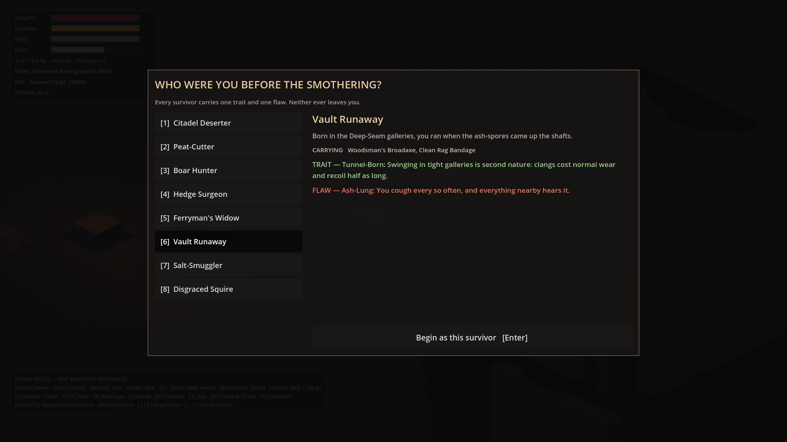

### Acoustic ripples & vision cone (Milestone 8)
- **You see what you face.** A 130° cone, 16 m deep, follows your aim. Enemies outside it, or behind a wall inside it, aren't drawn. Within 1.6 m you sense what's behind you.
- **Charcoal memory map.** Outside the cone the world turns to a dim, desaturated charcoal sketch, but only where you've looked before. Places you've never seen stay black, so the map fills in as you explore. Walls cast sight-shadows: the cone's rays stop at stone.
- **Acoustic ripples.** Every footstep, swing, clang, roar and slam is reported to a shared acoustic field. When you can hear a threat but can't see it, a dust-ring ripple spreads at its position, drawn over walls and roofs. Ripple size follows loudness and opacity follows distance.

  | Noise | Reach |
  |---|---|
  | Goblin footstep / swing | 4.5 m / 6 m |
  | Ork footstep / swing | 7 m / 8 m |
  | Any clang | 13–14 m |
  | Ogre footstep / sweep | 13 m / 12 m |
  | Ogre slam / roar | 18 m / 20 m |
- **V** toggles the cone and memory map (accessibility and debugging).

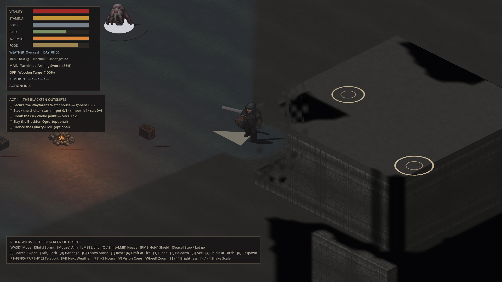

### Weather & atmosphere (Milestone 9)
The sky over the Blackfen changes every 2½–4 minutes. Each weather blends in over 8 seconds and is announced in a banner, and the HUD shows the current one. **F4** skips to the next. Weather changes four things: **sight** (fog, your cone's depth, enemy sight range), **hearing** (enemy ears and how far noises ripple), **fire** (torch fuel and light) and **footing**. Under the watchhouse roof you're *sheltered* from fire and footing effects, but fog, sound and miasma still get in.

| Weather | Sight | Hearing | Fire | Footing / other |
|---|---|---|---|---|
| Overcast | — | — | — | — |
| Ashfall | −25%, grey haze | ×0.8 | — | — |
| Miasma Fog | −50%, green murk | — | — | stamina regen −25% |
| Sleet | −15% | ×0.7 | torch burns 2× | sprint −10%, dodge +4 stamina |
| Cinder-Squall | −10%, ember glow | ×0.6 | torch +30% light | ember gusts shove you outdoors |
| Hoarfrost | +15%, crisp | ×1.25 | torch −20% light | ice: you slide when starting and stopping |
| Dead Calm | — | ×1.6 | torch burns 0.8× | — |

Ash, sleet, embers and frost glints are CPU-animated meshes around the survivor, and they don't fall through the roof.

| | | |
|---|---|---|
| 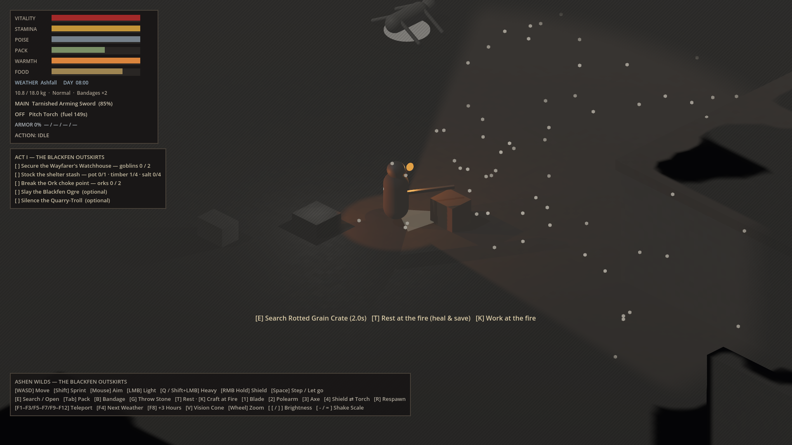 | 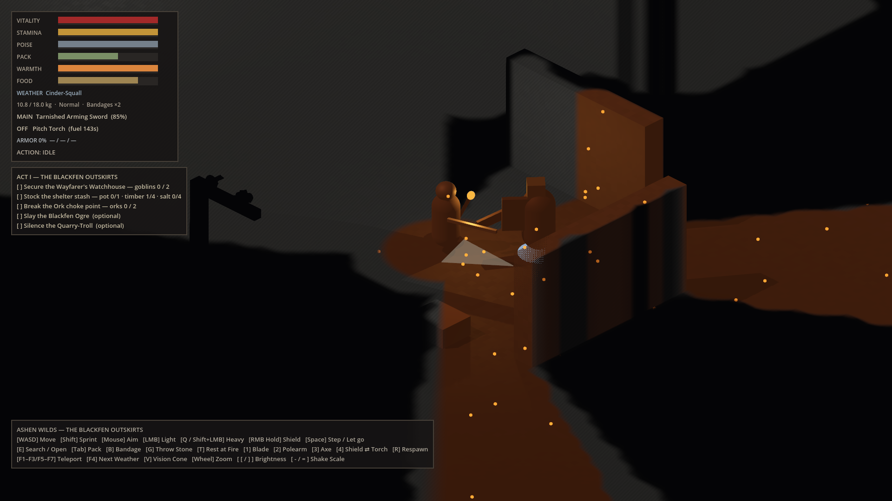 | 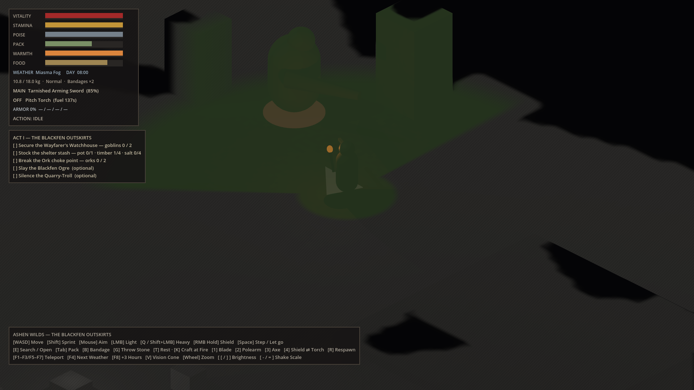 |
| **Ashfall** | **Cinder-squall** at the Ork choke | **Miasma** in the Ogre's lair |

### Enemy ears (Milestone 10)
Enemies hear what you actually do, through the same acoustic field that draws ripples, so weather affects their hearing too. **Walls muffle sound to 60%.**

| Your noise | Reach |
|---|---|
| Walking | 3.5 m (Light Step 2.1 m) |
| Sprinting | 9 m |
| Swinging | 9 m |
| Rummaging in a container | 4.5 m |
| Blocking a blow | 8 m |
| Burdened dodge | 6 m |

A burdened pack makes sprints, swings and dodges carry ×1.35. Goblins creep up to investigate where a sound came from, Orks advance on it shield-first, and a sleeping Ogre wakes up. Enemies ignore each other's footsteps but come running to a clang.

### The Blind Quarry-Troll (Milestone 11)
North-east of the watchhouse lies the **Old Quarry** (**F5**), a walled pit with one way in. The **Blind Quarry-Troll** lives there. It has no eyes, so darkness, the cone and walls don't hide you from it. Only silence does.
- **It hunts sound.** A faint noise makes it stalk toward the spot. A loud one (a clang, a swing, a thrown stone, a block) makes it charge. Once it reaches the spot it swings if you're there and feels around if you're not. A fainter new sound won't pull it off a louder fresh one.
- **Touch and pain give you away.** Come within 1.5 m of it and it swings, and any blow tells it exactly where you are.
- **Thick hide.** Light blows deal 35% unless it's staggered or recoiling. Its stone club clangs off the quarry walls, which is your opening.
- It drops a **Quarry-Troll Hide**.

**Thrown stones (G).** Throw a Fist-Sized Stone toward the cursor, up to 9 m. It thuds down with a 10 m noise and stays where it landed for you to pick up. The troll charges the thud, and goblins and Orks go to look **where it landed, not where you are**. You start with 3 in your shelter stash, and the Quarry Rubble Pile holds more.

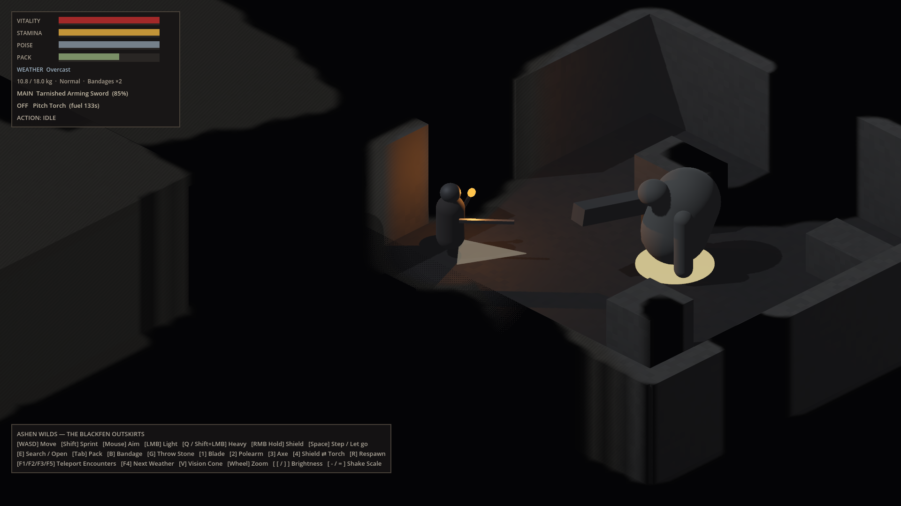

---

## Controls

| Input | Action |
|---|---|
| **WASD** | Move (camera-relative) |
| **Shift** | Sprint |
| **Mouse** | Aim |
| **LMB** | Light attack (tap again late in recovery to chain) |
| **Q** / **Shift+LMB** | Heavy attack |
| **RMB (hold)** | Raise shield |
| **Space** | Evasive step · let go of a lodged weapon |
| **E** | Search / open a container or corpse, or work a lodged weapon loose (press again to stop) |
| **Tab** | Open/close pack · **Esc** closes windows |
| **B** | Bandage a wound |
| **G** | Throw a stone (makes a noise where it lands) |
| **1 / 2 / 3** | Ready blade / polearm / axe |
| **4** | Swap off-hand: shield ⇄ torch |
| **F4** | Next weather (dev) |
| **V** | Toggle the vision cone & memory map |
| **R** | Respawn at the shelter fire |
| **F1 / F2 / F3 / F5** | Teleport to Watchhouse / Ork choke point / Ogre lair / Old Quarry (dev) |
| **Mouse wheel** | Zoom |
| **[ / ]** | Brightness down / up |
| **- / =** | Camera shake down / up |

---

## Getting started

**Requirements:** [Godot 4.3-stable](https://godotengine.org/download/archive/4.3-stable/) (standard build, not .NET). The project uses the Forward+ renderer, so you need a Vulkan-capable GPU.

```bash
git clone https://github.com/dribblejerp-KlunkDunker/Ashen-Wilds.git
cd Ashen-Wilds
```

Then open `project.godot` in the Godot editor and press **F5**, or run it from a terminal:

```bash
godot --path .
```

Everything — level geometry, enemies, UI, items, audio — is built in code at startup by `scripts/core/scene_bootstrap.gd`, so there are no assets to import.

### Running the tests

The game's systems are covered by a headless regression suite (no GPU needed):

```bash
godot --headless --path . --import          # first run only: builds the class cache
godot --headless --path . --script res://tests/smoke_test.gd
```

The process exit code is the number of failures (`0` = all passed). It covers spawning, the damage pipeline, the attack state machine, attack tokens, inventory stacking and weight, encumbrance, searching and every way to cancel it, equipment swaps and hitbox reshaping, torch fuel, durability and shield splintering, bandaging, dropping and picking up, the pack/loot UI, corpse loot, the world containers, which strokes clang where (per weapon, per stroke, hall vs. open ground vs. doorway), every lodging outcome (tug free, let go, torn free, work loose, and the cases that must *not* lodge), which enemy strokes clang (Ork sweep vs. chop, Vanguard discipline, Ogre sweep vs. slam, goblin stabs), every survivor's trait and flaw, what the cone can and can't see, exploration memory, when a noise does or doesn't make a ripple, each weather's effect on sight, hearing, fire and footing, indoors and out, what each enemy hears (and doesn't) through walls, the troll's hunting, hide and clangs, and thrown stones as lures.

> Headless runs print `Parameter "m" is null` and an "instances leaked at exit" warning. Both come from Godot's dummy renderer and audio driver, which are only used in headless mode — not from the game.

### Re-rendering the screenshots

```bash
# Linux without a GPU: needs Xvfb and Mesa's software Vulkan (mesa-vulkan-drivers)
xvfb-run -s "-screen 0 1920x1080x24" godot --path . --script res://tools/capture_screenshots.gd
```

On a desktop with a GPU, drop the `xvfb-run …` prefix.

---

## Project structure

```
CLAUDE.md                  Working notes for AI agents: Godot setup, verify steps, conventions
project.godot              Engine config, physics layer names
main.tscn                  Single root node → scene_bootstrap.gd
shaders/
  foreground_cutaway.gdshader   Bayer-dither wall/roof cutaway
  vision_memory.gdshader        Vision cone + charcoal memory map (full-screen pass)
scripts/
  core/       scene_bootstrap.gd (builds the level, input map, containers), procedural_audio.gd
  camera/     iso_camera_rig.gd
  combat/     hitbox / hurtbox components, encounter_coordinator.gd, swing_geometry.gd (shared clang arc check)
  data/       weapon_data, combat_payload, item_data, item_instance, item_database (all items + loot tables),
              survivor_background, background_database (the eight survivors)
  inventory/  inventory.gd (stacking, weight, encumbrance, equip slots)
  world/      lootable.gd (crates, corpses, ground piles), vision_cone.gd, acoustic_field.gd, acoustic_ripples.gd,
              weather_system.gd
  player/     player_controller.gd
  enemies/    goblin scavenger, ork warrior, ogre brute, quarry troll
  ui/         tactical_hud.gd, inventory_ui.gd, background_picker.gd
tests/
  smoke_test.gd            Headless regression suite (272 checks)
tools/
  capture_screenshots.gd   Renders docs/screenshots/
docs/screenshots/          README images (ignored by Godot via docs/.gdignore)
```

### How the pieces fit

- **Damage flow:** an attacker builds a `CombatPayload` and opens its `HitboxComponent` during the *active* phase. The hitbox finds overlapping `HurtboxComponent`s, rejects repeat hits and anything behind a wall (raycast), then calls `receive_attack()`. The defender decides whether it was dodged, blocked or taken.
- **Physics layers:** 1 Environment · 2 PlayerBody · 3 EnemyBody · 4 PlayerHurtbox · 5 EnemyHurtbox · 6 Occluders (roofs).
- **Items:** `ItemData` is the shared definition (one instance per id, built in code by `ItemDatabase`); `ItemInstance` carries quantity and condition. `Inventory` holds instances plus the main-hand and off-hand slots — equipped items still count toward weight.
- **Timed actions:** searching, bandaging and equipment swaps all share the player's `CHANNEL` state, so they're interrupted by the same rules and drive the same HUD progress bar.
- **Deflection:** `WeaponData` marks each stroke as a thrust or a sweep. When a sweep goes active, `SwingGeometry.sweep_obstruction()` casts 3–9 rays across the arc against the Environment layer. A hit sends the attacker into `RECOIL` instead of opening the hitbox. Enemies call the same function for their sweeping strokes. For the player, the check also runs every frame while idle to drive the orange "cramped" warning.
- **Backgrounds:** a `SurvivorBackground` is a bag of modifiers (flat bonuses and multipliers that default to "no change"). `PlayerController.apply_background()` refills the pack and stores the modifiers, and each system multiplies by them where it already computes its value. With the background set to `null` you get the legacy loadout, which the tests use.
- **Vision:** `PlayerController.can_see_point()` is the cone test plus a line-of-sight ray, and enemies use it to decide whether they're drawn. `VisionCone` casts 96 rays across the cone every other tick into two byte grids over the 52 m yard: "visible now" and "seen ever". The `vision_memory` shader is a full-screen quad on the camera. It rebuilds each pixel's world position from the depth buffer, passes visible pixels through, and draws the rest as charcoal or black.
- **Weather:** `WeatherSystem` blends between profile dictionaries. Gameplay code asks `WeatherSystem.factor(node, "sight" | "hearing" | "torch_burn" | …)`, which returns the neutral value when there's no weather, or when the node is under a roof and the key is a fire or footing effect. It drives the fog, ambient and sun light, and the acoustic field's reach.
- **Noise:** emitters call `AcousticField.report(self, pos, reach, kind)`. Listeners connect with `AcousticField.listen()` and test `AcousticField.can_hear()`, which cuts the reach to 60% when a wall is in the way. Enemies hear the survivor (and any clang) that way, and `AcousticRipples` draws a ripple when the survivor hears something it can't see.
- **Lodging:** on a confirmed heavy hit, the player asks the target `is_dead()` / `is_staggered()` and rolls `heavy_lodge_chance`. A lodge enters the `LODGED` state; releasing the weapon spawns a `Lootable` with a "Work loose" verb at the body.

---

## Roadmap

Milestones 6–9 followed [`docs/ROADMAP.md`](docs/ROADMAP.md). Their numbers are first-pass proposals to be checked against the design document and tuned in playtests. Next candidates:

- Milestones 12–14 (planned in the roadmap): armor slots, Act I objectives and the shelter, save & load.
- Later: companions, the rest of the bestiary, Acts II–III.
- An art and audio pass, once the look is settled. See *Known limitations*.

---

## Known limitations

- Placeholder visuals: characters and props are primitive meshes; audio is synthesized at runtime.
- No save system yet; your pack is kept when you respawn.
- Only tested on Godot **4.3-stable**.
- The test suite checks game logic, not feel. Swap times, light levels, charcoal contrast, ripple readability, ice handling and UI layout still need hands-on tuning.
- Survivor, weather and noise numbers are first-pass proposals (see the roadmap). The design document has the final say.

---

*No license has been chosen yet; all rights reserved by the author until one is added.*
