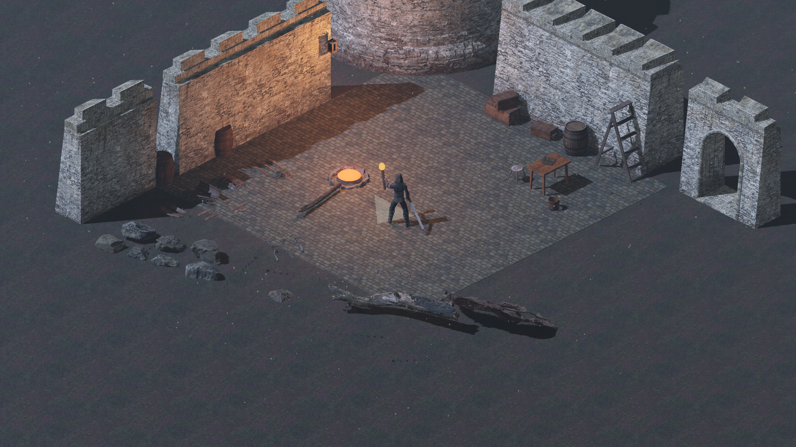

# Ashen Wilds: 3D quality benchmark pack

Reference 3D assets for the look in the owner's two target frames (a ruined, mossy keep in a fen at
dusk; a cobbled courtyard with mud, a plank shelter, a campfire and a lantern). They set the
**quality bar**: the surface detail, wear, scale and material setup the game's own assets should
reach. All are **CC0 1.0** from [Poly Haven](https://polyhaven.com) (no attribution required);
`benchmark_manifest.json` lists every asset with its page and triangle count.

A courtyard built only from these assets, inside the Godot game, under its moon, fog and torch light, at
the game's camera (rendered 2026-11-06).

**The files are not in git** (about 150 MB). `python3 tools/fetch_benchmark_assets.py` downloads them into
`assets/reference/benchmark/` (git-ignored), where Godot imports them for viewing in the editor.

## Contents

32 models (glTF 2.0, 1k textures) in `benchmark/models/`, 11 surface materials (1k PBR maps) in
`benchmark/materials/`.

| Model | Kind | Triangles | Stands in for |
|---|---|---|---|
| `modular_fort_01` | Structure | 28,218 | The ruined keep and curtain walls: 22 modular pieces (thick and thin walls, corners, a gate, a round tower, walkways, stairs). Real scale, 8.5 m high; scale to about 0.45 for our yard. |
| `large_castle_door` | Structure | 12,640 | The arched keep door (second image, right). |
| `stone_fire_pit` | Structure | 3,887 | The courtyard campfire ring (second image). |
| `wooden_barrels_01` | Prop | 33,142 | The barrel groups by the walls, with broken staves and lids for wreckage. |
| `wine_barrel_01` | Prop | 10,820 | A single standing barrel. |
| `wooden_crate_01` | Prop | 6,576 | Low crates under the shelter and by the fire. |
| `wooden_crate_02` | Prop | 5,176 | Long crates, stacked. |
| `wooden_bucket_01` | Prop | 5,116 | Bucket by the fire or the well. |
| `wicker_basket_01` | Prop | 22,276 | Small baskets on the shelter table. |
| `wooden_table_02` | Prop | 196 | The table under the plank shelter. |
| `wooden_stool_01` | Prop | 10,946 | Stool at the table or the fire. |
| `wooden_ladder` | Prop | 8,492 | Ladder against a wall or walkway. |
| `wooden_lantern_01` | Prop | 8,321 | The hanging wall lantern (both images); pair it with a warm OmniLight3D. |
| `kite_shield` | Equipment | 10,306 | Shield on the weapon rack; a quality bar for the survivor's targe. |
| `antique_estoc` | Equipment | 8,246 | A sword at weapon-rack quality; a bar for the arming sword. |
| `wooden_axe` | Equipment | 3,348 | Woodsman's axe; a bar for the broadaxe. |
| `hatchet` | Equipment | 5,250 | Hatchet by the woodpile. |
| `dead_tree_trunk` | Nature | 101,802 | Fallen dead trunk, thin. |
| `dead_tree_trunk_02` | Nature | 83,128 | Fallen dead trunk, thick, for the fen edges. |
| `tree_stump_01` | Nature | 41,046 | Stump (the chopping stump by the fire). |
| `tree_stump_02` | Nature | 62,345 | Stump with roots. |
| `root_cluster_01` | Nature | 225,261 | The tangled exposed roots at the water's edge (first image, right). |
| `root_cluster_02` | Nature | 339,641 | Low root mat over mud. |
| `pine_roots` | Nature | 162,693 | Roots spreading over the ground. |
| `dry_branches_medium_01` | Nature | 16,803 | Fallen dry branches. |
| `bark_debris_01` | Nature | 193,406 | Bark and wood litter on the ground. |
| `rock_moss_set_01` | Nature | 63,127 | Mossy rocks, a set of six. |
| `rock_moss_set_02` | Nature | 57,647 | Mossy rocks, a set of seven, lower. |
| `boulder_01` | Nature | 66,122 | A single large boulder. |
| `grass_medium_01` | Nature | 24,730 | Grass clumps; tint toward dry brown for the reeds and dead grass of the images. |
| `moss_01` | Nature | 204 | Moss patches for wall tops and stones. |
| `street_rat` | Creature | 57,216 | An ash-rat stand-in (the bible's bestiary): creature scan quality. |

| Material | Kind | Stands in for |
|---|---|---|
| `castle_wall_slates` | Wall | Mossy block walls of the keep. |
| `castle_brick_broken_06` | Wall | Broken, missing blocks for ruined wall tops. |
| `mossy_stone_wall` | Wall | Rubble stone walls with moss. |
| `mossy_cobblestone` | Ground | The courtyard cobbles (both images). |
| `grassy_cobblestone` | Ground | Cobbles going back to grass at the edges. |
| `brown_mud_leaves_01` | Ground | Mud with fallen leaves: the yard and path floor. |
| `muddy_tracks` | Ground | Rutted, wet mud with tracks and puddles. |
| `forest_leaves_02` | Ground | Fallen leaf litter. |
| `weathered_planks` | Wood | The shelter frame and boards, palisade stakes. |
| `roof_planks` | Wood | The shelter's plank roof. |
| `bark_brown_02` | Wood | Bark for logs and dead trees. |

## The quality bar these set

- **Physically based materials.** Every surface has albedo, a normal map (OpenGL convention,
  `nor_gl`) and an ARM map (ambient occlusion, roughness, metalness in R, G, B). In Godot that is an
  `ORMMaterial3D` (albedo, normal, ORM textures).
- **Real-world scale**, metres, Y-up. A crate is 0.8 m, a barrel 0.87 m, the fort's walls 8.5 m
  (scale those to about 0.45 for the yard, as the preview does).
- **Wear in the surface.** Moss in the cracks, chipped edges, grime, broken tops, uneven silhouettes;
  nothing reads as a clean box. This is the gap with the current kit.
- **Texel density.** 1k maps on props about a metre across, roughly 1,000 px per metre. At the game's
  camera (orthographic size 11.5 at 1080p, about 94 screen pixels per metre) 512 px per metre is
  already sharp, so 1k is headroom for zooming in.
- **Triangle counts.** Built props run 3k to 33k triangles. The nature scans (roots, bark, stumps,
  rocks) run 40k to 340k: they show the surface to aim for, not the budget. Decimate them to roughly
  5k to 15k with LODs before shipping anything like them.
- **Night palette.** The textures are daylight-calibrated. In the game's night they need tinting down
  to match the target frames: ground about 45%, stone about 60%, props about 72% (the preview uses
  exactly these).

## Not in the pack

No CC0 photoscans exist for these, so they still need making: reeds and cattails, standing water,
ivy, banners, palisade stakes, the plank shelter (build it from simple boxes with `roof_planks` and
`weathered_planks`), and sacks.

## Using them in Godot

Run `python3 tools/fetch_benchmark_assets.py` from the repo root. Godot imports each `.gltf` with its
textures. For a material, make an `ORMMaterial3D` with `*_diff_1k.jpg` as albedo,
`*_nor_gl_1k.jpg` as normal and `*_arm_1k.jpg` as ORM, and tile it in world space (triplanar).
