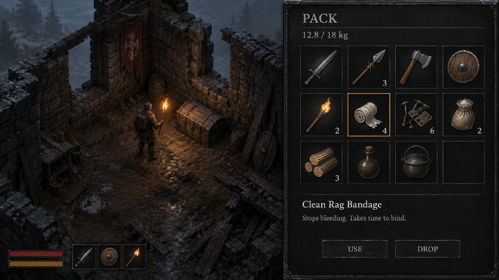

# Ashen Wilds — Visual Direction

**This is the owner's (sleeves) target for how the finished game looks.** Read it before any visual work: art integration, UI, lighting, VFX, new props or enemies. The reference images are in [`docs/art_reference/`](art_reference/). `docs/.gdignore` keeps them out of Godot's import pipeline, so they're reference only, not game assets.

The current primitive-mesh visuals are placeholders. Systems came first. A separate agent is producing the sprites.

---

## The target

`00_target_mockup.jpg` (the owner's "2901.png") is the north star. When in doubt, match it.

- **Camera:** high isometric view of a **ruined stone watchhouse**. You look down into a roofless interior with broken walls, a hanging red banner, scattered barrels, a heavy iron-banded chest, a leaning shield and collapsed timber beams.
- **Light:** night. A cold blue-grey ambient world with one **warm torch** in the survivor's hand throwing orange light onto wet cobbles and nearby stone. Light falls off fast, so most of the frame is near-black, readable silhouettes. Mist and dark pines sit beyond the walls.
- **Surfaces:** wet, worn, grimy. Mossy flagstones, puddles catching torchlight, rotten planks, mortar crumbling out of the stone.
- **The survivor:** small in frame, hooded and leather-armoured, holding a torch. A grounded human scale, not a heroic one.
- **UI (right panel):** a dark charcoal panel with a thin border and a serif title ("PACK"), weight shown as `12.8 / 18 kg`, and a **4-column icon grid** of square slots with stack counts in the corner. The selected slot has a warm gold border. A **detail pane** below shows item name, one-line description, and **USE / DROP** buttons.
- **HUD (bottom-left):** only two thin bars (red health, amber stamina) and **three quick slots** (weapon, shield, torch) as icons. Minimal; no text clutter.

## Style pillars

1. **Painterly, hand-rendered, dark fantasy.** Soft painted shading with crisp silhouettes. Think dark ARPG and grim survival, not pixel art and not cel shading.
2. **Muted, earthy palette.** Browns, iron greys, moss greens, bone, soot. Saturated colour is rare and meaningful: **fire orange/gold**, **blood red**, faded **heraldic red** cloth, occasional sickly **green** (rot, miasma, goblin skin).
3. **Everything is used and broken.** Chipped blades, rusted rivets, splintered shields, torn cloaks, crumbling walls. Every set has worn, damaged and broken variants. Use them for condition states (durability, splintering).
4. **Light is precious.** The world reads in darkness. Torches, braziers and campfires create the pools you can see in. This matches the vision cone, charcoal memory and torch fuel systems.
5. **Readable at small size.** Strong silhouettes and value contrast so enemies and props read at isometric scale and through the cone's edge.

## Reference sheets

| File | Contents | Maps to |
|---|---|---|
| `01_fire_light_weather_vfx.webp` | Torches, wall torches and braziers burning down to smoking stubs. Campfires and a cooking-tripod fire going from blaze to embers. Burning logs. Ember and spark sprays, ash puffs, dark smoke plumes, blue-grey mist wisps, rain/sleet streaks, splash rings, frost rings, warm ground glows, and fire light flares and halos. | Torch fuel (condition = fuel), the shelter fire, weather precipitation (sleet, ash, embers), cinder-squall gusts, impact effects |
| `02_flora_herbs_fungi.webp` | Flowers (white, yellow, red, bluebell, thistle), dried seed heads, mushrooms (brown, fly agaric, puffballs, shelf fungus), herbs and leaves, berry sprigs, reeds and cattails, small ground cover. | Ground dressing, future foraging/alchemy items |
| `03_bushes_reeds_rocks_ground.webp` | Bushes and shrubs (green, dry, thorny), reed beds, dense brambles, broad-leaf plants, mossy boulders, stumps with roots, logs and branches, bones, puddles. **Square top-down ground textures** (grass, dirt, moss) at the bottom. | Blackfen outdoor dressing; ground textures for the 3D ground plane |
| `04_tiles_props_items_characters_a.webp` | Iso ground tiles, stone wall blocks and arches, wooden fences, ladders, stairs, crates, chests, barrels, tables, beds, cauldrons, campfires, sacks, bottles, weapons, shields, banners, tents and carts. Rows of character figures: hooded survivors, green goblins/orks, skeletons, dark-skinned humanoids, a bear/boar. | Props and loot containers; early character concepts |
| `05_tiles_props_items_characters_b.webp` | A cleaner pass of sheet 04. **Item icons that match our item database:** arming sword, boar spear, broadaxe, round targe, rag bandage roll, iron scrap, salt sack, lamp-oil bottle, timber bundle, potion, cast-iron cooking pot, pitch torch. Character rows: survivor (hooded, leather), goblin, ork, skeleton, bear. VFX row: campfire, torches, embers, smoke, blood splats, dust pile, **clang starburst**, impact puff. | Inventory icons (direct 1:1 with current items), player and enemies, clang sparks, bleeding, ripples (dust) |
| `06_armor_clothing_shields.webp` | Great helms, nasal helms, hoods (brown, green, red), coifs/skullcaps, gambesons, brigandines, leather jerkins, mail, **cloaks in many colours** (brown, green, blue, red, grey, fur-trimmed), gloves/gauntlets, bracers, belts, boots, heater shields with damage stages, scarves and cowls, plus **full paper-doll armour sets on a figure**. | Armor slots (M12: padded hood, iron skullcap, quilted gambeson, riveted mail, leggings, greaves); armor visible on the survivor; future cloak slot |
| `07_enemy_npc_animation_sets.webp` | Animation strips in **4 direction blocks, about 5–6 frames each, plus a death/corpse frame**: green goblin, skeleton, dark goblin, **red-robed torch-bearing cultist**, spear goblin, **shield goblin**, ork with spear, grey ghoul, pale ghoul, black shade, and a **big bearded brute with club and shield** (ogre-tier). | Goblin Scavenger, Ork Vanguard (shield), Ork Cleaver, Blackfen Ogre candidates; corpses (searchable); future bestiary |
| `08_ruins_landmarks_debris.webp` | Ruined wall fragments, gothic arches, columns (whole, broken, fallen), gravestones and crosses, altars and sarcophagi, statues, **tattered banners on poles**, broken carts, fences, braziers and hanging cauldrons, dead trees, root tangles, collapsed roofs, timber debris, stone stairs, tables and chairs, rubble and **skull piles**, boulders and rock caves, standing stones, ground debris and cracks. | The Watchhouse ruins, the Ogre lair (bone heap), the Old Quarry (rubble, caves), landmarks |
| `09_modular_architecture.webp` | **Modular building kit:** stone wall segments with damage variants, pillars, arches and doorways, barred windows, wooden doors and panels, stone and wood floor tiles, stairs and ladders, slate roof pieces, timber beams and braces, palisades and fences, scaffolds and gallows, trapdoors and hatches, low walls and kerbs, ruined towers, chimneys. | Building the Watchhouse and future settlements; wall/roof cutaway targets |
| `10_item_icons.webp` | Large item icon set: rags, nails/scrap, locks, coins, pouches; potions (red, blue, green, amber), herbs, mushrooms; meat, fish, bread, cheese; keys, rings, amulets, teeth and claws; bones, feathers, **pelts and hides**; ingots, ores, coal; **timber bundles, rope coils**; tools (hammer, pickaxe, axe, shovel, chisel, knife, saw); pans, pots, kettle, bowls, mugs; lantern, candle, oil flask; whetstones and straps; traps; parchment, maps, scrolls, books; holy symbols, gems, ore heaps. | Inventory icons for every material and consumable, future crafting; Quarry-Troll Hide (pelt), throwing stones (rocks) |
| `11_weapons_shields.webp` | Daggers and knives; arming swords in **condition stages** (clean to rusted and broken); spears and polearms (long, snapped shafts); hand axes; flanged maces, spiked morning stars, nail-studded clubs, crude cudgels; bows, quivers, arrows, crossbows; pitchforks, glaives, bills, war-axes, scythes; round, heater and tower shields (plain, painted, studded, spiked, splintered); throwing knives; **fist-sized stones**; torches; **white and blood-streaked slash arcs**. | Arming sword, boar spear, broadaxe, wooden targe, pitch torch, throwing stone; durability states; swing and hit VFX; Ogre/Troll clubs; future weapons |
| `12_creatures_beasts.webp` | Mossy bog bears, black bear, rot-flesh bear, **horned bog-bull**, **antlered skull-faced deer**, black carrion crow (wings spread), hunched grey ghoul, **slime/rot mounds** (small to huge), vomiting rot-beast, pallid crawling horror, shambling corpses, spore-spewing fungus zombie, and a **huge mossy troll/ogre with a club**: animation frames, corpse frames, and **five face portraits** of the brute. | **Blackfen Ogre** and **Blind Quarry-Troll** (the mossy brute; eyeless variant for the troll); future bestiary; portraits for boss banners and dialogue |
| `13_water_marsh_tiles_vfx.webp` | Square **marsh ground tiles**: dark still water, water-to-mud shorelines, mud, moss-ringed ponds and puddles, reeds and grass standing in water, drowned debris. **Water flipbooks**: rain-drop rings and splashes, glints and reflections on water, foam and spray streaks, swirling eddies, wave-crest lines. **Blood spreading in water**, algae and lily patches, rocks in water, reed clumps. | The Blackfen marsh ground; sleet and rain splashes (weather); wet footing; water-ring variants of the acoustic ripples; bleeding into water |

## How to build it (technical direction)

**Keep the 3D world underneath, and swap only what you see.** Collisions, line of sight, wall clangs, the vision cone and charcoal memory, wall cutaways and saves all depend on real 3D geometry. Don't replace the walls with flat isometric sprites.

- **Characters, props, flora, items on the ground:** `Sprite3D` / textured quads standing in the 3D world, lit by the torches (not unshaded), with alpha-scissor shadows. Characters use direction-indexed frames picked from their facing relative to the camera.
- **Ground and walls:** 3D surfaces with **seamless painted textures** in this style (ground from sheets 03 and 13; stone, wood and slate from sheet 09), plus normal maps so torchlight rakes across stone like in the mockup. Walls keep the cutaway shader.
- **Camera:** tune pitch and zoom to match the art's projection. The art is drawn close to classic 2:1 isometric, roughly a −30° pitch, so it's near our current rig.
- **Lighting:** the sprites have light painted in. To sit under dynamic torchlight, each character and prop needs a **normal map** (or at least a light-direction layer), and the painted highlights should come from the upper left, roughly matching the moon/sun light.
- **VFX:** keep using tweened mesh/sprite flipbooks, not `GPUParticles3D` (see CLAUDE.md: particles don't render under software Vulkan). Sheet 01 strips are flipbooks.
- **UI:** rebuild the pack window as the mockup's icon grid + detail pane, and the HUD as two thin bars + three quick slots. Icons come straight from sheets 05 and 10.

### What's in the game now (interim art)

The sheets are cut and in use, so the game no longer waits on the final files:

- `tools/slice_sheets.py` cuts every sheet along its transparency into single sprites (1,791, in `assets/sheets/`, rebuilt on demand). Sheet 13 is opaque and isn't cut.
- `assets/art_map.json` names the cut used for each sprite, icon and texture. `--build` copies them to `assets/game/sprites/<key>.png`, `icons/<item_id>.png` and `textures/<ground|stone|wood>.png`.
- In game: the survivor and nine creature classes are torch-lit billboards (one frame, mirrored to their facing); the stash, chests, crates, sacks and campfire are props; every item has an icon; walls, timber and ground are triplanar-textured through the cutaway shader.
- Still primitive: the bog-bull, skull-deer, carrion crows and rot mounds (the sheet cuts are too small or merged with neighbours).

**Swapping in the art agent's files:** save each one over its `assets/game/` file (same name, transparent PNG, feet at the bottom edge), set its height in metres in `art_map.json` if it differs, and run Godot's `--import`. Nothing in the code changes. Direction frames and animation strips need a small addition to `FacingSprite` (pick a frame from the facing and the class's state); the list below still applies to them.

### What the art needs before it can go into the game

The sheets so far are AI-generated **contact sheets: small previews** (transparent, though they look white in a viewer). For the final art, the art agent should deliver:

1. **Full resolution.** On the sheets characters are about 60 px tall and icons about 40 px; in game, a character is about 150 px tall at 1080p and an icon is 64–96 px. Provide originals at 2× display size.
2. **Transparent PNGs**, one per sprite (or a fixed grid with a stated cell size). No white background: keying it out leaves halos on soft edges like smoke, fur and flames.
3. **File names matching item ids** (`arming_sword.png`, `boar_spear.png`, `riveted_mail.png`, …) and enemy class names.
4. **Characters:** 8 directions (or 5 mirrored) × the combat states the code uses: idle, walk, attack wind-up / strike / recovery, block, dodge, stagger, hit, death. Telegraphs are gameplay, so wind-up poses must be distinct.
5. **A foot/pivot point** per sprite and a **consistent scale** (survivor height 1.75 m = N px).
6. **Seamless tiling textures** for ground, stone, wood and slate, ideally with normal maps.
7. **Licensing:** confirm the generator's terms allow use in a shipped game.
8. **Where to put them:** committed to the repo under `assets/` (that ends the "everything built in code" rule for art, deliberately).

## Measuring progress: the visual benchmark

`docs/benchmark/` tracks how close each art pass gets to the mockup. [`REPORT.md`](benchmark/REPORT.md) has the latest run, the history and the rubric.

- `tools/visual_benchmark.gd` renders a fixed shot set the same way every time, with and without the HUD:
  - **B1:** the mockup's composition, night inside the watchhouse with a torch, plus a pack-open frame.
  - **B2:** the shelter fire at night.
  - **B3:** the marsh by day.
  - **B4:** a creature line-up.

  The vision cone's charcoal overlay is off, because the mockup shows the whole room. If the pack UI grows a `select_item(item)` method, B1 selects the rag bandage like the mockup.
- `tools/visual_benchmark.py` scores each world shot against the mockup's world area on eight readings of the style pillars: palette, darkness, light pool, torch pool, ambient share, ambient tint, saturation and surface detail. It also scores a hand-marked rubric of this doc's must-haves (`docs/benchmark/rubric.json`).
- Run it after every art pass, with a new run name so older shots stay: `.claude/skills/ashen-wilds-milestone/scripts/benchmark.sh 001-<what> "what changed"`. Then re-score the copied rubric and re-run the scorer.
- The numbers are a compass, not a judge. A high score with the wrong mood is still wrong, so look at the side-by-side too. Every reading also moves with overall brightness, and `detail` rises with grain or dithering, so treat a jump from a lighting or post-process change with suspicion.

The baseline (`000-baseline-placeholders`) measured 32/100, with a rubric of 7/100. Against the mockup's world, its night shots are:
- **Too black:** 99.9% of the frame is near-black, against 88.6%.
- **No visible ambient:** the mockup's dim blue-grey stone and ground cover 21% of its frame, and ours cover 0%. Nothing reads outside the torch.
- **A small torch pool:** it covers 0.1% of the frame, against 1.7%.
- **About half the chroma.**
- **About 4% of the surface detail.**

The palette readings sit at 66–73.

## Current game → reference mapping (quick lookup)

| In game now (placeholder) | Use from the references |
|---|---|
| Survivor (capsule + sphere) | Hooded leather survivor (05, 04); armour layers from 06 |
| Goblin Scavenger | Green goblin, dark goblin (07, 05) |
| Ork Vanguard (shield) / Ork Cleaver | Shield goblin/ork, spear ork (07) |
| Blackfen Ogre | Bearded brute with club and shield (07), mossy brute (12) |
| Blind Quarry-Troll | Huge mossy troll with club (12), eyeless |
| Watchhouse walls, entry hall, roof | Modular stone walls, arches, slate roofs (09); ruins (08) |
| Old Quarry | Rubble, rock caves, boulders, broken stone (08, 03) |
| Ogre lair bone heap | Skull piles, bones (08, 03) |
| Containers (crates, chest, plunder pile) | Crates, iron-banded chest, sacks, barrels (04, 05) |
| Shelter fire | Campfire, cooking tripod (01, 05) |
| Torch light / fuel | Torch burn-down strip (01) |
| Sparks / clang | Clang starburst (05), slash arcs (11) |
| Ripples (dust rings) | Dust swirls, splash rings (01, 05) |
| Weather: ash, sleet, embers, miasma | Ash puffs, sleet streaks, ember sprays, mist wisps (01) |
| Inventory list UI | Mockup icon grid + item icons (05, 10, 06, 11) |
| Blackfen ground, puddles, marsh | Marsh tiles and water flipbooks (13), ground textures (03) |
