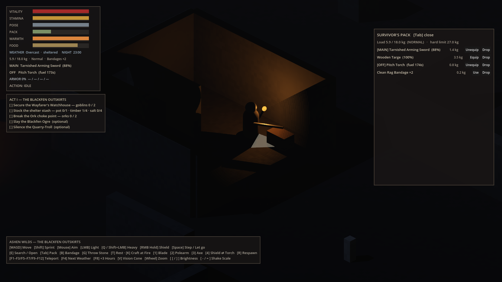

# Visual benchmark

How close the game's look is to the owner's target, [`00_target_mockup.jpg`](../art_reference/00_target_mockup.jpg) and [`VISUAL_DIRECTION.md`](../VISUAL_DIRECTION.md). Generated by `tools/visual_benchmark.py`; don't edit by hand.

**Latest run: `000-baseline-placeholders`** (2026-10-24): Baseline: placeholder primitives at Milestone 21

- **Measured: 32.4/100**: image metrics vs the mockup's world area.
- **Rubric: 7.4/100**: the doc's must-haves, scored by hand.

| Target | This run |
|---|---|
|  |  |

## Shots

| Shot | Overall | palette | darkness | light_pool | torch_pool | ambient_share | ambient_tint | saturation | detail |
|---|---|---|---|---|---|---|---|---|---|
| [Watchhouse at night (the mockup's composition)](runs/000-baseline-placeholders/b1_watchhouse_night_world.png) | **24** | 73 | 24 | 45 | 6 | 0 | 0 | 40 | 4 |
| [Shelter fire at night](runs/000-baseline-placeholders/b2_shelter_fire_night_world.png) | **25** | 69 | 24 | 43 | 4 | 0 | 0 | 53 | 4 |
| [The marsh by day](runs/000-baseline-placeholders/b3_marsh_day_world.png) | **41** | 66 | – | – | – | – | – | 49 | 8 |
| [Creature line-up (silhouettes)](runs/000-baseline-placeholders/b4_bestiary_lineup_world.png) | **40** | – | – | – | – | – | – | 63 | 17 |

Raw readings (target first, then each shot):

| | palette | darkness | light_pool | torch_pool | ambient_share | ambient_tint | saturation | detail |
|---|---|---|---|---|---|---|---|---|
| **target** | 0 (itself) | 0.886 | 30.1 | 0.017 | 0.214 | -3.77 | 4.58 | 6.09 |
| b1_watchhouse_night | 4.12 | 0.999 | 13.6 | 0.001 | 0 | none | 1.82 | 0.266 |
| b2_shelter_fire_night | 4.61 | 0.999 | 13 | 0.001 | 0 | none | 2.45 | 0.237 |
| b3_marsh_day | 5.1 | 0.995 | 8.44 | 0.004 | 0.072 | 2.72 | 2.23 | 0.513 |
| b4_bestiary_lineup | 5.7 | 0.974 | 38 | 0.016 | 0.112 | 4.41 | 2.89 | 1.02 |

### What each metric reads

- **palette**: Muted, earthy palette: Lab distance between the 8 dominant colours of shot and target.
- **darkness**: The world reads in darkness: share of the frame that is near-black (L* < 25).
- **light_pool**: Light is precious: how far the brightest 1% stands above the median (L*).
- **torch_pool**: Warm torchlight on a dark world: share of the frame that is warm-lit (b* > 12 at L* > 25).
- **ambient_share**: Silhouettes read in the dark: share of the frame that is dim but visible ambient (L* 15-50, not torch-lit).
- **ambient_tint**: A cold blue-grey ambient: mean b* of that dim, visible ambient (negative is blue); 0 if there's none.
- **saturation**: Saturation is rare and meaningful: mean chroma C*.
- **detail**: Painterly, worn surfaces: mean Laplacian of L* (surface detail).

Caveats: `detail` also rises with exposure and with film grain or dithering, and every reading moves with overall brightness. So compare runs rendered the same way, and treat a jump from a lighting or post-process change with suspicion. Scorer version 2; rows from other versions in the history aren't comparable.

## Rubric

| Pillar | Must-have | Score | Note |
|---|---|---|---|
| Painterly | The survivor is a hooded, leather-armoured painted sprite, small in frame, holding the torch | 0 | Capsule-and-sphere placeholder |
| Painterly | Enemies are painted sprites with distinct, readable silhouettes (goblin, ork, ogre, troll, beasts) | 0 | Primitive meshes; silhouettes differ by shape only |
| Readable | Wind-up poses read as telegraphs without the coloured status rings | 0 | Telegraphs rely on the coloured status rings and body tilts |
| Everything broken | Watchhouse walls are worn, crumbling painted stone with damage variants, not flat boxes | 0 | Flat untextured boxes |
| Everything broken | Ground is wet, mossy flagstone and mud that catches torchlight (puddle sheen) | 0 | One flat ground colour; no flagstone, moss or puddles |
| Everything broken | Props match the mockup: iron-banded chest, barrels, leaning shield, collapsed timbers, banner | 0 | Containers are plain boxes; no barrels, banner, timbers or leaning shield |
| Light is precious | One warm torch pool on cold blue-grey night, fast falloff, most of the frame near-black | 0.5 | A warm torch pool on a dark world with fast falloff is there; the cold blue-grey ambient and wet highlights aren't |
| Light is precious | Flames, embers and smoke are painted flipbooks (torches, braziers, the shelter fire) | 0 | Flames are emissive spheres; no flipbooks |
| Light is precious | Mist and dark pines beyond the walls | 0 | No mist or pines beyond the walls |
| Muted palette | Saturated colour only for fire, blood, heraldic red and rot green | 0.5 | Mostly muted, but the status rings add saturated colour that isn't fire, blood or rot |
| UI | PACK window: charcoal panel, serif title, weight line, 4-column icon grid with stack counts, gold selected border | 0 | The pack is a text list |
| UI | Detail pane: item name, one-line description, USE / DROP buttons | 0 | No detail pane; Use/Drop buttons sit on each row |
| UI | Painted item icons for every item id (sheets 05, 10) | 0 | No icons |
| UI | HUD is two thin bars (health, stamina) and three quick slots, bottom-left, no text clutter | 0 | Six bars and several text lines top-left, plus a key-help panel |

## History

| Run | Rendered | Scorer | Measured | Rubric | b1_watchhouse_night | b2_shelter_fire_night | b3_marsh_day | b4_bestiary_lineup | What changed |
|---|---|---|---|---|---|---|---|---|---|
| `000-baseline-placeholders` | 2026-10-24 | v2 | 32.4 | 7.4 | 24.0 | 24.8 | 41.0 | 39.9 | Baseline: placeholder primitives at Milestone 21 |

## Running it

```bash
xvfb-run -a -s "-screen 0 1920x1080x24" $GODOT --path . --rendering-driver vulkan \
  --script res://tools/visual_benchmark.gd -- --run=<name>
cp docs/benchmark/runs/<previous>/rubric.json docs/benchmark/runs/<name>/   # then re-score the must-haves
python3 tools/visual_benchmark.py --run <name> --label "what changed"
```
