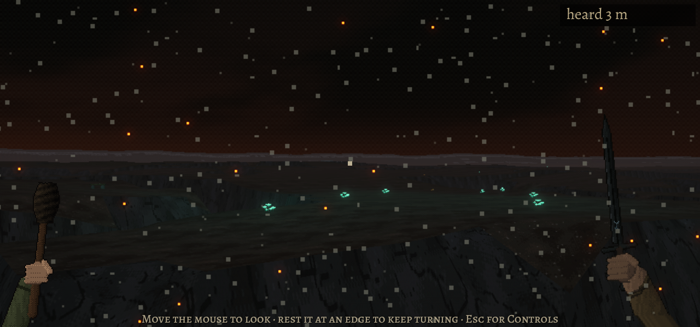

# Engine limits: how big one map can be (for O15)

Measured 2026-11-24 by `tools/limits.js`. Raw numbers: `docs/engine-limits.json`.

**The question.** CANON O15 rules that each region is one dense walkable zone of about a square mile. A cell is
about a metre of walking (P33), so a square mile is about 1600 x 1600 cells. This engine builds one static mesh per
map. How large can one map be?

**The short answer.** One map of 1600 x 1600 cells does not work in this engine as it stands: 20 million triangles,
1.3 GB of vertex buffers, a 5-second build, and about 40 ms of work every frame just checking whether the map has
changed. The largest single map worth using is **384 x 384**; **512 x 512** is the ceiling. A square-mile zone needs
either the renderer to load the map in pieces (chunks near you only), or the zone built as several connected maps of
at most 384 x 384. Details and trade-offs below.

## How it was measured

    NODE_PATH=$(npm root -g) node tools/limits.js                       # the five sizes, into docs/engine-limits.json
    NODE_PATH=$(npm root -g) node tools/limits.js out.json --sizes 96,160,256,384,512,768,1024,1600 --frames 20

For each size a fresh headless Chromium opens the game (`test/harness.js`), presses Begin, then builds a test map in
the page and loads it with the game's own `loadMap`. No game file changes; the test map exists only in that page.

The test map copies the ledge's recipe (`js/ledge1.js`): a height at every vertex, every cell sloped, cracks that drop
to embers, frost on the heights, a rock border, the ledge's eight floor tiles. At 96 x 96 it makes 72,166 triangles; the
real ledge, also 96 x 96, makes 71,972. So the test map is a fair stand-in.

Density, from O15 ("something to see, find or fight about every 30 to 60 seconds of walking") at 2.6 cells a second
(P33): one place every 115 cells on a jittered grid. The places take turns: a dry-stone hut with a roof the planner
finds, a door and a keeper; a ring of standing rock with a fire; a patch of bloom caps. Each has a light and three
things beside it. Between them, one deco in about every 120 cells of open ground. At 1600 x 1600 that is 196 places,
521 lights and 16,001 entities.

Recorded for each size:

- **Mesh build**: `R3D.mesh()` after the first frame (the first frame builds it), with vertices and triangles.
- **GPU buffers**: vertices x 48 bytes + indices x 4 bytes (`VSTRIDE` is 12 floats).
- **Frame**: `update(1/60)` and `render()` + `gl.finish()`, timed apart, 20 frames, median (and 95th percentile in the
  JSON), from two views: the middle of the map looking east, and a quarter in looking across the whole map.
- **Change check, light map, array check**: the three things R3D does over the whole map, timed alone (see below).
- **Memory**: the JS heap after a forced garbage collection, and the resident memory of every Chromium process.
- **Save**: `snapshotGame()` as JSON, the test map's share of it, and the save code (`encodeSave`, deflated), once as
  loaded and once with a circle of 24 cells round every place marked visited.
- A size that takes more than three minutes is stopped. None did.

Machine: a cloud box with two cores of an Intel Xeon at 2.1 GHz. The GPU is software: Chromium's ANGLE on Mesa
llvmpipe (the harness asks for SwiftShader; ANGLE chose llvmpipe). The 3D view renders at 1280 x 800.

## The numbers

The five sizes asked for, then three more to see where it breaks.

| Map | Cells | Entities | Lights | Mesh build (ms) | Triangles | GPU buffers (MB) | First frame (ms) | Frame, middle (ms) | Frame, across (ms) | update() (ms) | Change check, every frame (ms) | Light map, every frame (ms) | Array check, 2 a second (ms) | Snapshot JSON | Save code | Save code, explored |
|---|---|---|---|---|---|---|---|---|---|---|---|---|---|---|---|---|
| 96 x 96 | 9,216 | 44 | 1 | 48 | 72,166 | 4.6 | 71 | 2.8 | 1.6 | 0.2 | 0.2 | 0.0 | 1.1 | 6 KB | 3 KB | 3 KB |
| 160 x 160 | 25,600 | 129 | 1 | 129 | 202,214 | 12.8 | 169 | 2.8 | 3.0 | 0.3 | 1.0 | 0.1 | 0.6 | 9 KB | 3 KB | 3 KB |
| 256 x 256 | 65,536 | 364 | 9 | 247 | 520,144 | 32.9 | 302 | 4.2 | 2.5 | 0.3 | 0.4 | 0.2 | 0.8 | 17 KB | 4 KB | 5 KB |
| 384 x 384 | 147,456 | 876 | 24 | 389 | 1,173,450 | 74.1 | 434 | 4.7 | 4.5 | 0.5 | 2.8 | 0.3 | 1.4 | 36 KB | 7 KB | 9 KB |
| 512 x 512 | 262,144 | 1,609 | 41 | 773 | 2,088,852 | 131.8 | 853 | 7.8 | 5.3 | 0.4 | 3.5 | 2.7 | 2.1 | 63 KB | 11 KB | 14 KB |
| 768 x 768 | 589,824 | 3,708 | 129 | 1,461 | 4,706,014 | 296.8 | 1,566 | 13.6 | 17.9 | 1.2 | 1.5 | 2.3 | 6.3 | 140 KB | 22 KB | 31 KB |
| 1024 x 1024 | 1,048,576 | 6,544 | 216 | 2,495 | 8,371,764 | 527.7 | 2,631 | 17.0 | 933 | 1.8 | 16.3 | 3.1 | 10.0 | 245 KB | 36 KB | 49 KB |
| 1600 x 1600 | 2,560,000 | 16,001 | 521 | 4,827 | 20,453,272 | 1,288.7 | 5,194 | 975 | 932 | 2.7 | 39.5 | 11.2 | 24.1 | 605 KB | 84 KB | 116 KB |

Other columns, in the JSON: building the map in JS took 11 ms at 96 and 668 ms at 1600; `loadMap` itself under 50 ms
at every size; the game took about 5 s to open and press Begin each time. The JS heap held by the map stayed small
(13 MB at 1600, plus 37 MB of typed arrays), because the mesh's build arrays are let go once it is on the GPU. The
resident memory of the Chromium processes grew by about 60 MB at 256, 144 MB at 512, 337 MB at 768 and 571 MB at 1024;
at 1600 it read only 325 MB, which does not fit the trend, so treat that column as rough.

Small timings jump about from run to run (the change check reads 2.8 ms at 384 and 1.5 ms at 768 because the JIT
optimised it differently). Read the trend, not single cells. Per cell, the change check costs about 15 ns.

## What grows with the map, and why

All of these are in `js/r3d21.js`, the copied engine's WebGL2 renderer.

1. **The mesh is about 8 triangles and 9 vertices per cell**, because every sloped ground cell is drawn as 2 x 2
   quads so slopes shade smoothly. That is about 500 bytes of GPU buffer per cell: 1.3 GB at 1600 x 1600. It is one
   buffer, drawn with one call, every frame, all of it: there is no culling by distance or by view, and the far plane is
   set to 1.25 times the map's diagonal, though the fog closes at 120 cells.
2. **Any change to a cell rebuilds the whole mesh.** The build is about 2 ms per thousand cells here: 0.4 s at 384,
   0.8 s at 512, 5 s at 1600. That is a freeze the player sees if anything changes a block or a per-cell array while
   they walk.
3. **Every frame, R3D hashes every cell** to find out whether the map changed (`cellSig`): 40 ms at 1600 on this box,
   more than two whole frames at 60 a second before anything is drawn.
4. **Every frame, R3D clears and uploads a light map with one 32-bit texel per cell** (`frameLights`, which marks the
   cells each point light can reach): 10 MB a frame at 1600. Under software rendering this upload sometimes stalls for
   most of a second. A CPU profile at 1024 x 1024 put 1.16 s of 1.36 s of frame time in that `texSubImage2D`. It is
   why the "across" frames at 1024 and 1600 read about 930 ms, and why 384 and 512 show occasional 240 to 310 ms
   frames (95th percentile in the JSON).
5. **Twice a second, R3D hashes every per-cell array** (`arrSig`: heights, corners, floors, ceilings, side tiles):
   24 ms at 1600, a hitch every 30 frames.

What does *not* limit a square mile: `update()` (2.7 ms with 16,001 entities), the JS
heap, and saves. A square-mile map adds 600 KB to `snapshotGame()` and 84 to 116 KB to a save code, almost all of it
the entities. That is fine for one region, but it is per map and all maps go into every save, so ten regions would put
about 1 MB of save code into browser storage that this game shares with the Shattered Octave (one site).

## What software rendering cannot tell us

- **Real GPU speed.** llvmpipe runs the shaders on two CPU cores. A desktop graphics card draws 2 million triangles in
  about a millisecond; a phone's may take several milliseconds for the same. These frame times are a
  pessimistic GPU and say nothing exact about any real one.
- **Real GPU memory limits.** 1.3 GB of buffers is past what a phone or many laptops' integrated graphics will give a
  web page; the tab would likely lose its WebGL context or be killed. 130 MB (512) is likely fine on a desktop and a
  risk on older phones. Software rendering has no such limit, so it cannot show this.
- **How a real driver uploads the light map.** On a real card a 10 MB upload a frame costs bandwidth and may stall the
  same way; it may not. Only real hardware shows it.
- **Depth precision.** With the near plane at 0.02 and the far plane at 2,800 cells, distant ground and walls may
  shimmer (z-fighting) on a real 24-bit depth buffer. Nothing here looked for it.
- **The CPU numbers are real but this CPU is slow.** Mesh builds, the change check and `update()` are JavaScript and
  are measured truly; a desktop CPU is perhaps two to three times faster, and a phone is about like this box.
- **Feel.** A half-second freeze at a seam or a rebuild, pop-in, and how far a player wants to see: someone has to
  play it.

## Recommendation

**The largest single map worth using is 384 x 384** (1.2 million triangles, 74 MB of buffers, a 0.4 s build, a few ms
of whole-map checks a frame here). **512 x 512 is the ceiling**: it works on a desktop, but the per-frame checks reach
about 6 ms on this box before drawing anything, the build is 0.8 s, and it leaves no room for phones (the game has a
phone link). Anything larger should not be one map in this engine as it is.

For a square-mile zone, four ways, best first:

| Way | What it means | For | Against |
|---|---|---|---|
| **Chunks streamed inside one map** | One 1600 x 1600 map, its mesh built in pieces of about 64 x 64 cells; only pieces within about 150 cells of the player (the fog is at 120) are built and drawn; replace the three whole-map scans with dirty marks per piece and a light map that covers only a window round the player. | One seamless zone, exactly what O15 says. About 90,000 cells near you at any time, about 0.7 M triangles, whatever the zone's size. A change rebuilds one piece (about 10 ms), not the world. | Real work in `js/r3d21.js`, a copied engine file (CLAUDE.md: say so in ROADMAP). Pieces must be built while you walk without a hitch (a few per frame, or in a worker). Ground seen beyond 150 cells needs a cheap stand-in (the far country panorama, or a coarse distant mesh). The light, sleet and roof passes that read whole-map textures need the same windowing. |
| **Several connected maps** | Cut the square mile into maps of at most 384 x 384 (for example 4 x 4 of 400, or 3 x 3 of 512 for 1,536 cells a side), joined where a seam is natural: a pass, a gate, a stair, a bridge. Uses `transfer` and the bloom's `BLOOM4.DOORS`, as the bothy door does now. | Works today, no engine change. Each map stays in the comfortable range. Seams at real places can feel like thresholds, which suits the game's dread. | A half-second load at each crossing. You cannot see across a seam: a far map's places do not show (a painted far country can stand in). Hunters, the carter and co-op partners must be carried across seams by hand. Every map is in every save. |
| **A coarser cell** | Make one cell two metres, so a square mile is 800 x 800. | Fewer cells. | Breaks the game's measure: a person is one cell tall, doors and huts are sized in cells, P33's walking pace is in cells. Every phase's numbers would change. Not recommended. |
| **A smaller zone** | Make each region 384 to 512 cells a side (a quarter to a third of a mile) and squeeze its places tighter. | No engine work; O15 already says places are drawn closer than the atlas's miles. | O15 says not on the small side. A 512-cell zone walks edge to edge in about 3 minutes, against about 10 for a square mile. |

**Ruled** (O17, 2026-11-24, "I approve"): build regions as connected maps of at most 384 x 384 now, cut at natural thresholds,
so work on regions can start without waiting on the engine. In parallel, make chunked streaming a numbered phase in
`js/r3d21.js` (and the light, sleet and roof passes) with its own look and speed tests; when it lands, a region's maps
can be joined into one map with the seams removed. The zone sizes and squeeze ratio O15 asks for are still to be
ruled.

## Re-running

The tool takes about 5 minutes for all eight sizes on this box (most of it opening the game eight times). Re-run it
after any change to the mesh, the lights or the change checks, and on a real machine with a real GPU: locally, have `test/harness.js` launch Chromium with
`headless: false` and without the SwiftShader flags, and the frame columns will mean something about that card.
