# The zones: the world built at O15's scale

> Written 2026-11-24 for ruling O15 in `../CANON.md` ("the hybrid"). **Status: approved 2026-11-24 (O16).** Every
> zone size, squeeze, grid position, seam, rule and new site here was accepted ("i approve"); the **[PROPOSED]** marks
> below record what was invented here, not that it still waits. Wexhaven takes the standard zone size, its own extent
> inside the zone still unset. The atlas stays the true map: nothing here moves a place, changes a distance on the Chart, or
> settles anything the atlas leaves open. Read with `1-scale-and-distances.md` (the miles and the paces) and
> `../../engine-limits.md` (how big one map can be). The sketches are in `zones/`, drawn by `tools/zones.js`
> from the tables below; run `node tools/zones.js` after editing a table.

## What O15 asks, in cells

- **A cell is a metre** (P33), and the walker covers about **2.6 cells a second**.
- **"Something to see, find or fight about every 30 to 60 seconds of walking"** is one thing every **78 to 156
  cells** along the way a player walks. `tools/zones.js` measures every way in every zone below and fails if any
  stretch runs longer than 156 cells with nothing within 70 cells of it.
- **"Roughly a square mile"** is about 1,609 cells a side. The nearest size the engine can tile is **1,536 x 1,536**:
  four maps of 384 by four (0.95 of a mile a side, 2.4 square kilometres).
- **"Not on the small side"**: the three zones whose road is long (the Bell Road, the Causeway, the Citadels' rim)
  are drawn larger than a square mile, up to 1.8 square miles. None is smaller than 1,536 a side.

## The rules every zone follows [PROPOSED]

**Z-R1. The size.** A zone is 1,536 x 1,536 cells unless its section says otherwise. The eight zones of Orlen and the
four landfalls of the Round come to **about 13 square miles of walkable ground**, before the great complexes, which
add their own maps (Z-R3).

**Z-R2. How a zone is built.** `docs/engine-limits.md` measured one map: 384 x 384 is the largest worth using, 512 x
512 the ceiling. So a zone is built **now** as connected maps of at most 384 x 384 (the dashed squares on every
sketch), joined with `transfer` and `BLOOM4.DOORS` as the bothy's door is. Where a way crosses a map's edge, the edge
is put on a threshold the land already has: a bend through a cut, a bridge, a gate, a wall gap, a stand of reed.
When chunked streaming lands in `js/r3d21.js` (E2 in `ROADMAP.md`), a zone's maps join into one map and the seams go.
A reading of the engine-limits table, not measured: what grows with a map is its **number of cells** (the mesh, the
whole-map hash and the light map are all per cell), so a long thin map such as the King's Sluice under the Drowned Measures (about 1,600
x 30, 48,000 cells) costs less than one 256 x 256 map (65,536). `tools/limits.js` should be run on a
thin size before anyone relies on this.

**Z-R3. Great complexes stand at true size, in their own maps.** The atlas's scale (O10, rule 3) keeps built places
true: the Slagcrown's crown is half a mile across, Greystair a mile from gate to gate, Coldbarrow half a mile. A zone
holds the **outside** of a great complex, its approach and its gate; the inside is its own set of maps behind that
gate, as `la_bothy` is behind the bothy's door. Small built places (the Watchhouse, the Split Kiln, the Bell-Tender's
House, a grange-hold) are built in the zone itself, at true size. Sketches draw a complex as a black square at its
gate.

**Z-R4. Open country is squeezed, bearings are kept.** Between built places a zone draws the atlas's miles closer.
Each section gives its **squeeze**, as cells per atlas mile and as a ratio. The places keep their atlas bearings to
each other within about a quarter turn, so a player who knows the atlas is never lied to about which way a place
lies. Far landmarks keep their true bearing on the backdrop, drawn larger than true (O10, rule 5).

**Z-R5. A zone's days.** Walking a zone takes minutes; the road it stands for took days. So when the company leaves a
zone by a different threshold from the one it came in by, the Chart books the **atlas days of the road between those
two thresholds** (the walked-seam table below), and the food and fuel for them. Inside a zone the game's own clock
runs for light, weather and the hunt. Leaving by the way you came books nothing. This keeps the walk south at 28
days (O10).

**Z-R6. What counts as something.** Six kinds, each drawn its own way on the sketches:
**complex** (a great complex's gate), **atlas** (an atlas place built in the zone), **new** (a new small site, below
each zone), **gate** (a threshold to another zone, the Chart, or under ground), **hunt** (ground where a beast or a
band of the bestiary keeps: something to fight or flee), **way** (a wayside find or view).

**Z-R7. Wayside things are placed by hand.** A **way** row is one of a short list: a cairn with a cache under it, a
named or unnamed dead traveller with what they carried, a view of a landmark, a milestone or bench with words cut in
it, a broken cart or sledge, a mark left by people who live nearby. Each is placed and fixed by hand, never rolled
(CLAUDE.md: nothing visual uses live random numbers), and each shows something the atlas already says is in that
country. The list of kinds is **[PROPOSED]**; the individual rows add no new names.

**Z-R8. Landings on the Chart.** A Chart leg that the atlas gives a stop on (the White Trees on the Salt Trace, the
Lazaret Rocks at sea) can stop at a **landing**: one small map, at most 384 x 384, walked like a zone, with the leg's
remaining days still to pay.

## The zones at a glance

| Zone | Size in cells | Maps of 384 | Square miles | Squeeze (cells a mile) | Atlas places in it | New sites | Ways walked (cells): things on them, spacing, longest gap |
|---|---|---|---|---|---|---|---|
| Z1 The highland edge and the ledge | 1536 x 1536 | 16, and the ledge and bothy as they are | 0.9 | 85 to 110 (1:15 to 1:19) | 12 | 10 | 5426; 56 things, one every 85 on average, longest gap 152 |
| Z2 The Bell Road country | 1536 x 2688 | 28 | 1.6 | 26 to 30 along the road (1:54 to 1:62) | 22 | 7 | 6051; 58 things, one every 88 on average, longest gap 150 |
| Z3 The Watchhouse and the Causeway | 2688 x 1152 | 21 | 1.2 | 29 (1:55); the Watchhouse's ground true | 26 | 3 | 5719; 55 things, one every 71 on average, longest gap 155 |
| Z4 The Blackfen: the drowned middle, west and south | 2304 x 1536 | 24 | 1.4 | 35 to 42 (1:38 to 1:46) | 18 | 5 | 5943; 61 things, one every 84 on average, longest gap 153 |
| Z4b The Drowned Measures | 1536 x 1536 | 16 | 0.9 | 77 (1:21) | 16 | 3 | 4159; 42 things, one every 77 on average, longest gap 150 |
| Z5 The Salt Trace and the Downs | 1536 x 1536 | 16 | 0.9 | 24 down the Trace, 50 across (1:32 to 1:67) | 7 | 6 | 3539; 34 things, one every 91 on average, longest gap 154 |
| Z6 Wexhaven and the Burned Quay | 1536 x 1536 | 16 | 0.9 | not set: the archive leaves Wexhaven's scale open | 14 | 4 | 4260; 40 things, one every 89 on average, longest gap 155 |
| Z7 The Citadels and the north | 3072 x 1536 | 32 | 1.8 | 46 along the rim (1:35), 20 across the Scald (1:80) | 15 | 4 | 5935; 56 things, one every 89 on average, longest gap 153 |
| Z8a Port Sable and the Sable Shore | 1536 x 1536 | 16 | 0.9 | 28 (1:57) | 10 | 2 | 3377; 32 things, one every 84 on average, longest gap 151 |
| Z8b Saint-Aumere and the Wendle | 1536 x 1536 | 16 | 0.9 | not set by the atlas | 5 | 2 | 1513; 14 things, one every 95 on average, longest gap 155 |
| Z8c Sephar and the Garden of Hours | 1536 x 1536 | 16 | 0.9 | not set by the atlas | 4 | 2 | 1704; 15 things, one every 90 on average, longest gap 140 |
| Z8d Halsing and the White Deeps | 1536 x 1536 | 16 | 0.9 | not set by the atlas | 5 | 2 | 1591; 13 things, one every 106 on average, longest gap 150 |

The counts of places and the walked lengths are measured by `tools/zones.js`; each zone's section gives them.

The order is the road's: down from the ledge (Z1), down the Bell Road (Z2), along the Causeway (Z3), the fen's other
country off it (Z4) and the basin off the Bell Road (Z4b), down the Salt Trace to the Downs (Z5) and Wexhaven (Z6);
then the north, which the company may climb into from the ledge (Z7); then the Round by sea (Z8).

Z1, Z2 and Z3 touch: Coldbarrow's south road walks from Z1 into Z2, and the foot of the Bell Road walks from Z2 into
Z3. Z3 and Z4 touch along the fen, crossed only by the Corpseway and the dry ways, because "nobody crosses the drowned
middle of the fen in a straight line". Every other join is a Chart leg.

---

## Z1. The highland edge and the ledge

**Size:** 1536 x 1536 cells: 16 maps of 384, plus `la_ledge` (96 x 96) and `la_bothy` (7 x 6) exactly as Phase 1
built them (O6). The ledge's way down, the ramp, is the seam into the zone.

**What it stands for.** The uplands under the scarp's rim, from the Slagcrown's foot (scarp mile 34) east to
Greystair's lower gate (mile 50), and the upper road down to Coldbarrow, 18 miles and two days (`1-scale-and-distances.md`,
*The walk south*). The rim and everything on top of it is Z7.

**Squeeze.** About 110 cells to the mile east to west (1:15) and 85 north to south (1:19). Coldbarrow is a great
complex (half a mile across): its own maps behind its north gate, at the zone's foot.

**How you move.** The upper road is the spine: switchbacks, nothing on wheels (atlas). Off it, paths across the
warm slopes, where the danger is the ground and the still air in the hollows. The last climb goes up to the Slagcrown
(Z7), the Greystair branch east to its lower gate, and the ledge path back up to the bothy. The Iron Stair's foot is
in the zone's north-east corner.

**What hunts.** The walking bloom (O7) in the ledge's hollow and in the Bloom drifts. The ogre on the lower slope.
Quarry-trolls on the high ground. Ork packs coming down the road in silence this thaw. Goblins at the slag. Ash-moths
at any flame. Bees, which do not hunt.

**The rule.** `tools/zones.js` prints the numbers for this zone; they are copied under *Measured*.

### Places on the grid

| # | Place | x, y | Kind |
|---|---|---|---|
| 1 | The ledge (`la_ledge`) | 990, 140 | complex |
| 2 | Marget Sayle's bothy (`la_bothy`) | 1040, 110 | complex |
| 3 | The ramp foot: the ledge's way down | 1000, 250 | gate |
| 4 | Marget's peat bank [PROPOSED] | 960, 380 | new |
| 5 | The Greystair fork | 900, 520 | atlas |
| 6 | The Bloom drifts, the east hollow | 760, 380 | atlas |
| 7 | The flower ground | 620, 260 | atlas |
| 8 | The Warm Skeps [PROPOSED] | 650, 320 | new |
| 9 | The Boiling Stone [PROPOSED] | 570, 350 | new |
| 10 | The Slag Fall [PROPOSED] | 380, 150 | new |
| 11 | The last climb: to the Slagcrown (Z7) | 260, 60 | gate |
| 12 | The upper slope: to the Slagcrown's lower gate | 160, 90 | gate |
| 13 | The Bloom drifts, the west hollows | 300, 260 | atlas |
| 14 | The vent line | 330, 360 | atlas |
| 15 | Walking blooms among the flowers | 360, 480 | hunt |
| 16 | The lower slope: the ogre | 410, 560 | hunt |
| 17 | A miner's dead in the drifts, with a brass tag | 560, 610 | way |
| 18 | The Warm Shieling [PROPOSED] | 380, 760 | new |
| 19 | The edge of the venting slopes | 700, 700 | atlas |
| 20 | The crown seen whole from the road | 800, 610 | way |
| 21 | Ork packs coming down in silence | 740, 780 | hunt |
| 22 | The Listeners' Cairn [PROPOSED] | 760, 870 | new |
| 23 | The Hewers' Cross | 720, 960 | atlas |
| 24 | The tenth tower of the carrying line | 810, 1090 | atlas |
| 25 | The Downhill Den [PROPOSED] | 1050, 1000 | new |
| 26 | Quarry-troll ground | 1200, 1060 | hunt |
| 27 | The Dropping Place [PROPOSED] | 690, 1190 | new |
| 28 | The Ponies' Shelf [PROPOSED] | 830, 1290 | new |
| 29 | A cairn with a cache under it | 700, 1380 | way |
| 30 | Coldbarrow, its north gate (SOUTH painted inside) | 760, 1480 | complex |
| 31 | Coldbarrow's south road: on into Z2 | 760, 1530 | gate |
| 32 | Greystair's bloomery glow over the spur | 1100, 450 | way |
| 33 | A Company carrier dead with his heat-stones | 1200, 415 | way |
| 34 | Ork packs on the Greystair road | 1350, 360 | hunt |
| 35 | Greystair's lower gate (Z7) | 1500, 300 | gate |
| 36 | The Iron Stair's Foot (Z7) | 1490, 100 | gate |
| 37 | Quarry-troll on the high ground | 1230, 500 | hunt |
| 38 | The view of Kell Tor's black tarn | 1350, 560 | atlas |
| 39 | Wilmot's Fold [PROPOSED] | 1320, 780 | new |
| 40 | A dead pony still in its pack-straps | 765, 1335 | way |
| 41 | A hewer's spare boots set side by side on a wall | 760, 1240 | way |
| 42 | Goblins picking the Dropping Place over | 750, 1140 | hunt |
| 43 | Coldbarrow's roofs seen far below | 765, 1025 | way |
| 44 | Steam from a crack in the turf | 830, 450 | way |
| 45 | Slag lumps still warm to the hand | 475, 250 | way |
| 46 | A fallen stretch of field wall | 1000, 485 | way |
| 47 | Troll dung and a split boulder | 1275, 388 | way |
| 48 | Greystair's terraces seen stepping down the face | 1425, 330 | way |
| 49 | Frost stopping in a line where the warm ground starts | 630, 655 | way |
| 50 | An ogre's half-eaten kill | 485, 585 | way |
| 51 | A goblin's cache of bright scraps under a stone | 230, 175 | way |
| 52 | Bones of a sheep that sat down in a hollow | 395, 660 | way |
| 53 | An ork's dropped cleaver | 930, 1045 | way |
| 54 | Salt-licked stones on the den's spoil | 1125, 1030 | way |
| 55 | Kell Tor's crag shows over the ridge | 1335, 670 | way |
| 56 | The Iron Stair's black zigzag climbing into cloud | 1495, 200 | way |

### Ways

| Way | Kind | Points |
|---|---|---|
| The upper road | road | 760,1536 760,1450 700,1380 830,1290 690,1190 810,1090 720,960 770,830 700,700 900,520 |
| The last climb | track | 900,520 760,380 650,320 570,350 470,240 380,150 260,60 |
| The Greystair road | road | 900,520 1100,450 1300,380 1500,300 |
| The ledge path | track | 900,520 960,380 1000,250 990,150 |
| The slope path | track | 700,700 560,610 410,560 330,420 300,260 160,90 |
| The shieling path | track | 410,560 380,760 |
| The den path | track | 810,1090 1050,1000 1200,1060 |
| Wilmot's path | track | 1100,450 1350,560 1320,780 |
| To the Iron Stair | track | 1500,300 1490,100 |

### New small sites [PROPOSED]

- **Marget's peat bank** (4). A short black cut in the moss below the ramp where Marget Sayle digs the peat for her
  banked fire, a slane left standing in it and a stack under turf. *Why:* the bothy's fire is banked peat (people,
  Marget Sayle) and the highland edge builds under turf (O6); the peat has to come from somewhere near.
- **The Warm Skeps** (8). Straw bee-skeps on stone stools along the flower ground's warmest turf, set out by
  Slagcrown households before the Breaking; the bees live in them still and are out a month early. Honey and wax.
  *Why:* the atlas puts bees and early flowers on the venting slopes; skeps are the plainest reason bees would be
  kept there.
- **The Boiling Stone** (9). A flat stone over a vent where the water boils without a fire, a pot chained to it, and
  below it a hollow where someone sat down to rest and did not get up. *Why:* the vent line is "warm enough to boil
  water in places", and the Scald's rule (still air in hollows kills a walker who sits) holds here too.
- **The Slag Fall** (10). A fan of grey slag at the scarp foot, tipped over the rim from the crown's heaps for two
  hundred years; lumps of slag-iron in it that still take a fire and hold it. Goblins pick it over. *Why:* the crown's
  nine spoil heaps stand on the rim (atlas); slag-iron is the north's warmth (fact 2).
- **The Warm Shieling** (18). A roofless summer hut of dry field stone built over a vent crack, so its hearth never
  wanted peat. Nobody sleeps there twice: the air in it goes bad at night. *Why:* it builds the highland way (P16)
  and turns the slopes' gift and danger into one room.
- **The Listeners' Cairn** (22). A cairn by the road with a stone wrapped in felt on top, the listeners' sign that
  the quiet way runs here. Felt under it, left for whoever needs it. *Why:* listeners on the upper road "are seldom
  seen and see everyone" (atlas); they wrap what rings.
- **The Downhill Den** (25). An ork den in a spoil gully, its one opening facing downhill and away from the Citadels
  like every den from the Fold to the Slagcrown; empty this thaw, its plunder pile salt-licked. *Why:* the atlas's
  own evidence (*The edge of the Vaults*), shown, not explained.
- **The Dropping Place** (27). A bend of the switchbacks heaped with what the Citadel folk let fall walking out in
  S.1: a cradle, a loom frame, stove plates under the ash, a hewer's lamp numbered to the Slagcrown's lamp-room.
  *Why:* the Citadels emptied down this road on foot in S.1 (atlas), and Coldbarrow's gate says why: TAKE NOTHING
  YOU CANNOT CARRY WHEN THE CART BREAKS.
- **The Ponies' Shelf** (28). A resting shelf cut into the hill with iron tethering rings, pony bones, and a
  carrier's horn on a nail. *Why:* nothing on wheels gets up the upper road, so the iron went down it on pack animals.
- **Wilmot's Fold** (39). The shepherd Wilmot's dry-stone fold on the high ground east of the road, the one place
  on the edge from which Kell Tor's crag shows; on its gatepost, notches for every day he watched smoke on the crag
  in S.17. *Why:* Wilmot is in the lore (people, *The Slag-Lords and their houses*) and is the only one who saw it.

### Measured

Filled from `node tools/zones.js`: see the line for z1 at the end of this file.

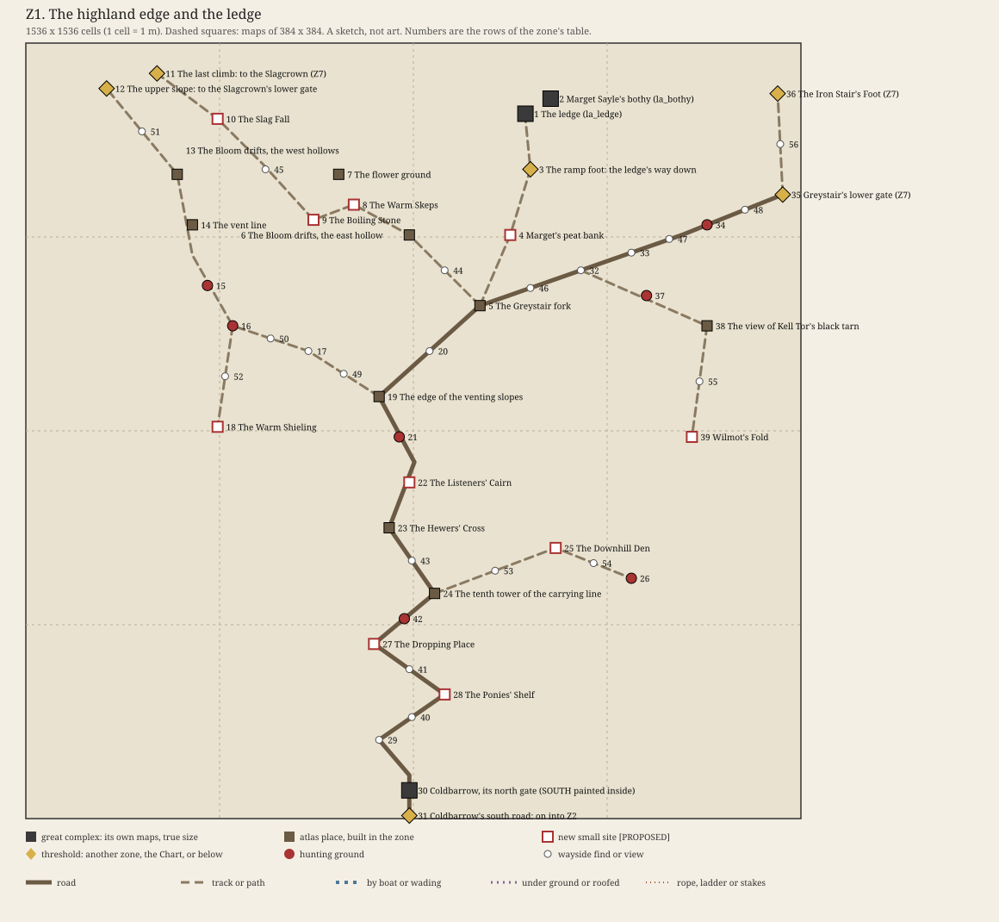

---

## Z2. The Bell Road country

**Size:** 1536 x 2688 cells: 28 maps of 384 (4 across, 7 down).

**What it stands for.** The Bell Road from Coldbarrow's south gate (road mile 80) down to its foot at the
Watchhouse (mile 0): seven days. Off it, the Rook's Stair branch, the drove road west to the Spiral Fold, and the
track east to Hollowmere Dam (`9-the-wilds-between.md`).

**Squeeze.** 30 cells to the road mile above the Roofed Mile (1:54), 26 below it (1:62). Across the road it is
squeezed harder (about 1:200), so that the Spiral Fold (four days west) and Hollowmere Dam (four days east) sit at
the zone's two edges. **The Roofed Mile** is drawn in the zone at a third of its true length, about 540 cells
[PROPOSED], because at the zone's squeeze it would be 30 cells and at true size it would be two-thirds of the zone's
height. It is roofed ground in the zone, not its own map, so its arches look out over the valley.

**Built.** Halwen House, Rook's Stair and Hollowmere Dam are great complexes, in their own maps behind their gates.
Everything else, Saint Vey's Fold included, is in the zone.

**How you move.** Down the road: a pale road in switchbacks between walls, a chapel tower every eight miles. The
sheep-track detour over the Roofed Mile, exposed and unsafe for a cart. Side tracks to the lodge in the birch, the
quarry, the dam and the fold. The bell towers are the way to find your way (*Kinds of place*: spires).

**The carrying line.** Eleven towers about eight miles apart (atlas). Counted from the fen as [PROPOSED]: the first
is Halwen's chapel tower (mile 12, a bell-beam and no bell, as the atlas has it), the fifth is the Bell-Tender's
House (46), the ninth is at Coldbarrow (80, in Z1), the tenth on the upper road (Z1, row 24) and the eleventh is
Greystair's belfry. Which four still hold a wrapped bell [PROPOSED]: the fifth (Edrin's, in its yard frame), the
second, the seventh and the tenth. The third, the sixth and the eighth have lost theirs; the fourth's lies broken in
its yard.

**What hunts.** Greymaw in the birch and on the drove road. The quarry-troll in the Split Kiln's cut and on the high
ground. The gravenback in Rook's Stair. The gallery-crawler in the Roofed Mile, from above. The ork pack in the
Fold's rear range, and packs coming south this thaw. Goblins in Halwen's culvert. People: the Remnant, the Grey
Lash, the Gutter Kin.

### Places on the grid

| # | Place | x, y | Kind |
|---|---|---|---|
| 1 | Coldbarrow's south road: from Z1 | 760, 10 | gate |
| 2 | The Bent Span and its warm gorge | 760, 120 | atlas |
| 3 | Quarry-troll on the high ground | 750, 190 | hunt |
| 4 | The eighth tower | 740, 280 | atlas |
| 5 | The Wether Bield [PROPOSED] | 790, 380 | new |
| 6 | Ork packs coming south in silence | 790, 430 | hunt |
| 7 | Saint Vey's Fold | 760, 480 | atlas |
| 8 | The seventh tower | 780, 540 | atlas |
| 9 | The Lime Fall [PROPOSED] | 770, 640 | new |
| 10 | The Roofed Mile, the north mouth | 760, 750 | atlas |
| 11 | The travellers' walls | 770, 870 | atlas |
| 12 | The gallery-crawler, in the roof-space | 770, 990 | hunt |
| 13 | The fifth pier: *We do not know his name* | 770, 1100 | atlas |
| 14 | The third arch, and the sheep | 765, 1180 | atlas |
| 15 | The Roofed Mile, the south mouth | 760, 1250 | atlas |
| 16 | Greymaw on the detour | 900, 800 | hunt |
| 17 | The sixth tower, on the slope above the arches | 960, 1000 | atlas |
| 18 | The arches seen from the detour | 900, 1200 | way |
| 19 | The Moth Barn [PROPOSED] | 780, 1350 | new |
| 20 | The Bell-Tender's House: the fifth tower, the quarry junction | 760, 1458 | atlas |
| 21 | The Stone Ruts [PROPOSED] | 950, 1400 | new |
| 22 | Rook's Stair, the upper gate | 1200, 1280 | complex |
| 23 | The quarry approach on to the Drowned Measures (Z4b) | 1500, 1120 | gate |
| 24 | A cut block abandoned in the ruts | 1350, 1200 | way |
| 25 | The Carriers' Pit [PROPOSED] | 740, 1590 | new |
| 26 | The fourth tower, its bell broken in the yard | 780, 1680 | atlas |
| 27 | The Split Kiln | 760, 1718 | atlas |
| 28 | A carrier's handcart on the dam track | 1000, 1650 | way |
| 29 | Greymaw in the dry spillway | 1250, 1560 | hunt |
| 30 | Hollowmere Dam | 1420, 1500 | complex |
| 31 | The Last Coach [PROPOSED] | 790, 1810 | new |
| 32 | The third tower | 740, 1900 | atlas |
| 33 | Darnel Cross | 760, 1978 | atlas |
| 34 | Greymaw in the birch on the drove road | 500, 1960 | hunt |
| 35 | A drovers' bield on the drove road | 250, 1900 | way |
| 36 | The Spiral Fold | 120, 1850 | atlas |
| 37 | The Halwen Stones [PROPOSED] | 740, 2050 | new |
| 38 | The second tower | 720, 2121 | atlas |
| 39 | Greymaw on the lower track | 600, 2200 | hunt |
| 40 | The Old Charcoal Lodge and its burning floors | 450, 2212 | atlas |
| 41 | The Last Gardens | 760, 2290 | atlas |
| 42 | Halwen House, the carriage drive | 900, 2320 | complex |
| 43 | The fen seen from the last rise | 770, 2450 | way |
| 44 | The Bell Road's first milestone | 760, 2570 | way |
| 45 | The foot of the Bell Road: on into Z3 | 760, 2680 | gate |
| 46 | A runner's message stone by the road | 770, 2380 | way |
| 47 | A pack saddle mended with copper wire, thrown down | 930, 900 | way |
| 48 | Greymaw where the detour crosses scree | 930, 1100 | hunt |
| 49 | The lower track's turning into the birch | 740, 2206 | way |
| 50 | Spoil heaps of grey quarry waste | 855, 1429 | way |
| 51 | The gravenback, ranging out of the quarry | 1075, 1340 | hunt |
| 52 | Benchwardens' chalk marks on a boulder | 1275, 1240 | way |
| 53 | The last firm ground before the Measures | 1425, 1160 | way |
| 54 | A broken wall of the kiln's fuel road | 894, 1680 | way |
| 55 | The dam's grey wall first seen across the valley | 1125, 1605 | way |
| 56 | The weep: water running where none should | 1335, 1530 | way |
| 57 | Drovers' marks cut on a gatepost | 630, 1969 | way |
| 58 | A stray ewe's fleece on the wire of an old fold | 375, 1930 | way |

### Ways

| Way | Kind | Points |
|---|---|---|
| The Bell Road, north | road | 760,0 760,120 740,280 790,430 760,480 780,640 760,750 |
| The Roofed Mile | under | 760,750 770,1000 760,1250 |
| The sheep-track detour | track | 760,750 900,800 960,1000 900,1200 760,1250 |
| The Bell Road, south | road | 760,1250 780,1350 760,1458 740,1590 760,1718 790,1810 760,1978 720,2121 760,2290 770,2450 760,2688 |
| The quarry branch | road | 760,1458 950,1400 1200,1280 1350,1200 1500,1120 |
| The dam track | track | 760,1718 1000,1650 1250,1560 1420,1500 |
| The drove road west | track | 760,1978 500,1960 250,1900 120,1850 |
| The lower track | track | 740,2190 600,2200 450,2212 |
| The carriage drive | track | 760,2290 900,2320 |

### New small sites [PROPOSED]

- **The Wether Bield** (5). A curved dry-stone windbreak where one of the last Bell Road flocks lay down together in
  a white winter and stayed; among the bones, a bell-wether's collar with no bell on it. *Why:* the uplands lost most
  of their sheep after S.0, and wether bells are rare and costly (Bellwether Yard).
- **The Lime Fall** (9). A hill where a lime carrier's wagon broke its axle, the sacks split, and the road has been
  white for a hundred paces ever since; carriers stop to scrape it up. *Why:* lime is the north's most needed thing
  after salt (*lime the dead or meet them*), and the Roofed Mile detour doubled what carriers charge for it.
- **The Moth Barn** (19). A roadside barn by the quarry junction where ash-moths winter on the beams in thousands
  and rise to any flame like snow falling upward. *Why:* the atlas puts the moths in the Roofed Mile; a barn half a
  day south gives them somewhere to go, and a reason to carry a light low.
- **The Stone Ruts** (21). The quarry branch worn into two ruts a hand deep by two hundred years of stone carts, and
  a dressed block left in them where a cart failed. *Why:* Rook's Stair cut the Slagcrown's halls and the Bell Road's
  chapels (atlas); the road shows the weight.
- **The Carriers' Pit** (25). A pit below the Split Kiln where the road's dead are limed, with a board of names nailed
  over it and lime thrown on every spring. *Why:* the kiln's lime "is worth as much for graves as for chimneys"
  (canon, fact 16).
- **The Last Coach** (31). A coach on its side in a cutting, its horses long eaten, its doors used as a family's
  walls one winter; a timetable in the coach matches the one on Darnel Cross's wall. *Why:* Darnel Cross keeps "a
  coaching timetable on the wall for a road nobody coaches" (atlas).
- **The Halwen Stones** (37). New-cut boundary stones along the road with the Halwen mark, *Possession has been
  resumed* chalked on each, and one knocked over. *Why:* the Remnant "claim the road for Lady Maudren Halwen"
  (atlas), and that is their words.
- (The first tower is Halwen's chapel tower, inside the complex; the line's numbering is above.)

### Measured

See the line for z2 at the end of this file.

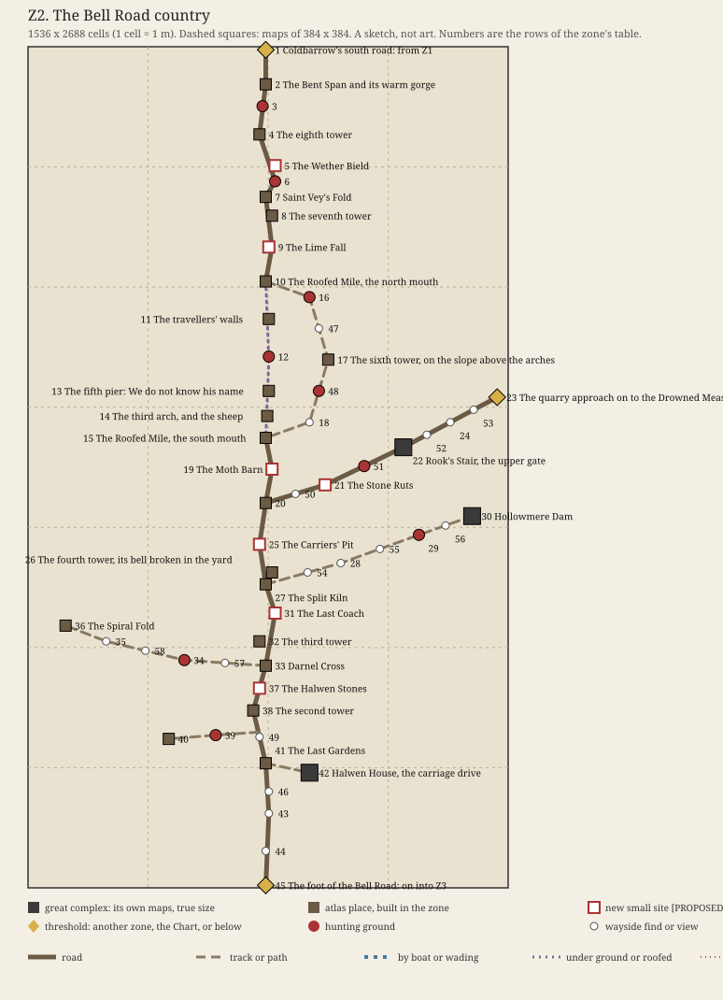

---

## Z3. The Watchhouse and the Causeway

**Size:** 2688 x 1152 cells: 21 maps of 384 (7 across, 3 down). Long, because the Causeway is a straight road
across water and its length is its danger.

**What it stands for.** The fen's north edge from Bellwether Yard (12 miles west-south-west of the Watchhouse) to
Brackenreach (60 miles east) and the burning east beyond it, with Moss Hythe (7 north) and Saint Ebbe's at Wick
Hollow off the road. Five days by the Causeway.

**Squeeze.** 29 cells to the mile along the Causeway (1:55). The Watchhouse and its ground (atlas, its thirteen
zones) are at true size: the yard is about 200 paces. The Causeway tower is a small complex: its yard in the zone,
its four floors and its culvert in their own map. The Drowned Lantern, Brackenreach and the Burning Bank's deep are
their own maps.

**How you move.** The Causeway: a bank a man's height over water on both sides, a leaning marker every mile (every
29 cells), a passing place every half mile, nowhere to go if something comes. North of it, firm ground and tracks.
South of it, water: the dry ways under the reeds (only with a stake-hand on the roster), and Edda's way round the
ork wall at low water. The Corpseway leaves the Watchhouse's west edge for Z4.

**What hunts.** Goblins in the Watchhouse drain. The ogre in the Long Stable. The blind quarry-troll in the Causeway
Delph. The Unnamed in the Drowned Graves. Walking blooms in Withy Bottom. The ork pack at the Fen Gate, until the gap
is broken. Greymaw at the passing places. Gallows herons. The band who call themselves Ashbound at the Drowned
Lantern. Ash-rats in the Burning Bank.

### Places on the grid

| # | Place | x, y | Kind |
|---|---|---|---|
| 1 | The foot of the Bell Road: from Z2 | 400, 10 | gate |
| 2 | The Watchhouse's smoke first seen | 395, 150 | way |
| 3 | A Watch signal cairn, cold, a cache under it | 392, 290 | way |
| 4 | The Moss Hythe turning, a peat sledge on its side | 390, 420 | way |
| 5 | A peat stack nobody burns | 470, 340 | way |
| 6 | Moss Hythe | 540, 260 | atlas |
| 7 | The gallows stump and the hard standing | 380, 560 | atlas |
| 8 | The Long Stable: the ogre | 260, 520 | atlas |
| 9 | The Causeway Delph: keep still | 290, 600 | atlas |
| 10 | The Outside Fire | 335, 640 | atlas |
| 11 | The Wayfarer's Watchhouse | 380, 660 | complex |
| 12 | The Roofed Gallery | 330, 700 | atlas |
| 13 | Withy Bottom (the Spore Hollow) | 250, 690 | atlas |
| 14 | The Naming Stone | 420, 700 | atlas |
| 15 | The Drowned Graves | 450, 780 | atlas |
| 16 | The drove's walled track and a hurdle gate | 200, 680 | way |
| 17 | Bellwether Yard | 80, 640 | atlas |
| 18 | The Corpseway's parish end, its stone cross | 320, 735 | atlas |
| 19 | The first pair of benches | 250, 850 | way |
| 20 | The second pair, a warning cut in it | 205, 990 | way |
| 21 | The Corpseway: on into Z4 | 180, 1145 | gate |
| 22 | The Fen Gate (the East Choke Point) and the plunder pile | 520, 700 | atlas |
| 23 | Edda's way round the ork wall | 560, 870 | atlas |
| 24 | The tower yard and the Causeway tower | 600, 690 | complex |
| 25 | The Cold Passing | 690, 700 | atlas |
| 26 | Stake-heads in the reeds | 700, 850 | way |
| 27 | A junction of the dry ways | 690, 1000 | atlas |
| 28 | The dry ways: on into Z4 | 690, 1145 | gate |
| 29 | The Three Swans, drowned | 820, 740 | atlas |
| 30 | The Leaning Team | 940, 705 | atlas |
| 31 | The Wick Hollow turning | 1080, 712 | way |
| 32 | A targe on a stake: the way to Saint Ebbe's | 1110, 560 | way |
| 33 | Saint Ebbe's at Wick Hollow | 1140, 400 | atlas |
| 34 | The Wayfarer's Rest, drowned | 1230, 735 | atlas |
| 35 | The Roll Stone [PROPOSED] | 1310, 715 | new |
| 36 | The toll house | 1400, 715 | atlas |
| 37 | The Spent Beacon [PROPOSED] | 1530, 715 | new |
| 38 | The inn with no name, drowned | 1650, 740 | atlas |
| 39 | Greymaw at a passing place | 1760, 718 | hunt |
| 40 | The band's boat on the old spur | 1900, 850 | way |
| 41 | The Drowned Lantern | 1910, 960 | complex |
| 42 | The Eel Weir [PROPOSED] | 2000, 760 | new |
| 43 | Gallows herons in the dead trees | 2120, 705 | hunt |
| 44 | The Causeway's last marker | 2200, 720 | way |
| 45 | Brackenreach, the Causeway's end and the old toll post | 2280, 720 | complex |
| 46 | The Salt Trace's mouth: the Chart (C1) | 2330, 780 | gate |
| 47 | Smoke out of the moss | 2400, 560 | way |
| 48 | The cutters' banks of the burning east | 2520, 450 | atlas |
| 49 | A fire-well: down into the Burning Bank | 2560, 420 | gate |
| 50 | A bench pair, a name cut fresh | 193, 1068 | way |
| 51 | The Drowned Lantern's tower seen over the water | 1880, 720 | way |
| 52 | Greymaw tracks on the hollow's rim | 1125, 480 | way |
| 53 | A stake driven by Edda's own hand, its head notched | 625, 788 | way |
| 54 | Brackenreach's tannery chimneys behind | 2340, 640 | way |
| 55 | Ash-rats round a fire-well | 2460, 505 | hunt |

### Ways

| Way | Kind | Points |
|---|---|---|
| The King's road's end | road | 400,0 390,200 390,420 380,560 |
| The yard | track | 380,560 380,700 450,780 |
| To the Long Stable | track | 380,620 290,600 260,520 |
| To Withy Bottom | track | 380,700 250,690 |
| The drove | track | 330,700 200,680 80,640 |
| The Moss Hythe track | track | 390,420 470,340 540,260 |
| The Corpseway | track | 320,735 250,850 205,990 180,1152 |
| The Old Causeway | road | 450,700 520,700 600,700 700,705 1000,710 1300,715 1600,715 1900,720 2280,720 2330,780 |
| The Wick Hollow track | track | 1080,712 1110,560 1140,400 |
| The old spur | water | 1880,720 1900,850 1910,960 |
| The dry ways | rope | 690,705 700,850 690,1000 690,1152 |
| Edda's way | rope | 450,780 560,870 690,705 |
| The cutters' track | track | 2280,720 2400,560 2520,450 2560,420 |

### New small sites [PROPOSED]

- **The Roll Stone** (35). A Causeway marker on which the Watch, over twenty-six years, cut the names of travellers
  found dead on the road between the tower and the toll house, with the year beside each. *Why:* the Watch "write
  down the dead" like everyone in the archive; the markers already carry numbers and horns (atlas).
- **The Spent Beacon** (37). An iron fire-basket on a cairn halfway between the toll house and the far reach, where
  the Watch lit a fire to call the next post; cold since S.29, with a bundle of dry fuel still lashed under it.
  *Why:* the Watch held the road from two posts (the tower and the toll house, atlas) and needed to signal along it.
- **The Eel Weir** (42). A fence of withies across a channel south of the road, its traps baited and emptied by
  someone nobody sees, like the boat at Low Harrow's market cross. *Why:* eels are the fen's food (Low Harrow,
  Brackenreach), and the fen is full of work done by hands nobody meets.
- **The Watchhouse's other edges** are the atlas's own (its thirteen zones). The Roll Stone and the Spent Beacon are
  the only new things on the Causeway itself, which is meant to feel long and bare between them.

### Measured

See the line for z3 at the end of this file.

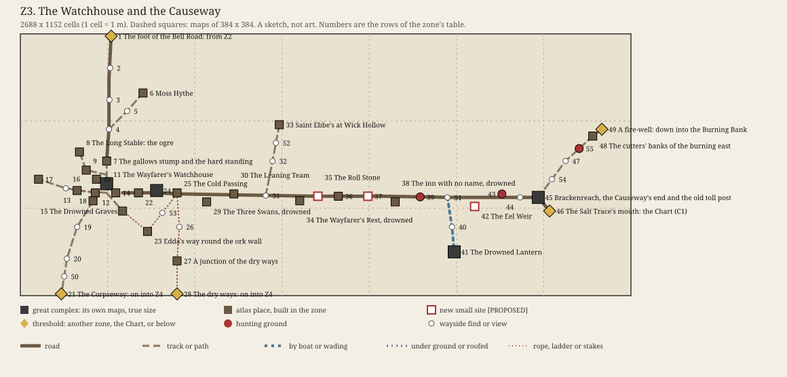

---

## Z4. The Blackfen: the drowned middle, west and south

**Size:** 2304 x 1536 cells: 24 maps of 384 (6 across, 4 down). It lies south of Z3, reaching about 700 cells
further west, so that the Corpseway and the dry ways run straight down out of Z3 into it.

**What it stands for.** The fen off the Causeway: the Corpseway west to Saint Orra's Steps (23 miles), Reedwake by
punt (12 more), Merewick, the Nine Stakes and the bargain road, Dunmere on its mere, Tavin's road station and Alder
Fold on the road south, Saint Leof's at Crake Ford, and the drowned middle with Low Harrow, the dry ways and Stakeby.
About 52 miles east to west and 43 north to south.

**Squeeze.** About 42 cells to the mile east to west (1:38) and 35 north to south (1:46). Saint Orra's Steps,
Dunmere and Low Harrow are great complexes (the rock and its galleries, the walled town and its Undercroft, a mile of
roofs), each in its own maps behind its gate or embankment.

**How you move.** Mostly not on foot. The Corpseway is a raised track with a pair of benches every mile (here every
35 cells: a road you can read). Reedwake is punt-only. The dry ways need a stake-hand on the roster and low water.
Merewick, the Nine Stakes and Dunmere are joined by kept roads at the fen's rising edge. Saint Leof's is reached by
the ford road and left by the ferry path.

**What hunts.** Greymaw following stretchers and loads. Harrow eels in every flooded room and hull. Bloodwicks in the
warm shallows. Gallows herons on posts and roofs. Walking blooms in Dunmere's Pit Ward. The Unnamed where a carried
body was left on a bench unnamed, and behind the Steps' Lower Door. People: the claims on any visible cargo.

### Places on the grid

| # | Place | x, y | Kind |
|---|---|---|---|
| 1 | The Corpseway: from the Watchhouse (Z3) | 880, 10 | gate |
| 2 | A bench pair, names cut close as writing | 800, 80 | way |
| 3 | The Weeping Bench | 650, 140 | atlas |
| 4 | The halfway shelter (the bier-house) | 600, 150 | atlas |
| 5 | The Penitents' Lime Cache [PROPOSED] | 500, 170 | new |
| 6 | Greymaw following a stretcher | 420, 185 | hunt |
| 7 | A bench where someone waits for a companion | 350, 200 | way |
| 8 | The last mile, on a bank across open water | 250, 240 | atlas |
| 9 | Saint Orra's Steps: the Foot Gate | 180, 280 | complex |
| 10 | The Withy Beds [PROPOSED] | 175, 380 | new |
| 11 | Harrow eels in a sunk hull | 175, 520 | hunt |
| 12 | Reedwake's cut: the leaning post, the empty bell bracket | 195, 640 | atlas |
| 13 | Reedwake: the Rows, the chapel barge, the bread posts | 230, 720 | atlas |
| 14 | Harrow eels in the reed channel | 400, 760 | hunt |
| 15 | The Eel Traps [PROPOSED] | 560, 800 | new |
| 16 | Merewick | 700, 830 | atlas |
| 17 | A bone needle tied to a reed: the healer's path | 675, 740 | way |
| 18 | Hawise Scarth's hut on the meres | 650, 650 | atlas |
| 19 | A turf stack with a claim chalked on it | 575, 890 | way |
| 20 | The reed hamlets beyond Merewick (Sib Arden) | 450, 950 | atlas |
| 21 | The Claim Post [PROPOSED] | 850, 780 | new |
| 22 | A Merewick flour cart, its wheel off | 960, 750 | way |
| 23 | The Nine Stakes | 1050, 720 | atlas |
| 24 | The mill road lookout: Dunmere's spire across the water | 720, 1000 | way |
| 25 | Greymaw on the mill road | 740, 1100 | hunt |
| 26 | Dunmere: the Lee, the Mere Causeway, the gate | 760, 1220 | complex |
| 27 | Greymaw out of Dunmere's outer town in frost | 950, 1225 | hunt |
| 28 | A stake-marked ford, its stakes leaning | 1100, 1195 | way |
| 29 | A drowned barn on a mound | 1300, 1170 | way |
| 30 | Saint Leof's at Crake Ford | 1500, 1150 | atlas |
| 31 | The ferry path: to the Salt Trace's Downs road (C5) | 1650, 1300 | gate |
| 32 | A Crown milestone: TAVIN 2 | 820, 1380 | way |
| 33 | Tavin's road station | 900, 1480 | atlas |
| 34 | The road south to the Downs (C4) | 950, 1530 | gate |
| 35 | Greymaw in the carr | 730, 1450 | hunt |
| 36 | Alder Fold | 560, 1420 | atlas |
| 37 | The dry ways: from the Cold Passing (Z3) | 1390, 10 | gate |
| 38 | Heron Holm [PROPOSED] | 1450, 200 | new |
| 39 | A junction of the dry ways, stakes in a ring | 1550, 380 | atlas |
| 40 | Harrow eels at the drowned lanes | 1620, 470 | hunt |
| 41 | Low Harrow: the embankment | 1700, 550 | complex |
| 42 | A junction of the dry ways | 1850, 700 | atlas |
| 43 | Stakeby | 2000, 800 | atlas |
| 44 | The burial stakes going down | 2150, 815 | way |
| 45 | The dry ways east: to the Nailhouse (C6) | 2290, 830 | gate |
| 46 | A Gallows heron on the bier-house roof | 725, 110 | way |
| 47 | A Reedwake family mark on a drifted post | 315, 740 | way |
| 48 | A sunk reed-barge under the channel | 480, 780 | way |
| 49 | The mill's wheel heard turning | 775, 805 | way |
| 50 | Reed plots in strips, a boundary at a bent willow | 710, 915 | way |
| 51 | The Lee's shelters against Dunmere's wall | 855, 1222 | way |
| 52 | Bloodwicks in the warm shallows of the ford | 1200, 1182 | hunt |
| 53 | Crake Ford's shut doors on the rise | 1400, 1160 | way |
| 54 | The ferry path's stakes across the shallows | 1575, 1225 | way |
| 55 | Garran's Lantern seen behind in the gate arch | 790, 1300 | way |
| 56 | Tavin's well rope, new again | 815, 1465 | way |
| 57 | A pair of boots at a burners' clearing | 645, 1435 | way |
| 58 | Stake-heads notched in the stake-hands' code | 1422, 104 | way |
| 59 | Harrow eels where the way runs deep | 1500, 290 | hunt |
| 60 | Low Harrow's chapel belfry standing out of the water | 1775, 625 | way |
| 61 | Stakeby's ring of black stake-heads ahead | 1925, 750 | way |

### Ways

| Way | Kind | Points |
|---|---|---|
| The Corpseway | track | 880,0 800,80 650,140 500,170 350,200 250,240 180,280 |
| The punt way to Reedwake | water | 180,280 175,450 195,640 230,720 |
| The reed channel | water | 230,720 400,760 560,800 700,830 |
| The healer's path | track | 700,830 675,740 650,650 |
| To the reed hamlets | track | 700,830 575,890 450,950 |
| The bargain road | road | 700,830 850,780 960,750 1050,720 |
| The mill road | road | 700,830 720,1000 740,1100 760,1220 |
| The ford road | track | 760,1220 950,1225 1100,1195 1300,1170 1500,1150 1650,1300 |
| The road south | road | 760,1220 820,1380 900,1480 950,1536 |
| The carr track | track | 900,1480 730,1450 560,1420 |
| The dry ways | rope | 1390,0 1450,200 1550,380 1620,470 1700,550 1850,700 2000,800 2150,815 2304,830 |

### New small sites [PROPOSED]

- **The Penitents' Lime Cache** (5). A stone box under one bench of the Corpseway where the penitents leave lime for
  the next carrier, and the next carrier leaves what they can. *Why:* the atlas finds "lime, sometimes, left on a
  bench for the next carrier"; this makes it a place.
- **The Withy Beds** (10). A stand of withies at the Steps' foot, cut for bier-poles and stretcher frames, the cut
  stools marked with the penitents' sign. *Why:* every stretcher on the Corpseway needs poles, and the halfway
  shelter keeps bier-poles (atlas).
- **The Eel Traps** (15). Withy traps hung from stakes along the reed channel, each tied with a hamlet's colour of
  rag, emptied at dawn. *Why:* the reed hamlets beyond Merewick live on the water (people, Sib Arden).
- **The Claim Post** (21). A post on the bargain road where claims on carts and loads are nailed, scraps of paper
  and cloth on every face, the newest on top. *Why:* on that road "visible cargo attracts claims" (atlas, the Nine
  Stakes) and Merewick's danger is the writing.
- **Heron Holm** (38). A drowned farm on a mound beside the first junction of the dry ways, its roof a Gallows heron
  rookery, every bird facing the way someone comes. *Why:* Gallows herons call everything to the dying (bestiary),
  and the dry ways pass close enough to be seen from it.

### Measured

See the line for z4 at the end of this file.

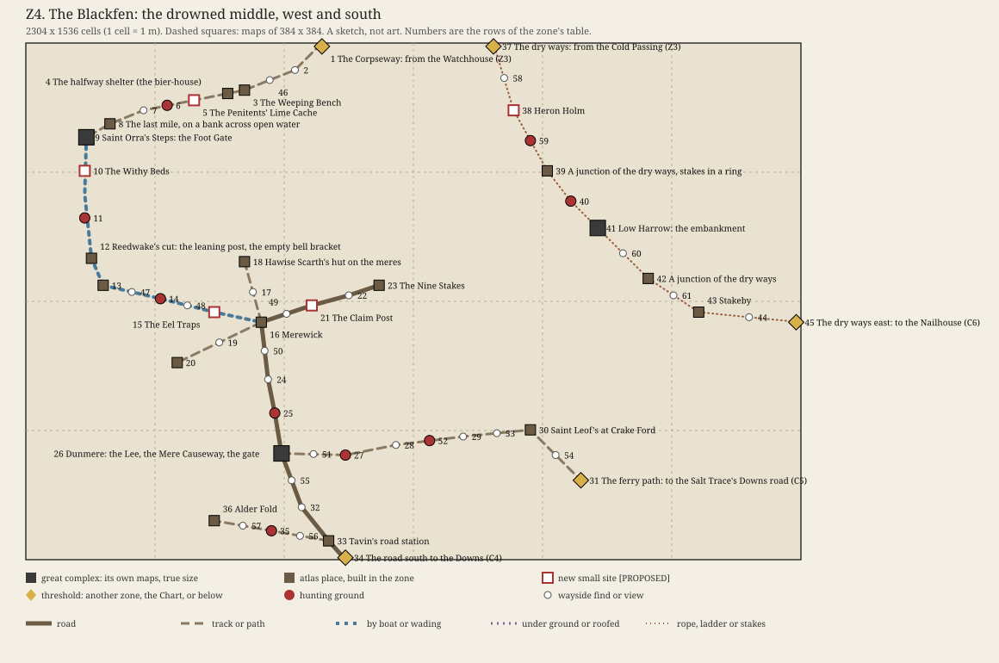

---

## Z4b. The Drowned Measures

**Size:** 1536 x 1536 cells: 16 maps of 384.

**What it stands for.** The basin past Rook's Stair, about 20 miles across, two days by bank and boat (atlas). It is
not beside the Blackfen: it hangs off the Bell Road's quarry branch, 12 miles past Rook's Stair, so it is its own zone,
joined to Z2 by a one-day Chart leg (C3). The brief put it with the Blackfen; the atlas puts it fifty miles north, and
the atlas is the true map.

**Squeeze.** 77 cells to the mile (1:21). **Milebank**, a bank road a mile long, is drawn at about 820 cells, half its
true length [PROPOSED]. The King's Sluice (the vaults behind the Three Mouths, a mile to the pumping hall) is its own
long thin map.

**How you move.** Banks, plank walks between foundations, wall-tops at low water, and boats. The Long Cut's
maintenance walk survives in sections. Routes change with the water: the Silt Readers' sheets say which are open.

**What hunts.** Reed-jaws in the deep pockets and at the landings. Harrow eels in the flooded rooms and the vaults.
Greymaw on the dry approaches. The rising water.

### Places on the grid

| # | Place | x, y | Kind |
|---|---|---|---|
| 1 | The quarry approach: from Rook's Stair (C3) | 10, 200 | gate |
| 2 | A banded pole: a depth mark with a date | 170, 222 | way |
| 3 | The Dry Table | 330, 250 | atlas |
| 4 | The Surveyors' Mound [PROPOSED] | 470, 330 | new |
| 5 | The Peg Houses and the Crooked Pair | 600, 420 | atlas |
| 6 | The drowned survey hut | 640, 470 | atlas |
| 7 | Milebank, the north end | 520, 480 | atlas |
| 8 | The Eel Garths [PROPOSED] | 512, 620 | new |
| 9 | The Red Stitch | 505, 800 | atlas |
| 10 | The drowned church, a hundred paces off the bank | 620, 820 | atlas |
| 11 | Harrow eels in the drowned houses | 500, 1000 | hunt |
| 12 | A woodpile with a bank-labour tally | 500, 1150 | way |
| 13 | Milebank, the south end and its waiting ground | 510, 1290 | atlas |
| 14 | The Rent Stones [PROPOSED] | 750, 500 | new |
| 15 | The Three Mouths | 900, 600 | atlas |
| 16 | The King's Sluice: in under the basin | 940, 570 | gate |
| 17 | A collapse of the Long Cut's wall | 1000, 700 | atlas |
| 18 | Reed-jaws in a deep pocket | 1080, 840 | hunt |
| 19 | The Four Steps | 1180, 980 | atlas |
| 20 | A reed-jaw slide: a boot above the waterline | 1250, 1080 | way |
| 21 | The narrowed channel and the Low Rack Four | 1330, 1200 | atlas |
| 22 | The Long Cut's tail, at the river | 1450, 1350 | gate |
| 23 | A drowned hedge line, its top a path at low water | 1300, 920 | way |
| 24 | Far Bank Gate and the Return Shelf | 1400, 900 | atlas |
| 25 | The drowned approach, where the tapping is heard | 1520, 880 | way |
| 26 | Reed-jaws near the landing | 1100, 1150 | hunt |
| 27 | The Drowned Orchard and its five living trees | 1000, 1250 | atlas |
| 28 | The Bent Fence | 850, 1300 | atlas |
| 29 | The Three Steps | 760, 1300 | atlas |
| 30 | The Reed Yard | 620, 1300 | atlas |
| 31 | The basin's ruled rectangles showing through the water | 90, 212 | way |
| 32 | Greymaw on the dry approach | 250, 236 | hunt |
| 33 | A drowned hedge top in a straight line | 400, 290 | way |
| 34 | Fish and laundry on drying screens | 535, 375 | way |
| 35 | Rain-barrels and woodpiles kept off the passage | 508, 710 | way |
| 36 | A chimney-top of the old village in the water | 502, 900 | way |
| 37 | A household's patch that sends the water next door | 825, 550 | way |
| 38 | A reed-jaw shape that could be floating timber | 1040, 770 | way |
| 39 | A gap in the walk hidden by reeds | 1130, 910 | way |
| 40 | Stone from a collapse, good for a bank | 1390, 1275 | way |
| 41 | A carrying frame left at a slide | 1140, 1065 | way |
| 42 | The debris backing water toward the three plots | 925, 1275 | way |

### Ways

| Way | Kind | Points |
|---|---|---|
| The quarry approach | road | 0,200 170,222 330,250 |
| To the Peg Houses | track | 330,250 470,330 600,420 |
| The walks | rope | 600,420 520,480 |
| Milebank | road | 520,480 512,620 505,800 500,1000 500,1150 510,1300 |
| To the Mouths | track | 600,420 750,500 900,600 |
| The Long Cut's walk | track | 900,600 1000,700 1080,840 1180,980 1250,1080 1330,1200 1450,1350 |
| The wall-tops | rope | 1180,980 1100,1150 1000,1250 850,1300 760,1300 620,1300 510,1300 |
| To Far Bank Gate | water | 1180,980 1300,920 1400,900 1520,880 |
| To the drowned church | water | 505,800 620,820 |

### New small sites [PROPOSED]

- **The Surveyors' Mound** (4). An earth mound the King's surveyors raised two centuries ago to sight their lines,
  with a stone sighting table on top. At low water the whole field system shows from it under the surface, ruled
  like a ledger. *Why:* the atlas's wonder ("from a height at low water the whole old field system shows") needs a
  height, and surveyors build one.
- **The Eel Garths** (8). Plank pens along Milebank's lee side where the bank households keep eels alive until they
  are wanted. *Why:* a mile of crest with no fields needs food the water gives.
- **The Rent Stones** (14). Wall-tops between the Peg Houses and the Three Mouths, each corner stone cut with a
  measure number and the crown over a rod. *Why:* the basin was let to tenants by the measure (atlas, *the King's
  Measures*); the walls were the rent.

### Measured

See the line for z4b at the end of this file.

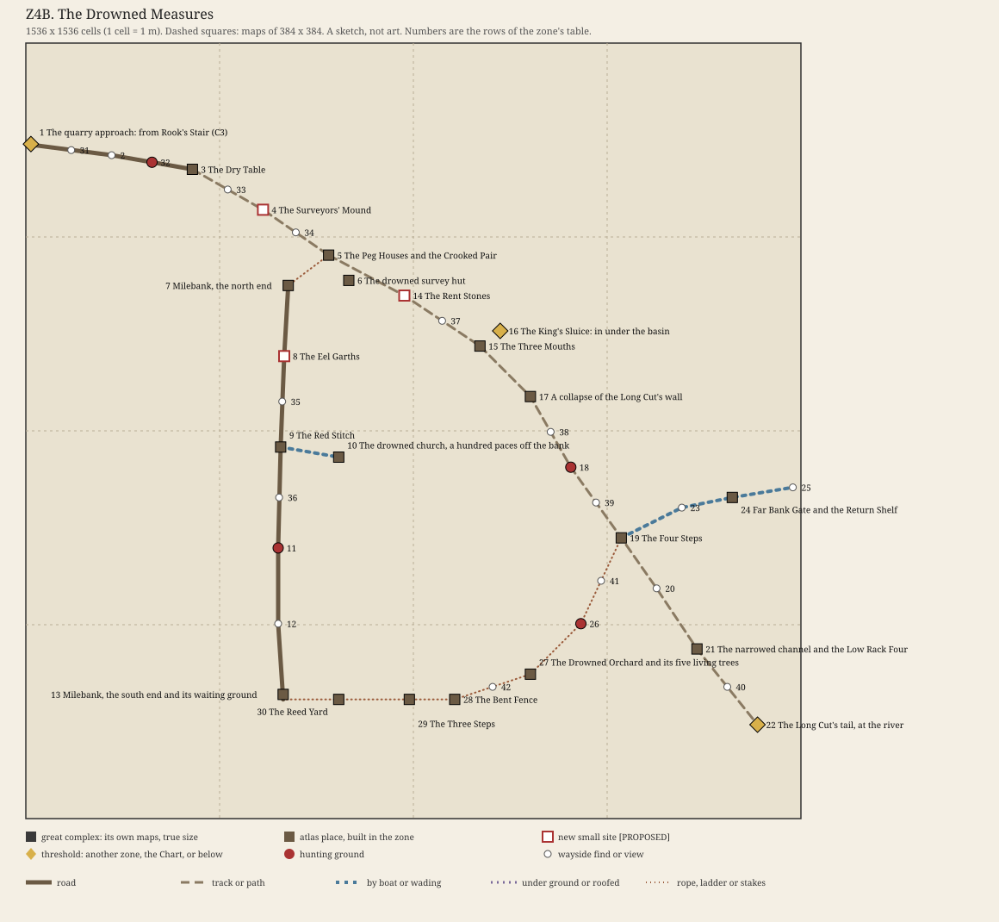

---

## Z5. The Salt Trace and the Downs

**Size:** 1536 x 1536 cells: 16 maps of 384.

**What it stands for.** The Salt Trace's Downs stretch from the fen's southern reach to Whitlow Grange, about 61
miles and five days, with the high Downs west of it: the White Horse and the Kings' Barrows (`9-the-wilds-between.md`).
The Trace's fen stretch, Brackenreach to the southern reach (36 miles, four days, with the White Trees half way), is a
Chart leg (C1), as O15 says the long hauls are; so is the last stretch, Whitlow to Wexhaven (C2).

**Squeeze.** 24 cells to the mile down the Trace (1:67), about 50 across it (1:32), so the barrows two days west of
the Trace sit at the zone's west edge. The White Horse is at true size, a quarter of a mile long (about 400 cells),
because it is a built thing and it is meant to be seen. Whitlow Grange is a great complex (a walled town for four
hundred): its own maps behind its Trace gate.

**How you move.** Down the Trace between toll-posts: every grange-hold has its mile, its chain and its price. The
ridge track along the highest down to the barrows. Tavin's road comes in from Z4 (C4) and joins the Trace at Sallow
Grange.

**What hunts.** Greymaw in the open country. The Unnamed at the fifth barrow (O12). People: the wintermen at every
chain, and the tolls. The open downs in snow.

### Places on the grid

| # | Place | x, y | Kind |
|---|---|---|---|
| 1 | The southern reach: from the Chart (C1) | 1300, 10 | gate |
| 2 | The Trace leaves the fen: the last stake-marked post | 1280, 80 | atlas |
| 3 | Cleeve Grange and its toll-post [PROPOSED] | 1240, 180 | new |
| 4 | The Gate Camp [PROPOSED] | 1200, 280 | new |
| 5 | Greymaw on the loads | 1150, 400 | hunt |
| 6 | Sallow Grange and its toll-post [PROPOSED] | 1100, 500 | new |
| 7 | A staddle stone fallen in the road | 1080, 575 | way |
| 8 | Hollow Grange [PROPOSED] | 1050, 700 | new |
| 9 | Wintermen at a toll chain | 1020, 800 | hunt |
| 10 | Brockhold and its toll-post [PROPOSED] | 980, 900 | new |
| 11 | The next hold's watch tower seen from this one | 960, 1000 | way |
| 12 | The Chalk Well [PROPOSED] | 935, 1110 | new |
| 13 | Whitlow's Trace gate and toll-house | 900, 1260 | atlas |
| 14 | Whitlow Grange | 820, 1300 | complex |
| 15 | A grange's mile ends at a chain | 880, 1410 | way |
| 16 | The Salt Trace on to Wexhaven (C2) | 860, 1530 | gate |
| 17 | Tavin's road: from Z4 (C4) | 300, 10 | gate |
| 18 | A Crown milestone on the Downs road | 350, 100 | way |
| 19 | Greymaw on the Downs road | 400, 200 | hunt |
| 20 | A dew-pond on the open down | 475, 300 | way |
| 21 | Where the ridge track leaves the road | 550, 400 | way |
| 22 | A winterman's lookout post | 625, 475 | way |
| 23 | Rye strips sown in the thaw mud | 800, 590 | way |
| 24 | Greymaw in the outer field | 940, 610 | hunt |
| 25 | The White Horse of the Downs | 450, 500 | atlas |
| 26 | The scouring: each hold's own stretch of the horse | 330, 600 | way |
| 27 | The Kings' Barrows, the first four | 250, 750 | atlas |
| 28 | The fifth barrow: the Unnamed | 240, 850 | hunt |
| 29 | The robbers' camp | 290, 870 | atlas |
| 30 | The warden's cottage at the ridge's end | 260, 1000 | atlas |
| 31 | The ferry path from Crake Ford (C5) | 1230, 60 | gate |
| 32 | A winterman's grave by the road, his arms taken | 712, 532 | way |
| 33 | White chalk where the turf has slipped | 390, 550 | way |
| 34 | The nine barrows in a line seen from the track | 290, 675 | way |

### Ways

| Way | Kind | Points |
|---|---|---|
| The Salt Trace | road | 1300,0 1280,80 1240,180 1200,280 1150,400 1100,500 1075,600 1050,700 1020,800 980,900 960,1000 935,1110 900,1260 880,1410 860,1536 |
| Tavin's road | road | 300,0 350,100 400,200 475,300 550,400 625,475 700,550 800,590 940,610 1075,600 |
| The ridge track | track | 550,400 450,500 330,600 250,750 240,850 260,1000 |
| The ferry path | track | 1230,60 1280,80 |
| Into Whitlow | track | 900,1260 820,1300 |

### New small sites [PROPOSED]

- **Cleeve Grange** (3), **Sallow Grange** (6) and **Brockhold** (10). Three grange-holds on the Trace, each the
  atlas's typical hold (toll-post, outer field, wall, tithe barn, granary on staddle stones, steward's house with
  the march-lord's empty chair, wintermen's barracks, watch tower), each with one thing of its own: Cleeve's chain
  is the first and its steward asks the fen's news before the toll; Sallow's tithe barn doors are blessed every
  spring and it says so on a board; Brockhold's wintermen include two in Watch cloaks. *Why:* "a walled farm on every
  rise" and every hold takes a toll on its mile (atlas); a five-day stretch needs several, and only Whitlow is named.
- **The Gate Camp** (4). Shelters of hurdle and sod against Cleeve's wall where fen people wait to be let in to work
  for a share. *Why:* "in hard winters, people from the fen at the gates" (atlas), and Dunmere's Lee shows what such
  a camp becomes.
- **Hollow Grange** (8). A hold that failed: its wall breached, its granary on its staddle stones empty, the
  march-lord's chair still at the head of the hall table, the toll chain lying in the road for anyone to step over.
  *Why:* thirty years of tolls and levies cannot have kept every hold alive; it shows the cost of the ones that
  stand.
- **The Chalk Well** (12). A deep well cut through the chalk at the Trace's side, shared by two holds that do not
  speak, with a rope each and two locks. *Why:* the Downs are chalk and dry; water is the one thing a grange-hold
  cannot toll.

### Measured

See the line for z5 at the end of this file.

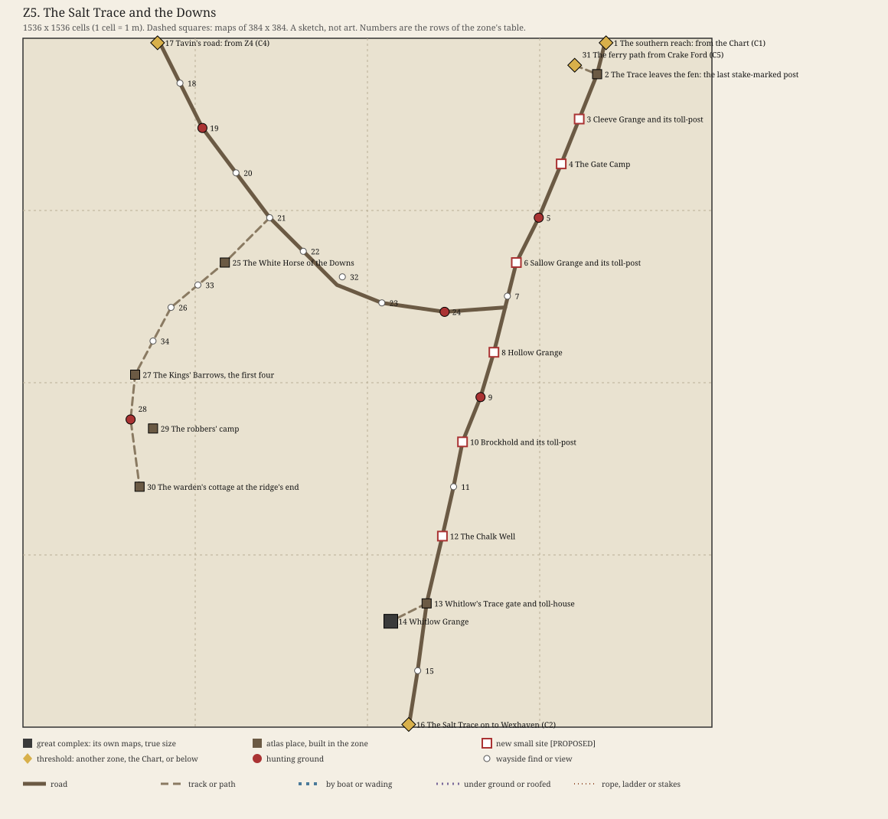

---

## Z6. Wexhaven and the Burned Quay

**Size:** 1536 x 1536 cells: 16 maps of 384. **This size is a ruling the owner must make first:** the archive leaves
Wexhaven's scale unset (atlas, *Wexhaven and the Burned Quay*). The size below is the standard zone, and the grid
places the atlas's nine zones of the city inside it without fixing how big the city was.

**What it stands for.** The last mile of the Salt Trace past the last grange-hold, the gutted upper town, the Long
Steps down through the burned lower city, the harbour square, the Burned Quay and the customs vaults, Wat Hebble's
slip, the Breakwater and its dead light-tower, and the inlet of drowned hulls with the *Constance* at its deep end.
The salt-pans east of the city, which did not burn. Act I begins here (scenes 1 to 3).

**Squeeze.** None set (above). The customs vaults and the *Constance* are their own maps.

**How you move.** Down: the Trace into the upper town, the Long Steps to the quay, the hoist-shaft shortcut once it is
opened. Along: the quay to the slip and the Breakwater. Across the inlet at dead low water, hull to hull.

**What hunts.** Corvin Hale's reavers (people; they will fight, trade or let you go). The hulk-conger in the
*Constance*'s hold. Greymaw on the Trace above the city. Fallen floors in the lower city. The tide.

### Places on the grid

| # | Place | x, y | Kind |
|---|---|---|---|
| 1 | The Salt Trace: from Whitlow (C2) | 700, 10 | gate |
| 2 | The last grange-hold's toll-post | 700, 80 | atlas |
| 3 | The inlet's masts first seen | 700, 200 | way |
| 4 | Greymaw at the city's edge | 700, 300 | hunt |
| 5 | The upper town, every chimney broken open | 720, 450 | atlas |
| 6 | The Stove Sledge [PROPOSED] | 580, 480 | new |
| 7 | A gutted house, its stove dragged out | 450, 500 | way |
| 8 | The reavers' working camp | 1000, 520 | atlas |
| 9 | The Rear-guard Barricade [PROPOSED] | 705, 560 | new |
| 10 | A lane of houses gutted for their stoves | 700, 700 | way |
| 11 | The Long Steps | 695, 780 | atlas |
| 12 | The hoist-shaft shortcut | 820, 850 | atlas |
| 13 | The harbour square, its fountain full of ash | 690, 880 | atlas |
| 14 | The Burned Quay and Gytha Marrin's chair | 750, 920 | atlas |
| 15 | The customs vaults | 600, 930 | complex |
| 16 | Cranes fallen across the lanes | 450, 940 | way |
| 17 | Wat Hebble's slip | 220, 1050 | atlas |
| 18 | Black warehouse ribs | 880, 950 | way |
| 19 | The Fishers' Stair [PROPOSED] | 990, 960 | new |
| 20 | The Breakwater | 1100, 950 | atlas |
| 21 | The Breakwater's cut stones, half under | 1250, 1150 | way |
| 22 | The dead light-tower | 1350, 1300 | atlas |
| 23 | The inlet of drowned hulls | 650, 1100 | atlas |
| 24 | The masts at dawn, a drowned wood | 620, 1200 | way |
| 25 | The hulk-conger's dark | 600, 1300 | hunt |
| 26 | The *Constance* | 560, 1450 | complex |
| 27 | The inlet's mouth: the sea (S1) | 600, 1525 | gate |
| 28 | Salt-pan smoke over the roofs | 1250, 600 | way |
| 29 | The salt-pans east of the city | 1450, 650 | atlas |
| 30 | A slip of the lower city's stone | 300, 990 | way |
| 31 | Reavers' sentries on the lanes | 860, 535 | hunt |
| 32 | The Burned Ropewalk [PROPOSED] | 1130, 560 | new |
| 33 | A reaver's stove-hook left in a chimney | 790, 492 | way |
| 34 | A fallen warehouse's floors, the hoist-shaft open | 847, 640 | way |
| 35 | The burned lower city seen down the shaft | 833, 745 | way |
| 36 | A fishing boat burned to its keel | 375, 965 | way |
| 37 | A dead gull on the breakwater's wall | 1175, 1050 | way |
| 38 | The lamp-room glass catching the low sun | 1300, 1225 | way |
| 39 | A hull's ribs walked like a ladder at low water | 669, 1004 | way |
| 40 | A salt-rake left by the pans, nobody in sight | 1350, 625 | way |

### Ways

| Way | Kind | Points |
|---|---|---|
| The Trace road in | road | 700,0 700,300 720,450 |
| The upper town | road | 450,500 580,480 720,450 860,535 1000,520 |
| The Long Steps | track | 720,450 705,560 700,700 695,780 690,880 |
| The hoist-shaft | rope | 860,535 820,850 |
| The quay | road | 220,1050 300,990 450,940 600,930 690,900 750,920 880,950 990,960 1100,950 |
| The Breakwater | road | 1100,950 1250,1150 1350,1300 |
| Across the hulls | water | 690,900 650,1100 620,1200 600,1300 560,1450 600,1536 |
| To the salt-pans | track | 1000,520 1130,560 1250,600 1450,650 |

### New small sites [PROPOSED]

- **The Stove Sledge** (6). A reavers' sledge stuck at a lane's turn with a stove still roped to it, the rope cut,
  as if the crew left in a hurry. *Why:* the upper town is quarried for slag-iron stoves (atlas); the stoves go down
  to the boats somehow.
- **The Rear-guard Barricade** (9). Carts and doors across the head of the Long Steps, Crown pikes still in it,
  burned on its harbour side. Whoever held it held it the night the harbour burned. *Why:* the harbour-marshal
  commanded a rear guard and did not sail (atlas, Hugh Ardern); this says where a rear guard stood, and nothing about
  him.
- **The Fishers' Stair** (19). Worn steps down the quay's face to the water east of the vaults, where vault people
  fish at night with lines weighted with nails. *Why:* a few hundred people living under the quay must eat from the
  inlet.
- **The Burned Ropewalk** (32). A straight line of black post-stumps a quarter of a mile long on the way to the
  salt-pans, where the royal fleet's rope was walked. *Why:* a harbour that refitted a fleet (atlas, Osbert III)
  walked its own rope; Brackenreach's ropewalk is the fen's.

### Measured

See the line for z6 at the end of this file.

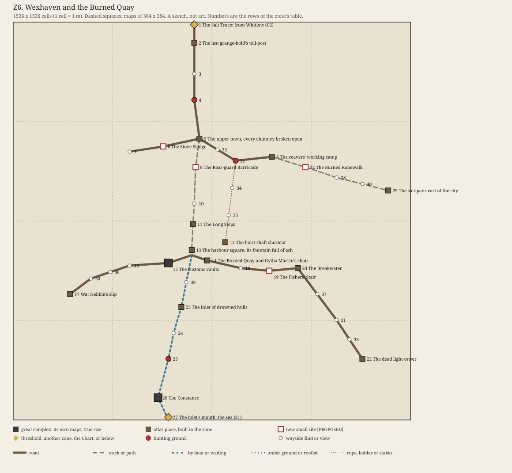

---

## Z7. The Citadels and the north

**Size:** 3072 x 1536 cells: 32 maps of 384 (8 across, 4 down). The largest zone, because the scarp is sixty miles of
rim with five Citadels on it and the Scald behind.

**What it stands for.** The rim of the scarp from Hob's Height (scarp mile 0) to Kell Tor (63), the scarp's foot under
Hob's Height with the Ringing Field, and north of the rim the Scald from its Scarp Foot to the Cold Edge, eight days
across, with the Bald Hills.

**Squeeze.** About 46 cells to the scarp mile along the rim (1:35). The Scald is squeezed hardest: 60 miles into about
1,200 cells (1:80), because the Scald is a crossing, not a country. Every Citadel is a great complex at true size in
its own maps: the Slagcrown (its crown alone 800 cells), Greystair (a mile from its upper gate on the rim to its lower
gate in Z1), Dunmarrow, Hob's Height. **Kell Tor is drawn only to its blank gate and its tarn** (the atlas's rule: going
inside is a ruling the owner makes first).

**Under it.** The Deep is not in the zone. The Low Galleries, the Hewers' Road, the Eleventh Gallery and the Black
Seam drift are their own maps, entered from the Slagcrown's main shaft and lower gate, Greystair's breathing hollow
and Dunmarrow's deep forges. The Hewers' Road (63 miles) would be drawn at the rim's squeeze as one long thin map of
about 2,900 x 24 cells (Z-R2). The Deep-Seam Vaults are never laid out.

**How you move.** Along the rim by its broken track, a week on foot (atlas). Up from Z1 by the last climb, Greystair's
terraces or the Iron Stair. North across the Scald only by the Cairn Line, where the cairns stand, and only with cold
light in the Sinks. Down the founders' track to the Ringing Field.

**What hunts.** Quarry-trolls on the high ground and drawn to noise. Ork packs everywhere, in force at Dunmarrow and
on the Marrow road. Goblins at Hob's Height and in the shafts. Hoar-bears at the Cold Edge. The Sinks' bad air. This
thaw, everything moving south in silence.

### Places on the grid

| # | Place | x, y | Kind |
|---|---|---|---|
| 1 | Hob's Height and the Bell-Spire | 100, 1250 | complex |
| 2 | Goblins out of Hob's Height's shafts | 250, 1245 | hunt |
| 3 | The founders' track, bells by the path | 220, 1350 | way |
| 4 | The Ringing Field | 260, 1480 | atlas |
| 5 | The Mother Bell seen from the rim road | 400, 1232 | way |
| 6 | A Hewers' Road air shaft breathing warm | 560, 1245 | way |
| 7 | Quarry-troll on the rim | 700, 1255 | hunt |
| 8 | The Breathing Holes [PROPOSED] | 800, 1260 | new |
| 9 | A fallen winding-tower | 950, 1250 | way |
| 10 | Goblins at a spoil heap | 1100, 1245 | hunt |
| 11 | The crown's spoil heaps close at hand | 1250, 1242 | way |
| 12 | An ork pack crossing toward the open courts | 1400, 1245 | hunt |
| 13 | The Slagcrown: the outer gate and barbican | 1570, 1250 | complex |
| 14 | The main shaft: the Deep (own maps) | 1570, 1320 | gate |
| 15 | The last climb: down to Z1 | 1520, 1520 | gate |
| 16 | The ninth spoil heap and its winding-tower | 1750, 1242 | way |
| 17 | The Lodge Cairn [PROPOSED] | 1900, 1240 | new |
| 18 | Quarry-troll drawn by the hammers | 2050, 1240 | hunt |
| 19 | Greystair's hammers heard on the wind | 2200, 1245 | way |
| 20 | Greystair: the upper gate | 2400, 1250 | complex |
| 21 | The Iron Stair's Head: down to Z1 | 2560, 1260 | atlas |
| 22 | Ork packs on the rim | 2640, 1250 | hunt |
| 23 | Dunmarrow: the approach, under three towers | 2730, 1160 | complex |
| 24 | Dunmarrow's one gate | 2760, 1080 | atlas |
| 25 | Kell Tor's beacon tower, cold | 2860, 1235 | way |
| 26 | Kell Tor: the blank gate of dressed stone | 3000, 1230 | atlas |
| 27 | The black tarn, pale lights on it | 3000, 1380 | atlas |
| 28 | An ork pack on the Marrow road | 2900, 1040 | hunt |
| 29 | The Marrow Passes: the Chart (C9) | 3060, 1000 | gate |
| 30 | The Scald's first fumarole | 1590, 1150 | way |
| 31 | The Scarp Foot | 1600, 1050 | atlas |
| 32 | The Ice-walkers' Camp [PROPOSED] | 1580, 950 | new |
| 33 | The Cairn Line | 1550, 800 | atlas |
| 34 | The Prospectors' Shelter [PROPOSED] | 1500, 700 | new |
| 35 | The Glass Field | 1750, 700 | atlas |
| 36 | The Sinks | 1450, 600 | atlas |
| 37 | A Sink at dawn: birds dead at the bottom | 1420, 480 | way |
| 38 | Red vents glowing to the horizon | 1600, 450 | way |
| 39 | The rings of the Bald Hills | 1650, 300 | atlas |
| 40 | A fallen cairn | 1400, 360 | way |
| 41 | Hoar-bears at the ice edge | 1400, 230 | hunt |
| 42 | The Cold Edge and the frozen herd | 1400, 100 | atlas |
| 43 | The Hoar beyond: off this plan | 1400, 20 | gate |
| 44 | A Hewers' Road air shaft, goblins in it | 2500, 1255 | way |
| 45 | The rim track over a gully | 1060, 1250 | way |
| 46 | A miners' path down the face | 2980, 1240 | way |
| 47 | Hob's Height's spiral of houses behind | 480, 1238 | way |
| 48 | The open courts seen through the outer gate | 1485, 1248 | way |
| 49 | A winding-tower's cage hanging on slag-iron chain | 1660, 1248 | way |
| 50 | Greystair's bloomery smoke over the rim | 2300, 1248 | way |
| 51 | Dunmarrow's cold forge-chimneys like black teeth | 2750, 1242 | way |
| 52 | The venting slopes steaming far below | 1538, 1419 | way |
| 53 | A fallen cart in the ditch, Weald pitch in its barrels | 2980, 1022 | way |
| 54 | A prospectors' cairn still standing | 1525, 525 | way |
| 55 | Moss on warm ground, the only green | 1625, 375 | way |
| 56 | Sheets of black glass that cut boots | 1650, 750 | way |

### Ways

| Way | Kind | Points |
|---|---|---|
| The rim track | track | 100,1250 400,1232 800,1260 1200,1240 1570,1250 2000,1240 2400,1250 2560,1260 2720,1240 3000,1230 |
| The founders' track | track | 200,1250 220,1350 260,1480 |
| The last climb | track | 1570,1250 1520,1520 |
| To Dunmarrow | road | 2720,1240 2730,1160 2760,1080 |
| The Marrow road | road | 2760,1080 2900,1040 3072,1000 |
| To the tarn | track | 3000,1230 3000,1380 |
| The Cairn Line | track | 1570,1250 1590,1150 1600,1050 1580,950 1550,800 1500,700 1450,600 1420,480 1400,360 1400,230 1400,100 1400,0 |
| To the Bald Hills | track | 1450,600 1600,450 1650,300 |
| To the Glass Field | track | 1550,800 1750,700 |

### New small sites [PROPOSED]

- **The Breathing Holes** (8). Stone-capped shafts on the rim, a row of them, warm air coming up out of each in a
  slow breath; put an ear to one and the road below is heard. Goblins use them. *Why:* the Hewers' Road runs under
  the whole scarp and "breathes" at Greystair (atlas); a road sixty miles long needs air.
- **The Lodge Cairn** (17). A great cairn on the rim above the Hall of the Lodges, faced with five stones cut with
  the Lodges' signs (a pick, a lamp, a pair of hands), where hewers on the surface could stand over their own hall.
  *Why:* the five Lodges met once a year in that hall (atlas, *The Hewers' Road*); the cairn marks it from above
  without opening it.
- **The Ice-walkers' Camp** (32). A ring of stones at the Scald's foot where ice-walkers coming south stop, a carved
  antler on a cairn, and the signs they draw in the ash for anyone who will read them. *Why:* Hoarfolk walk south
  across the Scald and are seen on the upper Bell Road (atlas, *The Scald and the Hoar*); they come down here first.
- **The Prospectors' Shelter** (34). A Citadel prospectors' stone shelter on the Cairn Line, its lintel cut with a
  cold-light mark, because a flame on the Scald kills. *Why:* cold light is "the only safe light on the Scald"
  (atlas), and the Cairn Line is the prospectors' track.

### Measured

See the line for z7 at the end of this file.

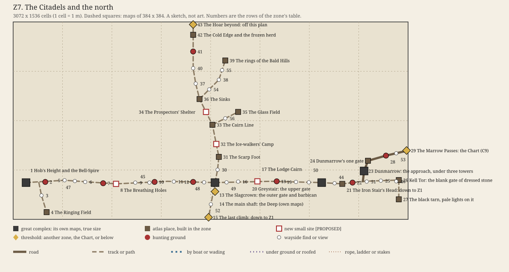

---

## Z8. The wider Round by sea

The Round's lands are reached by sea from Wexhaven's inlet on the Chart (the sea legs below). Each landfall the story
needs is a zone of its own, built by the same rules. The atlas gives these four far fewer miles to work from, so their
squeezes are not set and their sections are shorter. The Skerries, the Wrack Shore (Gull's Throat), the Weald and the
Long Marrow are not zoned yet (see *Places not in a zone yet*).

## Z8a. Port Sable and the Sable Shore

**Size:** 1536 x 1536 cells: 16 maps of 384.

**What it stands for.** Port Sable in the middle of the Shore, with Pennick 25 miles west and Wendlemouth 30 miles
east, the Narrows off it and the Lazaret Rocks 15 miles out. The sea is north. Act I's scene 5 (the Forty) and Act II's
Exchange.

**Squeeze.** 28 cells to the mile along the coast (1:57). Port Sable's walled terraces are the zone's middle; the
Exchange and the counting-houses are in it, and the Bloom Quarter is behind its wall (not entered without a ruling of
the story's own). The Lazaret Rocks are their own maps, reached by water.

**How you move.** By sea to the Rocks and the chain; by the coast road along the Shore; up the terraces to the crown;
out of the landward gate to the Limewalks.

**What hunts.** Hold-goblins in the drains. Walking bloom in the Bloom Quarter and on the Rocks. Hulk-congers in the
sealed hulks. The law, for a northerner.

### Places on the grid

| # | Place | x, y | Kind |
|---|---|---|---|
| 1 | The sea: from Wexhaven (S1) | 760, 10 | gate |
| 2 | The Lazaret Rocks: Keeper's Rock, the Ring | 450, 100 | complex |
| 3 | The Roads, the outer anchorage | 700, 200 | atlas |
| 4 | The Chain Towers and the winding-house | 760, 350 | atlas |
| 5 | The Quays | 760, 540 | atlas |
| 6 | The Exchange | 780, 650 | atlas |
| 7 | The Counting-houses on the crown | 800, 800 | atlas |
| 8 | The Bloom Quarter's wall | 620, 640 | atlas |
| 9 | The Limewalks | 820, 1000 | atlas |
| 10 | Dead-carts going out at dawn | 810, 900 | way |
| 11 | Pennick | 60, 520 | atlas |
| 12 | A Pennick-marked keel on the shingle | 180, 540 | way |
| 13 | Hold-goblins out of a drain | 300, 558 | hunt |
| 14 | A lime-shed for the road's dead | 450, 560 | way |
| 15 | Salt-cod racks | 900, 570 | way |
| 16 | The Hand-Sign Stones [PROPOSED] | 1030, 578 | new |
| 17 | The Debt Board [PROPOSED] | 1150, 570 | new |
| 18 | A Compact patrol on the coast road | 1300, 560 | hunt |
| 19 | Wendlemouth | 1480, 560 | atlas |
| 20 | The river road, grain barges beside it | 1500, 800 | way |
| 21 | The river road to Saint-Aumere (S2) | 1530, 1000 | gate |
| 22 | Hulk-congers in a sealed hulk | 600, 150 | hunt |
| 23 | A ship waiting for the chain | 730, 280 | way |
| 24 | The coast road west, a boundary stone of the Compact | 600, 560 | way |
| 25 | A dead-cart's limed load waiting for dawn | 680, 560 | way |
| 26 | A Grey's lime-washed hut by the road | 1390, 560 | way |
| 27 | A lime-house where the wall's watch keeps its barrels | 690, 600 | way |
| 28 | The chain rising out of the water at dusk | 748, 107 | way |
| 29 | Ships waiting in the Roads for the chain | 760, 445 | way |
| 30 | Walking bloom on Bone Rock | 525, 125 | hunt |
| 31 | A granary on the river bank | 1490, 680 | way |
| 32 | The Wendle's seven-arch bridge seen behind | 1518, 900 | way |

### Ways

| Way | Kind | Points |
|---|---|---|
| The coast road | road | 60,520 180,540 300,558 450,560 600,560 760,560 900,570 1030,578 1150,570 1300,560 1480,560 |
| Up the terraces | road | 760,560 780,650 800,800 810,900 820,1000 |
| The Bloom Quarter's wall | track | 760,560 620,640 |
| By sea | water | 760,0 730,280 760,350 760,540 |
| To the Rocks | water | 730,280 700,200 600,150 450,100 |
| The river road | road | 1480,560 1500,800 1536,1000 |

### New small sites [PROPOSED]

- **The Hand-Sign Stones** (16). A strip of shingle where the Greys bury their own, each stone cut with a hand in
  hewers' hand instead of a name. *Why:* the Greys keep the Keeping and speak hewers' hand among themselves (atlas);
  this is how they would name their dead where Quay law does not.
- **The Debt Board** (17). A board on the coast road where the Exchange posts the day's price of Orlen's ash-paper,
  chalked fresh each morning: "a hundredth of face in a good week". *Why:* the Exchange prices everything on the
  Round (atlas), and the company carries eleven thousand receipts past it.

### Measured

See the line for z8a at the end of this file.

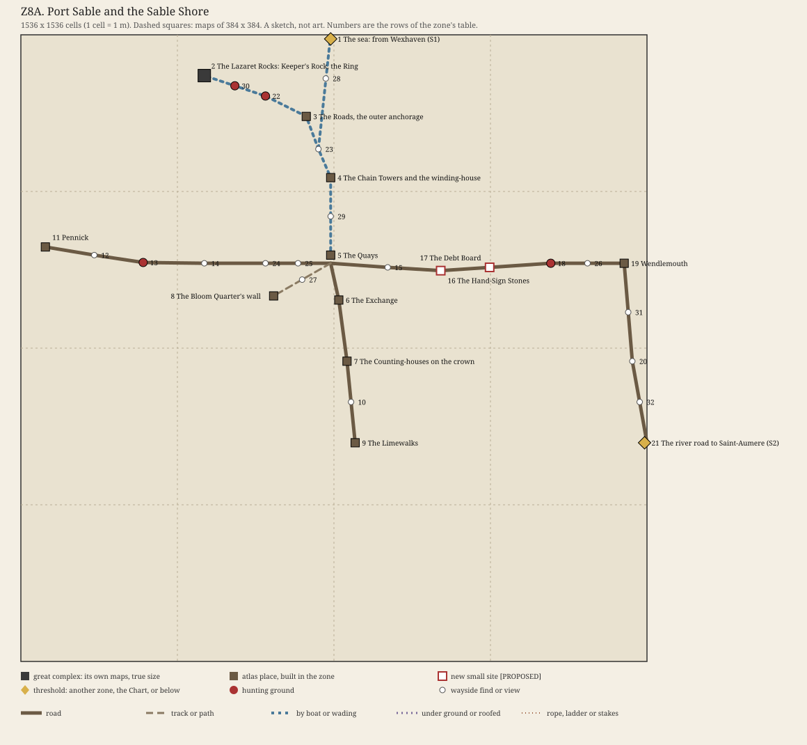

## Z8b. Saint-Aumere and the Wendle

**Size:** 1536 x 1536 cells: 16 maps of 384.

**What it stands for.** The royal city of Vauclere on its hill above the river (atlas zones 1 to 7) and the terraced
valley round it: rye where vines stood, idle presses, gibbets at the crossroads from the last Hunger. Act II's court and
one of the three winter roofs (the guest-house).

**Squeeze.** Not set by the atlas: it gives the city's zones and no distances inside the valley. The palace, the Orlen
Court and the treasury vaults are one complex in their own maps.

**How you move.** Up the river road from Wendlemouth (S2), through the river town, up the hill.

**What hunts.** The court (people). The countryside in a Hunger. Nothing the bestiary names.

### Places on the grid

| # | Place | x, y | Kind |
|---|---|---|---|
| 1 | The river road: from Wendlemouth (S2) | 10, 1200 | gate |
| 2 | A gibbet at the crossroads from the Third Hunger | 160, 1160 | way |
| 3 | An idle wine press on the terraces | 310, 1110 | way |
| 4 | The Pressers' Shrine [PROPOSED] | 450, 1060 | new |
| 5 | Rye on the wine terraces | 590, 1010 | way |
| 6 | The river town: cloth halls and granaries under guard | 720, 950 | atlas |
| 7 | The Queen's Granary | 860, 900 | atlas |
| 8 | Hungry at the granary gate | 900, 790 | hunt |
| 9 | The Priory of the Keeping in Exile | 950, 680 | atlas |
| 10 | The guest-house | 820, 650 | atlas |
| 11 | The palace, the Orlen Court and the treasury vaults | 1000, 520 | complex |
| 12 | Osbert's banners seen from the hill road | 900, 600 | way |
| 13 | The Petitioners' Steps [PROPOSED] | 1000, 600 | new |
| 14 | A cloth town's tall hall above the road | 235, 1135 | way |

### Ways

| Way | Kind | Points |
|---|---|---|
| The river road | road | 0,1200 160,1160 310,1110 450,1060 590,1010 720,950 860,900 |
| Up the hill | road | 860,900 900,790 950,680 1000,600 1000,520 |
| To the guest-house | track | 950,680 900,600 820,650 |

### New small sites [PROPOSED]

- **The Pressers' Shrine** (4). A wayside shrine of the vine-dressers' saint with its offerings changed from grapes
  to ears of rye. *Why:* the vines failed in S.2 (the Sour Years) and rye grows badly where they stood (atlas).
- **The Petitioners' Steps** (13). The palace steps where Orlen's refugees wait to have a paper sealed under
  Osbert's seal, numbered by the day they came. *Why:* the Orlen Court's chancery "issues paper under his seal"
  (atlas), and paper draws petitioners.

### Measured

See the line for z8b at the end of this file.

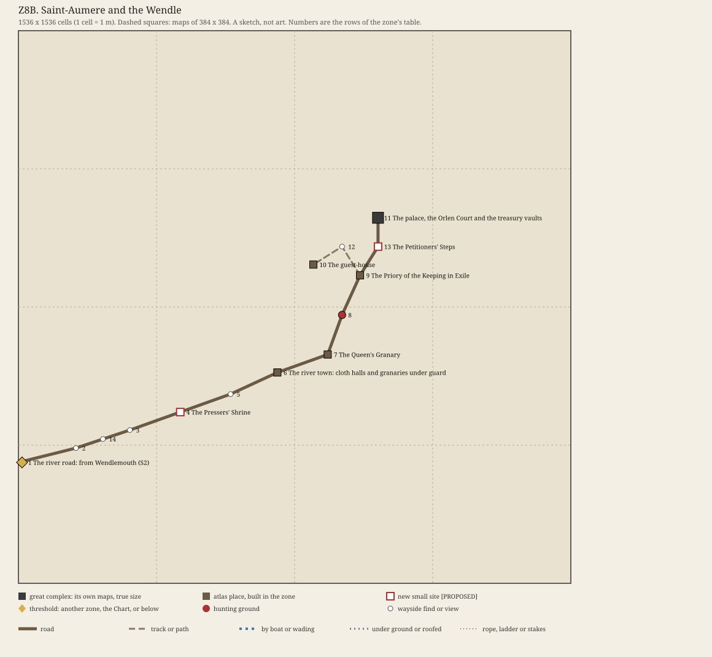

## Z8c. Sephar and the Garden of Hours

**Size:** 1536 x 1536 cells: 16 maps of 384.

**What it stands for.** The Throne's seat on the great river: the Garden of Hours where the Guest lives, the canals at
dawn, and the temples the atlas names, Qesh and Marrah (whose registers of noon light disagree) and the oldest temple
with its crypt. The atlas places them in Sephar without distances, so the zone draws them into one stretch of river
[PROPOSED].

**Squeeze.** Not set. The oldest temple's crypt is its own map, to its walled passage and no further.

**How you move.** Along the canal banks, best at dawn before the sun warms the ditch-monitors; by boat on the river.

**What hunts.** Ditch-monitors on the canals. Temple law, for a northerner carrying cold light.

### Places on the grid

| # | Place | x, y | Kind |
|---|---|---|---|
| 1 | The river: from the sea (S3) | 760, 10 | gate |
| 2 | The river's mouth landing, a sun-disc on its post | 760, 150 | way |
| 3 | A canal low and stinking, the flood failed | 760, 290 | way |
| 4 | Ditch-monitors on the canals at dawn | 760, 430 | hunt |
| 5 | The temple at Qesh and its smoked-glass house | 500, 560 | atlas |
| 6 | The Glass-Carriers' Path [PROPOSED] | 760, 560 | new |
| 7 | The temple at Marrah | 1020, 560 | atlas |
| 8 | A sighting-house on a temple roof | 640, 560 | way |
| 9 | A ditch-monitor in a house's doorway | 900, 560 | hunt |
| 10 | The Garden of Hours, where the Guest lives | 760, 760 | complex |
| 11 | The Embassy Quay [PROPOSED] | 640, 900 | new |
| 12 | The oldest temple: the sanctuary on its mound | 760, 1000 | atlas |
| 13 | A mud-brick street at noon under a red sun | 760, 880 | way |
| 14 | A smoked-glass sighting-house on a roof | 760, 660 | way |
| 15 | A canal lock dry, mud cracked | 700, 830 | way |

### Ways

| Way | Kind | Points |
|---|---|---|
| Up from the river's mouth | road | 760,0 760,150 760,290 760,430 760,560 760,760 |
| The canal between the temples | track | 500,560 640,560 760,560 900,560 1020,560 |
| To the oldest temple | track | 760,760 760,880 760,1000 |
| The quay path | track | 760,760 640,900 |

### New small sites [PROPOSED]

- **The Glass-Carriers' Path** (6). The canal bank between Qesh and Marrah, which no priest has walked with a glass
  in his hands. *Why:* "nobody has ever carried one temple's glass to the other" (atlas); this is the road that
  hook travels.
- **The Embassy Quay** (11). An empty quay with six mooring rings, each with a lamp-bracket, from which the Embassy of
  Lamps sailed north in S.9; lamps are still lit on it on that day each year. *Why:* six ships sailed and none came
  back (atlas); a quay remembers ships.

### Measured

See the line for z8c at the end of this file.

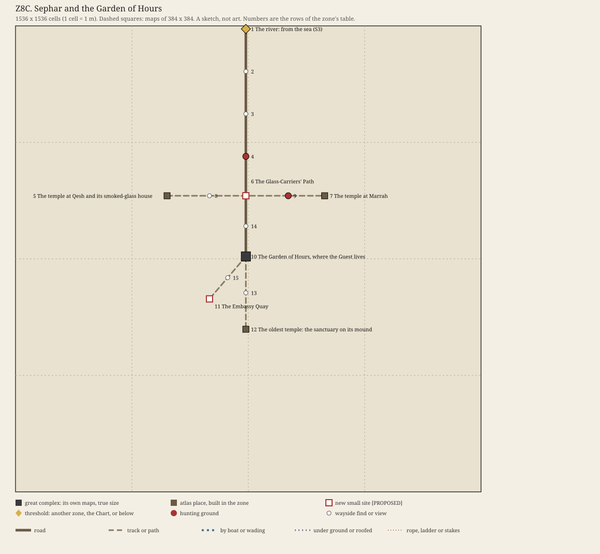

## Z8d. Halsing and the White Deeps

**Size:** 1536 x 1536 cells: 16 maps of 384.

**What it stands for.** Halsing in its high valley in the Saltbacks, the Old Pit-heads, and below them the White
Galleries, the Chapel Gallery, the Sump, the pumps and the Wall (atlas zones 1 to 7). Act III's eleven days, and one of
the three winter roofs (the bunkhouses).

**Squeeze.** Not set by the atlas. The town and the pit-heads are in the zone; the White Galleries, the Sump and the
Wall are their own maps under it, reached by the pit-head stairs.

**How you move.** Up the carting road into the valley, through the town, down the stairs.

**What hunts.** Nothing: "salt mines never held rats, bats or beetles" (atlas), and that is the dread. The Company's
law (people). Collapse. The Wall.

### Places on the grid

| # | Place | x, y | Kind |
|---|---|---|---|
| 1 | The carting road: from Saint-Aumere (S4) | 10, 800 | gate |
| 2 | Salt-block cairns along the road | 160, 790 | way |
| 3 | The Company's toll on the valley road | 310, 780 | hunt |
| 4 | The Empty Traps [PROPOSED] | 460, 770 | new |
| 5 | The Company's new pumping house, steaming | 600, 760 | atlas |
| 6 | Halsing town: the Company's offices, the lanes, the chapels | 760, 760 | atlas |
| 7 | The bunkhouses of the bonded hewers | 760, 620 | atlas |
| 8 | The Low Lodge's Meeting Room [PROPOSED] | 760, 490 | new |
| 9 | The Old Pit-heads, six hundred years of winding gear | 900, 760 | atlas |
| 10 | The stair-heads down to the White Galleries | 1040, 760 | gate |
| 11 | A carter's yard of salt blocks | 760, 900 | way |
| 12 | The carters' and bakers' lanes | 760, 1040 | atlas |
| 13 | A bonded hewer's family in a salt-block house door | 680, 760 | way |

### Ways

| Way | Kind | Points |
|---|---|---|
| The carting road | road | 0,800 160,790 310,780 460,770 600,760 760,760 900,760 1040,760 |
| Up to the bunkhouses | track | 760,760 760,620 760,490 |
| Down the lanes | track | 760,760 760,900 760,1040 |

### New small sites [PROPOSED]

- **The Empty Traps** (4). A row of rat-traps set along the road wall by the first Company engineers, never sprung,
  rusted shut and kept as proof. *Why:* the Company cites the empty deep as proof it is safe (atlas); people set
  traps before they believe it.
- **The Low Lodge's Meeting Room** (8). A back room behind the bunkhouses where the unlawful Low Lodge meets, its
  door hung with leather so it swings shut without a sound, as the listeners hang theirs. *Why:* Edith Brode's Lodge
  is unlawful (atlas) and the hewers' grandchildren keep the north's habits.

### Measured

See the line for z8d at the end of this file.

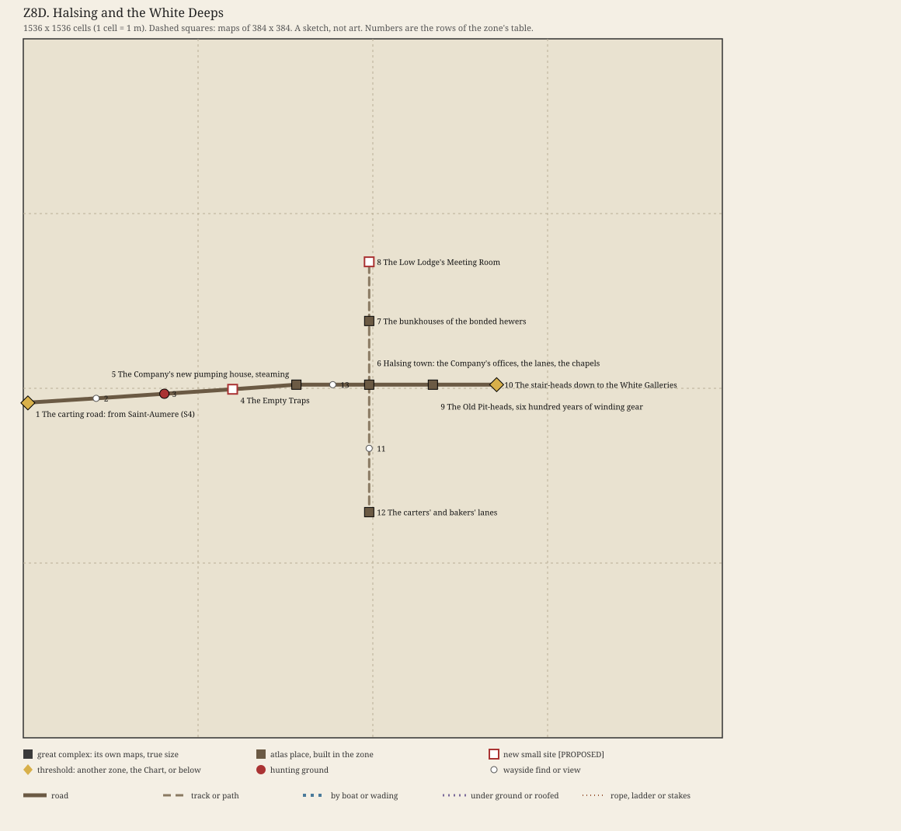

---

## How the zones join

### Walked seams (Z-R5: the days are booked when you leave by another threshold)

| From | To | Through | Atlas road | Days booked |
|---|---|---|---|---|
| The ledge (Z1) | Coldbarrow (Z1) | the upper road | 18 miles | 2 |
| Coldbarrow (Z1) | the Bell Road's foot (Z2) | the Bell Road | 80 miles | 7 |
| The Watchhouse (Z3) | Brackenreach (Z3) | the Old Causeway | 60 miles | 5 |
| The Watchhouse (Z3) | Saint Orra's Steps (Z4) | the Corpseway | 23 miles | 2 (with a stretcher) |
| The Cold Passing (Z3) | Stakeby (Z4) | the dry ways, at low water, with a stake-hand | about 30 miles | 5 |
| The southern reach (Z5) | Whitlow Grange (Z5) | the Salt Trace's Downs stretch | about 61 miles | 5 |
| The ledge (Z1) | the Slagcrown (Z7) | the last climb | 14 miles of broken ground | 1.5 (O6) |
| Greystair's lower gate (Z1) | Greystair's upper gate (Z7) | Greystair's great stair | a mile, at true size | none: a complex |

### Chart legs

Days come from the atlas's distances and pace table. **Food** is one ration a traveller a day; **fuel** one a
traveller a night not spent at a hearth (a landing with a roof and a fire saves that night's fuel); **oil** at sea is
counted in nights, as the quays count it. The units are [PROPOSED]; the days are the atlas's.

| Leg | From | To | Miles | Days | Food a traveller | Fuel a traveller | Landings | Dangers |
|---|---|---|---|---|---|---|---|---|
| C1 | Brackenreach (Z3) | the southern reach (Z5) | 36 | 4 | 4 | 3 (the White Trees has a roof) | Long Wade (6), the Ferry Stump (12), **the White Trees** (18), Pole Bridge (24) | crossings that have moved (V), Greymaw on the loads, bloodwicks at the fords, the herons |
| C1n | the White Trees (on C1) | the Nailhouse | 9 | 1 | 1 | 0 (the forge) | **the Nailhouse** | rustlings in the scrap yard, the pits |
| C2 | Whitlow Grange (Z5) | Wexhaven (Z6) | about 60 | 5 | 5 | 4 | the grange-holds' toll-posts, as scenes | tolls and wintermen, Greymaw, the open downs in snow (V) |
| C3 | Rook's Stair (Z2) | the Drowned Measures (Z4b) | 12 | 1 | 1 | 1 | none | Greymaw on the dry approach |
| C4 | Tavin's road station (Z4) | Tavin's road on the Downs (Z5) | about 20 [PROPOSED] | 2 | 2 | 1 | none | Greymaw on the Downs road |
| C5 | Crake Ford (Z4) | the Salt Trace's Downs road (Z5) | about 10 [PROPOSED] | 1 | 1 | 1 | none | the ford in spate |
| C6 | Stakeby (Z4) | the Nailhouse (on C1n) | 13 | 3 (the dry ways at 6 a day) | 3 | 2 | none | low water only; a stake-hand on the roster; harrow eels |
| C9 | Dunmarrow (Z7) | the Weald Steps | about 60 | 8 | 8 | 8 | none | ork packs at the Lower Gate and the Saddle Wall (V); the prospectors' trail round it, from the cairns |
| S1 | Wexhaven (Z6) | the Lazaret Rocks and Port Sable (Z8a) | about 700 | 7 in fair weather | 7 | oil 7 | **the Lazaret Rocks** (the Forty: 40 days, or a clean bill, or run the chain) | the Dead Calm, the Follower, the Unpaid, ice, gales |
| S2 | Port Sable (Z8a) | Saint-Aumere (Z8b) | about 180 | 12 by river barge and road | 12 | 6 | Wendlemouth (in Z8a) | the levies, a Hunger |
| S3 | Wexhaven (Z6) | Sephar's river mouth (Z8c) | about 1,300 | 14 | 14 | oil 14 | none | as S1, and the Embassy of Lamps' sea |
| S3b | Port Sable (Z8a) | Sephar's river mouth (Z8c) | about 1,000 [PROPOSED] | 10 [PROPOSED] | 10 | oil 10 | none | as S1 |
| S4 | Saint-Aumere (Z8b) | Halsing (Z8d) | about 120 [PROPOSED] | 15 at the climbing pace [PROPOSED] | 15 | 10 | none | the Saltbacks in weather, the Company's road toll |

The walk south stays the atlas's 28 days: 2 (Z1) + 7 (Z2) + 5 (Z3) + 4 (C1) + 5 (Z5) + 5 (C2).

The Chart as built in Phase 26 (`js/chart26.js`) has five nodes and six shorter roads (the ledge to Wexhaven in 6
days). If these legs are approved, its table is rebuilt from them in a later phase. This document changes no code. (Rebuilt 2026-11-24 under O18, LP5: the walk south's six legs.)

## Places not in a zone yet

These are in the atlas and reached on the Chart, or wait for a zone of their own: the **Hanging Tarns** (ten days
off the Bell Road), the **Kettle** and the **Long Marrow**, the **Marrow Passes** themselves (C9), **Gull's Throat**
and the **Wrack Shore**, the **Skerries** and the Sunk Stair, the **Weald**, the **Scald's** far side and the **Hoar**,
the **Royal Roads** and the **Narrows** (sea, as Chart events), the ten other ports of the Compact except Pennick and
Wendlemouth, and the far side of every great complex's gate (built when the complex is). The **Deep-Seam Vaults** are
never zoned.

## What this does not settle

- No zone is built. This is a plan and a set of sketches; no game file changed.
- Zone sizes are proposals against O15's "roughly a square mile"; the three long zones are larger on purpose.
- Feel cannot be judged from a sketch: whether one thing every 115 cells reads as dense or as cluttered, and whether
  a half-second load at each seam breaks the dread, need a person at the controls once a zone exists.
- The engine-limits numbers came from software rendering (see that file). The thin-map reading in Z-R2 is not
  measured.

## Measured

The lines `node tools/zones.js` prints, copied here. "Meetings on ways" counts a place once for every way it is
within 70 cells of.

    ok   z1 1536x1536: 56 places, 5426 cells of ways, 64 meetings on ways, one every 85 cells on average (30 s is 78, 60 s is 156), longest empty stretch 152 (The ledge path)
    ok   z2 1536x2688: 58 places, 6051 cells of ways, 69 meetings on ways, one every 88 cells on average (30 s is 78, 60 s is 156), longest empty stretch 150 (The lower track)
    ok   z3 2688x1152: 55 places, 5719 cells of ways, 80 meetings on ways, one every 71 cells on average (30 s is 78, 60 s is 156), longest empty stretch 155 (The Wick Hollow track)
    ok   z4 2304x1536: 61 places, 5943 cells of ways, 71 meetings on ways, one every 84 cells on average (30 s is 78, 60 s is 156), longest empty stretch 153 (The ford road)
    ok   z4b 1536x1536: 42 places, 4159 cells of ways, 54 meetings on ways, one every 77 cells on average (30 s is 78, 60 s is 156), longest empty stretch 150 (Milebank)
    ok   z5 1536x1536: 34 places, 3539 cells of ways, 39 meetings on ways, one every 91 cells on average (30 s is 78, 60 s is 156), longest empty stretch 154 (The Salt Trace)
    ok   z6 1536x1536: 40 places, 4260 cells of ways, 48 meetings on ways, one every 89 cells on average (30 s is 78, 60 s is 156), longest empty stretch 155 (Across the hulls)
    ok   z7 3072x1536: 56 places, 5935 cells of ways, 67 meetings on ways, one every 89 cells on average (30 s is 78, 60 s is 156), longest empty stretch 153 (The Cairn Line)
    ok   z8a 1536x1536: 32 places, 3377 cells of ways, 40 meetings on ways, one every 84 cells on average (30 s is 78, 60 s is 156), longest empty stretch 151 (Up the terraces)
    ok   z8b 1536x1536: 14 places, 1513 cells of ways, 16 meetings on ways, one every 95 cells on average (30 s is 78, 60 s is 156), longest empty stretch 155 (The river road)
    ok   z8c 1536x1536: 15 places, 1704 cells of ways, 19 meetings on ways, one every 90 cells on average (30 s is 78, 60 s is 156), longest empty stretch 140 (Up from the river's mouth)
    ok   z8d 1536x1536: 13 places, 1591 cells of ways, 15 meetings on ways, one every 106 cells on average (30 s is 78, 60 s is 156), longest empty stretch 150 (The carting road)
