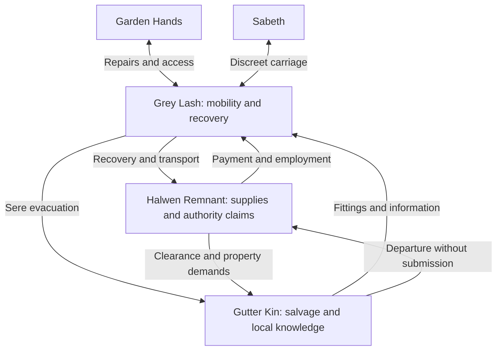

# Grey Lash: Three-Way Relationship Web

Structured consolidation of the two-faction web’s expansion and later three-way map. Proposed ties, not implemented faction reputation. Main triangle is Grey Lash, Halwen Remnant, and Gutter Kin; Garden Hands and Sabeth apply outside pressure.

## Remnant relationship

Unloading, recovery, transport, waiting, and exclusivity require distinct compensation. Oren sees useful contractors as potential household servants; Marda sees separate jobs. Work tomorrow needs tomorrow’s terms. Remnant can lose cooperation through intimidation, supplies becoming unspecified advances, claiming gear because it stands on estate land, unsafe interference, or blocking downhill exit. They may nevertheless retain Marda through dependable provisions/future custom against crew objections.

## Kin relationship

Need acceptable frame, suitable passage, carriers/relief, agreed load, inspected destination, bounded contingency. Grey Lash cannot supply everything alone. Getting Sere through grounds is not delivering six people to viable shelter. Useful fittings may be essential to current survival; removal timing matters. Company may lose trust by changing terms after loading, negotiating without consultation, treating Sere as freight, discarding necessities without asking, or selling confidential route information. Hesh can reject a workable plan for principled or trapping reasons.

## NPC links

Marda–Oren: profitable customer versus exclusivity. Marda–Hesh: equal exchange versus conditional permission. Tern–Dema: repair judgment and refusal. Tern–Brik: respect for load knowledge. Tern–Sere: equipment expertise. Vey–Perrin: overlooked work. Vey–Sere: help must respect consent. Lenna–Sere–Vey may negotiate a corridor even while leaders remain hostile. Tern–Brik–Perrin can establish physical feasibility or jointly refuse impossible labor.

Each leader can promise beyond internal consent: Oren cannot guarantee restraint, Hesh cannot compel six members’ acceptance, Marda cannot promise a lift Tern rejects. Failure may arise within parties, not from essential racial hostility.

## Withdrawal pressures

Better paid urgent job: Marda considers, Vey objects, Tern checks promises. Exit blocked: crew prioritizes departure, factions lose transport. Extra possessions: Tern refuses overload, terms change. Remnant cannot pay: future value competes with Kin’s urgent need. Route worse than described: halt/reassess, Kett’s concealment matters. Abandonment may mean stopping at court, refusing a second attempt, taking tackle away, or leaving before agreement—not only leaving someone to die.

## Encounter chains

Successful timber recovery creates potential frame material; Oren can release, sell, or leverage it, and Marda chooses whether to advocate. Disputed rain fitting is simultaneously estate asset, contractor payment, and Moth’s shelter component; replacement/removal-last/other payment resolves sequencing. Blocked departure: frame ready, court guarded, Rauth demands broad search, Hesh refuses bedding seizure, Marda sets deadline, Vey disputes it. Trusted witnesses, search limits, route change, or failure remain possible.

## Stable outcome

Defined passage without future service, specified restitution without unlimited liability, transport to inspected destination, agreed contingencies, no forced friendship. Six leave alive; Remnant obtains space; company earns payment. Same event serves all three without shared interpretation. Practical success does not heal the estate’s politics.
