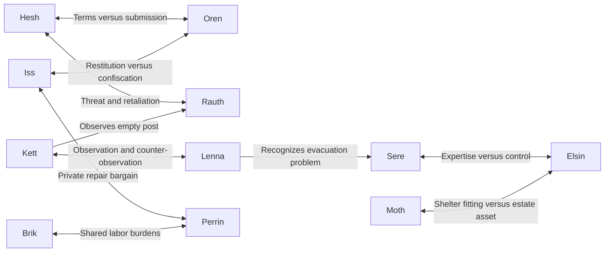

# Gutter Kin–Halwen Remnant Relationship Web

Structured consolidation of proposed cross-faction ties. New relationships are proposals, not retroactive knowledge or implemented reputation. See [Kin](gutter-kin.md), [members](gutter-kin-members.md), [Remnant](halwen-remnant.md). Revised 2026-11-05 for owner decision O1 (only humans are people): the Gutter Kin are a human household of road waifs. The original is in git history at commit fd60061.

## Main tension

Interdependence: Remnant needs materials and secure access; Kin need food, transport, and shelter for Sere. Sabeth is employed by the claimant but quietly feeds the Kin. Garden Hands hold service access and restitution claims as outside pressure. Under all of it sits class: the Remnant serves a family that owned the estate, the Kin grew up under the Roofed Mile robbing carts, and every term offered can sound like *gutter*.

## Cross-faction ties

Hesh–Oren: same physical departure can be called an exchange by one and permission by the other. Neither leader fully guarantees internal cooperation. Hesh–Rauth: each expects hostage pressure; observing exits and watching Perrin are real behaviors but not proof of orders. Player can intervene before violence.

Kett–Lenna: shifting cloth reveals observers; routines change and leave other tasks unattended. Both may discover an unstable wall and choose whether to warn the other. Scout knowledge becomes stale.

Iss–Perrin: she can repair harness for food and a discarded leather piece. Both benefit. Elsin may consider unauthorized exchange; Hesh may resent private bargaining amid hunger. Iss insists the bargain belongs to its participants.

Brik–Perrin: carrying and clearing work create cooperation before political agreement. Shared grievance: others assume they can manage. They can make evacuation possible or reject impossible loads.

Sere–Elsin: identifying fittings for food requires proper examination and access. Respect can become an attempt to retain useful expertise. Sere fears being retained as well as discarded.

Moth–Elsin: estate inventory claims a fitting now keeping an inhabited bed dry. Once shown its use, Elsin can amend, substitute, or insist occupants lack rights.

Iss–Oren: a bounded restitution could acknowledge wrongdoing; open-ended service until the household is satisfied turns settlement into extraction. Oren’s abuse must not erase the injured worker’s legitimate harm.

## Sabeth’s cup

Claimant pays Sabeth; Oren expects her report; Iss leaves a damaged cup and receives food in it. Discovery leads Oren to ask what was concealed, Hesh to ask what Iss revealed, Iss to deny food bought intelligence, and Sabeth to decide how to answer without surrendering notes. Cup proves contact, not conspiracy.

## Connected events

Harness repair creates private authority disputes. Completed carrying frame removes practical excuses for postponing departure and links Brik, Perrin, Lenna, Sere, Hesh, and Oren. Inventory of Moth’s fitting forces a choice between reclaiming an asset and stripping shelter. Individual trust is local; no friendship resolves the entire occupation.
